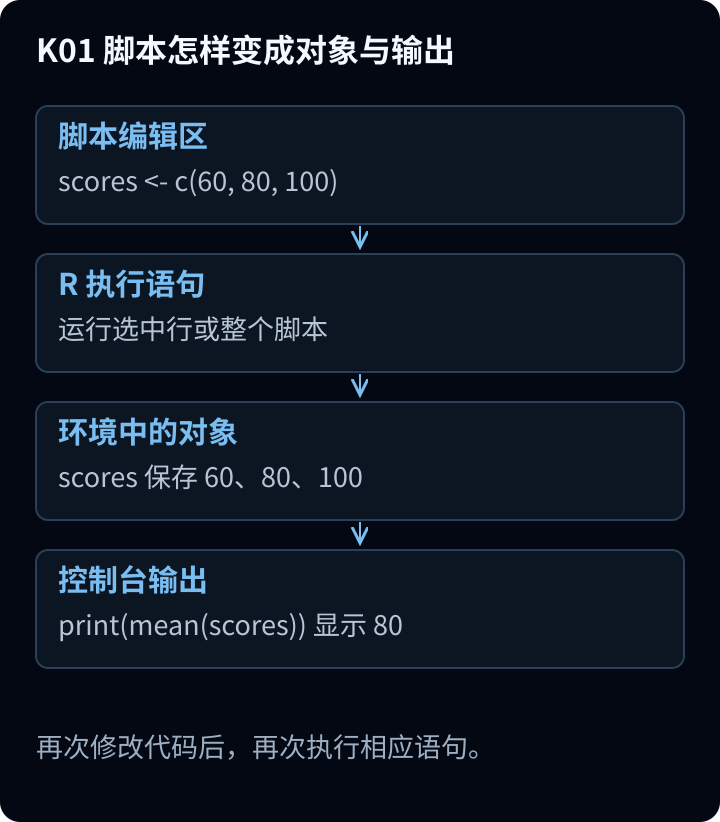

# K01 R、RStudio与脚本执行

## 基本信息

- 所属单元为环境与自助学习。
- 难度为核心。
- 前置知识为无。
- 关联知识为K02、K03、K09。
- 编写人为Codex，样品版本为1.0，日期为2026年11月15日。
- 例题和练习数据均为原创模拟教学数据。

## 学习目标

- 能够辨认脚本编辑区、控制台、环境窗格和输出所在位置。
- 能够运行选中代码与完整脚本，并解释对象更新的时机。
- 能够保存脚本，在新会话中复现计算并记录版本信息。

## 先备检查

1. 输入三个分数后，希望得到什么结果？预期回答为一个平均分。
2. 文件保存到哪里才能再次找到？预期回答为自己选定的项目目录，并知道文件名。

## 直观理解

把一次计算拆成编辑、执行和查看三个动作。脚本保存计算步骤，R负责执行语句，环境窗格展示当前会话里的对象，控制台显示执行信息和显式打印的结果。保存文件只完成了记录步骤。修改分数后，还要重新执行赋值和计算语句，平均分才会更新。新会话重新运行整份脚本，可以检验步骤是否齐全。

## 为什么

1. 为什么改了分数，平均分仍可能保持原值？`average <- mean(scores)`执行时保存当时的计算结果，后续更新`scores`后，需要再次执行这条计算语句。
2. 为什么脚本中使用`print()`？整份脚本通过`source()`运行时，显式打印便于稳定查看结果，并清楚标出希望展示的对象。

## 基础例题

题目要求比较修改成绩前后两次查看`average`的结果。三名虚构学生的成绩以分为单位，第二次数据专门用于演示重新计算。

独立脚本见[K01_example_01.R](../../ai_tutor/content_assets/code/K01_example_01.R)。

```r
scores <- c(60, 80, 100)
average <- mean(scores)
print(average)
scores <- c(70, 85, 100)
print(average)
average <- mean(scores)
print(average)
```

### 预期输出（本次R 4.6.1实际运行记录）

```text
[1] 80
[1] 80
[1] 85
```

### 逐步讲解

1. `c()`把三个数放入向量，`<-`把向量保存为`scores`。
2. 首次计算把80保存为`average`，`print()`将它显示出来。
3. 更新`scores`后立即打印`average`，看到的仍是已经保存的80。
4. 再次执行`mean()`的赋值语句，`average`更新为85。

## 应用例题

为一份虚构的十人成绩表生成基本统计记录。数据单位为分，取值依次为55至100、每次增加5，无缺失项。

独立脚本见[K01_example_02.R](../../ai_tutor/content_assets/code/K01_example_02.R)。

```r
scores <- c(55, 60, 65, 70, 75, 80, 85, 90, 95, 100)
count <- length(scores)
total <- sum(scores)
average <- mean(scores)
print(c(count = count, total = total, average = average))
```

### 预期输出（本次R 4.6.1实际运行记录）

```text
  count   total average 
   10.0   775.0    77.5
```

### 逐步讲解

1. `length()`统计成绩项数，`sum()`计算总分，`mean()`计算均值。
2. 将三个计算结果分别保存为有明确含义的对象。
3. `c(count = ..., total = ..., average = ...)`给输出项加名称，方便对应人数、总分和平均分。

这十项数据的均值为77.5分。解释范围限于这组教学数据，评价课程教学效果还需要实际样本和研究设计。

## 图解方案

图名为“脚本怎样变成对象与输出”，采用流程图，使用独立R代码生成SVG。图片中文字与标签共同表达关系。



生成代码见[K01_visual_01.R](../../ai_tutor/content_assets/code/K01_visual_01.R)。在`content_assets/code`目录执行以下命令，可将图解生成到相邻图片目录。

```sh
Rscript --vanilla K01_visual_01.R ../images
```

流程从可保存的脚本经过R执行到达会话对象，再展示明确打印的结果。每层都标出具体语句或数据，帮助学生对照RStudio中的区域定位操作，并观察再次执行与对象更新的关系。

## 易错案例

错误写法把已经创建的`scores`写成了`Scores`。


```r
scores <- c(60, 80, 100)
print(mean(Scores))
```

### 实际错误或异常结果

```text
Error: object 'Scores' not found
Execution halted
```

R区分名称中的大小写。参考修正统一使用已经创建的名称。


```r
scores <- c(60, 80, 100)
print(mean(scores))
```

### 预期输出（本次R 4.6.1实际运行记录）

```text
[1] 80
```

判断时需要检查完整代码的执行顺序。其他会话中若恰好存在`Scores`，这段代码可能读取那个对象，因此复查应从干净会话开始。

## 完整练习

将下面答案代码保存为`K01_exercise.R`。输入为十名虚构学生的成绩，单位为分。完成三个任务，计算人数和均值，输出R版本与会话信息，然后在新会话中重新运行并比较成绩统计结果。

提示先在RStudio中新建R脚本，输入全部语句并保存。选中代码后使用Run或Ctrl+Enter逐段执行，再使用Source执行整份脚本。使用Restart R后重新执行整份文件。

独立脚本见[K01_exercise.R](../../ai_tutor/content_assets/code/K01_exercise.R)。

```r
scores <- c(60, 64, 68, 72, 76, 80, 84, 88, 92, 96)
average <- mean(scores)
print(length(scores))
print(average)
print(R.version.string)
print(utils::sessionInfo())
```

### 预期输出（本次R 4.6.1实际运行记录）

```text
[1] 10
[1] 78
[1] "R version 4.6.1 (2026-06-24 ucrt)"
R version 4.6.1 (2026-06-24 ucrt)
Platform: x86_64-w64-mingw32/x64
Running under: Windows 11 x64 (build 26300)

Matrix products: default
  LAPACK version 3.12.1

locale:
[1] C
system code page: 65001

time zone: Asia/Shanghai
tzcode source: internal

attached base packages:
[1] stats     graphics  grDevices utils     datasets  methods   base     

loaded via a namespace (and not attached):
[1] compiler_4.6.1
```

评分共10分，正确创建输入得2分，人数与均值各2分，保存并复现脚本得2分，会话信息记录得2分。常见错误是只运行最后一行、漏存输入数据，或把旧会话已有对象当作脚本的一部分。

## 自测题

1. 预测下面代码最后打印什么，并说明原因。


```r
x <- c(2, 4, 6)
y <- mean(x)
x <- c(10, 20, 30)
print(y)
```

### 预期输出（本次R 4.6.1实际运行记录）

```text
[1] 4
```

答案为4。`y`保存了首次均值，更新`x`后需要再次计算才能得到新的均值。

2. 只点击保存，环境窗格一定出现新对象吗？答案为否。对象在相应赋值语句执行后进入当前会话。

## 追问建议

- 例题请求演示只重新运行一部分语句时的对象变化。
- 易错点请求检查对象名称和运行顺序。
- 练习请求解释如何用新会话复现同一份脚本。
- 相关知识继续学习K03的最小复现与会话记录。

## 来源与验证

- 课程来源为[S1《CH11R语言安装.pdf》PDF  4–20](../../成员一/CH11R语言安装.pdf#page=4)。
- 课程来源为[S2《CH12R语言安装.pdf》PDF  1–7](../../成员一/CH12R语言安装.pdf#page=1)。
- 补充来源为本机R 4.6.1官方帮助主题`help("assignOps", package = "base")`、`help("source", package = "base")`、`help("print", package = "base")`、`help("sessionInfo", package = "utils")`。
- R版本为4.6.1，平台为Windows x64，`base`、`stats`、`utils`、`tools`均为4.6.1。
- 验证环境采用进程级`LC_ALL=C`与`LANGUAGE=en`，时区为`Asia/Shanghai`，输出宽度为80。
- 图解脚本在字符区域缺少UTF-8支持时，为当前R进程设置Windows英文UTF-8字符区域，以正确写入中文标签。
- 验证命令为在代码目录运行`Rscript --vanilla --encoding=UTF-8 K01_example_01.R`，应用例题和练习使用各自同名前缀脚本。
- 验证记录见[K01_validation.txt](../../ai_tutor/content_assets/code/K01_validation.txt)，包含各段代码、实际输出、退出状态、边界断言及文件摘要。
- 代码验证结果为通过，包括基础例题、应用例题、参考修正、练习答案和自测预测。易错代码按预期产生错误或异常结果，详见记录。
- 本文输出为离线脚本实测记录。版本、会话信息和警告语言随验证环境变化，复核时应同时保存环境。
- 图解通过浏览器桌面与390像素窄屏核对，文字边界、连接关系和替代文本检查通过。
- 核验日期为2026年11月15日，核验人为Codex，核验方式为自动运行及内容审阅，课程适配由整合成员复核。
- 待人工复核项为RStudio中的保存、Run、Source和Restart R界面操作。新会话计算已通过两个独立R进程重复核验。
