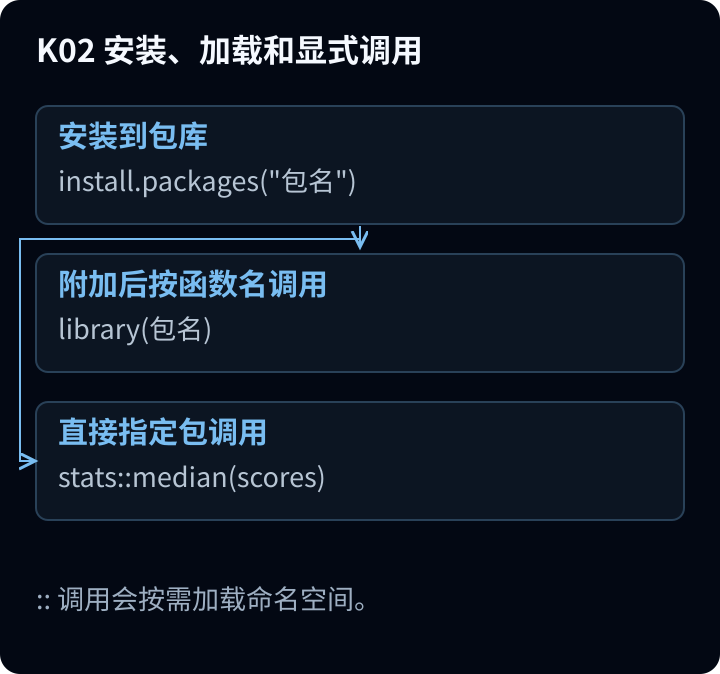

# K02 安装、加载与命名空间

## 基本信息

- 所属单元为环境与自助学习。
- 难度为核心。
- 前置知识为K01。
- 关联知识为K01、K03、K40。
- 编写人为Codex，样品版本为1.0，日期为2026年11月15日。
- 例题和练习数据均为原创模拟教学数据。

## 学习目标

- 能够根据电脑和会话的状态选择安装、加载或命名空间调用。
- 能够用随R附带的包完成显式函数调用并记录版本。
- 能够从包缺失、名称拼写和安装环境三个方向排查问题。

## 先备检查

1. RStudio关闭后重新打开，上一会话的执行状态是否自然保留？预期回答为新会话需要重新执行所需代码。
2. `stats::median`中的`stats`表示什么？预期回答为函数所属包的名称。

## 直观理解

包为R提供一组函数、数据和帮助文档。安装让包文件保存在某个包库中，通常可以跨会话使用。`library()`把包附加到当前会话的搜索路径，之后能直接按函数名查找。`包名::函数名`指定函数来源，并按需加载命名空间。把电脑上有什么包与当前会话使用了什么包分别检查，排错会更清楚。

## 为什么

1. 为什么重新打开R后常要运行`library()`？附加状态属于会话。包文件已经存在时，再次分析通常从加载或显式调用开始。
2. 为什么示例写`stats::median()`？包名明确了函数来源，有助于阅读代码，并减少同名函数带来的疑惑。
3. 为什么安装可能失败？镜像连接、库目录写入权限、R版本兼容性以及源码编译工具都会影响安装，需要结合完整安装日志判断。

## 基础例题

检查`stats`是否可加载，再计算三项分数的中位数。`stats`随R提供，标准R会话通常已经附加它。

独立脚本见[K02_example_01.R](../../ai_tutor/content_assets/code/K02_example_01.R)。

```r
print(requireNamespace("stats", quietly = TRUE))
library(stats)
print(stats::median(c(60, 80, 100)))
print("package:stats" %in% search())
```

### 预期输出（本次R 4.6.1实际运行记录）

```text
[1] TRUE
[1] 80
[1] TRUE
```

### 逐步讲解

1. `requireNamespace()`检查包能否加载，成功时返回`TRUE`，过程中可以加载命名空间。
2. `library(stats)`将包附加到搜索路径，本例会话通常已经包含它。
3. `stats::median()`明确选择该包的导出函数，得到80。
4. `%in%`检查搜索路径中是否有指定名称，这里只用它完成一次成员判断。

## 应用例题

对十名虚构学生的成绩预览前四项，并计算中位数和样本标准差。成绩单位为分，标准差用于描述这组数据的波动。

独立脚本见[K02_example_02.R](../../ai_tutor/content_assets/code/K02_example_02.R)。

```r
scores <- c(55, 60, 65, 70, 75, 80, 85, 90, 95, 100)
print(utils::head(scores, n = 4))
print(stats::median(scores))
print(round(stats::sd(scores), digits = 2))
```

### 预期输出（本次R 4.6.1实际运行记录）

```text
[1] 55 60 65 70
[1] 77.5
[1] 15.14
```

### 逐步讲解

1. `utils::head()`提供数据预览，参数`n`控制展示项数。
2. `stats::median()`计算中心位置，`stats::sd()`计算样本标准差。
3. `round()`将标准差显示到小数点后两位，便于阅读。

这里着重练习调用来源。更全面的统计解释见K13，对总体作推断还需要相应抽样条件。

## 图解方案

图名为“安装、加载和显式调用”，采用分支流程图，使用独立R代码生成SVG。图片中文字与标签共同表达关系。



生成代码见[K02_visual_01.R](../../ai_tutor/content_assets/code/K02_visual_01.R)。在`content_assets/code`目录执行以下命令，可将图解生成到相邻图片目录。

```sh
Rscript --vanilla K02_visual_01.R ../images
```

图中分别标明包库、会话和函数调用所在阶段。结合说明指出双冒号会按需加载命名空间，学生可以据此判断实际任务要执行哪一步，并理解安装操作的持续范围。

## 易错案例

错误写法将导出函数名称`median`写成了`Median`。


```r
print(stats::Median(c(60, 80, 100)))
```

### 实际错误或异常结果

```text
Error: 'Median' is not an exported object from 'namespace:stats'
Execution halted
```

R区分大小写，`::`会检查指定名称是否为该包的导出对象。参考修正使用官方帮助中的名称。


```r
print(stats::median(c(60, 80, 100)))
```

### 预期输出（本次R 4.6.1实际运行记录）

```text
[1] 80
```

单凭这条错误无法推断网络和安装权限状况。先读错误中提到的包名与对象名，再针对当前步骤检查。

## 完整练习

输入为十项成绩，单位为分。先给以下三个场景选择操作，再运行参考代码预览首尾成绩、计算中位数并记录包版本。

| 场景 | 参考选择 |
|---|---|
| 所需扩展包尚未安装 | 在明确包名和安装条件后使用`install.packages()` |
| 包已安装，新会话希望直接使用其导出函数名 | 使用`library()`附加包 |
| 包已安装，希望明确调用来源 | 使用`包名::函数名` |

提示安装语法属于操作判断题，本练习运行部分使用随R附带的包。`tail()`与`head()`分别查看尾部和头部。

独立脚本见[K02_exercise.R](../../ai_tutor/content_assets/code/K02_exercise.R)。

```r
scores <- c(60, 64, 68, 72, 76, 80, 84, 88, 92, 96)
print(requireNamespace("stats", quietly = TRUE))
print(utils::head(scores, n = 3))
print(utils::tail(scores, n = 3))
print(stats::median(scores))
print(utils::packageVersion("stats"))
```

### 预期输出（本次R 4.6.1实际运行记录）

```text
[1] TRUE
[1] 60 64 68
[1] 88 92 96
[1] 78
[1] '4.6.1'
```

评分共10分，三个场景各2分，首尾预览、中位数和版本记录共4分。常见错误包括每次运行都重复安装、把示意名称直接当真实包名，以及函数名大小写错误。

## 自测题

1. 预测两行输出。


```r
print(utils::head(1:8, n = 3))
print(stats::median(c(1, 5, 9)))
```

### 预期输出（本次R 4.6.1实际运行记录）

```text
[1] 1 2 3
[1] 5
```

答案依次为整数向量`1 2 3`与中位数5。`n`控制项数，显式命名空间指定函数来源。

2. `requireNamespace()`返回`TRUE`能否证明包已附加到搜索路径？答案为否。附加状态可以通过`search()`检查。

## 追问建议

- 例题请求比较同一函数的直接调用与显式调用。
- 易错点请求依据完整安装日志定位失败阶段。
- 练习请求为一个新会话列出准备步骤。
- 相关知识继续学习K03的函数帮助和包版本记录。

## 来源与验证

- 课程来源为[S1《CH11R语言安装.pdf》PDF 21–29](../../成员一/CH11R语言安装.pdf#page=21)。
- 课程来源为[S2《CH12R语言安装.pdf》PDF 8–10](../../成员一/CH12R语言安装.pdf#page=8)。
- 补充来源为本机R 4.6.1官方帮助主题`help("install.packages", package = "utils")`、`help("library", package = "base")`、`help("::", package = "base")`、`help("requireNamespace", package = "base")`。
- R版本为4.6.1，平台为Windows x64，`base`、`stats`、`utils`、`tools`均为4.6.1。
- 验证环境采用进程级`LC_ALL=C`与`LANGUAGE=en`，时区为`Asia/Shanghai`，输出宽度为80。
- 图解脚本在字符区域缺少UTF-8支持时，为当前R进程设置Windows英文UTF-8字符区域，以正确写入中文标签。
- 验证命令为在代码目录运行`Rscript --vanilla --encoding=UTF-8 K02_example_01.R`，应用例题和练习使用各自同名前缀脚本。
- 验证记录见[K02_validation.txt](../../ai_tutor/content_assets/code/K02_validation.txt)，包含各段代码、实际输出、退出状态、边界断言及文件摘要。
- 代码验证结果为通过，包括基础例题、应用例题、参考修正、练习答案和自测预测。易错代码按预期产生错误或异常结果，详见记录。
- 本文输出为离线脚本实测记录。版本、会话信息和警告语言随验证环境变化，复核时应同时保存环境。
- 图解通过浏览器桌面与390像素窄屏核对，文字边界、连接关系和替代文本检查通过。
- 核验日期为2026年11月15日，核验人为Codex，核验方式为自动运行及内容审阅，课程适配由整合成员复核。
- 安装场景采用题目判断，实际联网安装、权限失败及编译失败的现场操作尚未验证。
- 待核对事项为S2 PDF第10页使用了“调用R包后，方可使用”的概括表达。正式知识库已补充双冒号调用，本样品按实测说明附加包与加载命名空间的职责，交由整合线程核对课件措辞。
