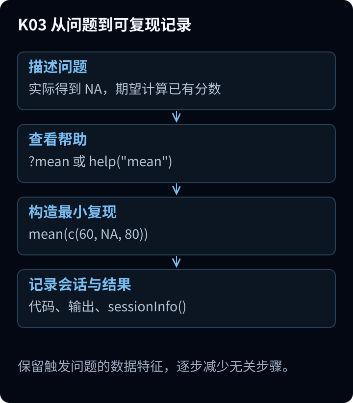

# K03 帮助与可复现记录

## 基本信息

- 所属单元为环境与自助学习。
- 难度为核心。
- 前置知识为K01、K02。
- 关联知识为K01、K02、K06。
- 编写人为Codex，样品版本为1.0，日期为2026年11月15日。
- 例题和练习数据均为原创模拟教学数据。

## 学习目标

- 能够用`?`和`help()`查找函数参数，并运行官方示例。
- 能够把一段较长代码缩小为可独立运行的最小复现。
- 能够记录期望、实际输出和`sessionInfo()`，形成可核验的问题说明。

## 先备检查

1. 在新脚本里使用一个对象前需要做什么？预期回答为提供创建该对象的语句或输入数据。
2. 函数来源不清楚时怎样指定包？预期回答为使用`包名::函数名`。

## 直观理解

遇到问题时，先把“我以为会怎样”和“实际发生了什么”写下来。帮助文档说明函数接受哪些参数，官方示例展示基本用法。接着逐步缩小输入和步骤，同时保留触发问题的特征，得到别人复制后就能观察的最小复现。再加上版本和会话信息，接收者才能在具体环境中核对现象。

## 为什么

1. 为什么查到函数名还要看参数？默认参数决定函数的初始行为，例如`mean()`的`na.rm`默认值为`FALSE`，会影响含缺失值的结果。
2. 为什么精简数据时要保留`NA`？本例问题由缺失值触发，删除这一特征会使问题消失，无法再解释原来的现象。
3. 为什么记录会话信息？R版本、已加载包和语言区域都可能影响行为或输出，记录这些信息方便复查。

## 基础例题

查找`mean`的帮助主题，并运行安装版本附带的示例。交互会话还可输入`?mean`阅读同一主题，关注Usage、Arguments、Value和Examples等部分。

独立脚本见[K03_example_01.R](../../ai_tutor/content_assets/code/K03_example_01.R)。

```r
mean_help <- utils::help("mean", package = "base")
print(length(mean_help) > 0L)
utils::example("mean", package = "base", echo = TRUE, ask = FALSE)
```

### 预期输出（本次R 4.6.1实际运行记录）

```text
[1] TRUE

mean> x <- c(0:10, 50)

mean> xm <- mean(x)

mean> c(xm, mean(x, trim = 0.10))
[1] 8.75 5.50
```

### 逐步讲解

1. `help()`取得帮助主题，`length(...) > 0L`检查是否找到条目。
2. `example()`运行官方帮助中的示例，`ask = FALSE`避免等待交互确认。
3. `echo = TRUE`显示示例语句与计算结果，输出中的`mean>`表示语句回显。这里保留本机安装版本的完整记录。

## 应用例题

十项模拟成绩中第三项缺失，单位为分。目标是解释均值为什么出现`NA`，并缩小复现所需的数据。

独立脚本见[K03_example_02.R](../../ai_tutor/content_assets/code/K03_example_02.R)。

```r
scores <- c(55, 60, NA, 70, 75, 80, 85, 90, 95, 100)
print(mean(scores))
mini_scores <- c(60, NA, 80)
print(mean(mini_scores))
print(mean(mini_scores, na.rm = TRUE))
print(utils::packageVersion("base"))
```

### 预期输出（本次R 4.6.1实际运行记录）

```text
[1] NA
[1] NA
[1] 70
[1] '4.6.1'
```

### 逐步讲解

1. 完整成绩向量运行后得到`NA`，先记录这个实际现象。
2. 将输入缩小为三项，仍保留一个`NA`，现象继续出现。
3. 根据帮助设置`na.rm = TRUE`后得到70，这说明计算使用了两个已有分数。
4. 记录`base`版本，为复核提供环境线索。

该设置规定缺失值在计算中的处理方式。原始缺考原因、缺失机制及其对班级评价的影响，需要结合实际教学记录判断。

## 图解方案

图名为“从问题到可复现记录”，采用流程图，使用独立R代码生成SVG。图片中文字与标签共同表达关系。



生成代码见[K03_visual_01.R](../../ai_tutor/content_assets/code/K03_visual_01.R)。在`content_assets/code`目录执行以下命令，可将图解生成到相邻图片目录。

```sh
Rscript --vanilla K03_visual_01.R ../images
```

图沿问题描述、阅读帮助、最小复现和会话记录四步展开。每步配一个可执行或可检查的动作，使学生能把模糊的提问整理成同伴可以运行并核验的材料。

## 易错案例

从控制台复制内容时保留了输入提示符，写入脚本后形成下面的语法错误。


```r
> scores <- c(60, 80, 100)
> print(mean(scores))
```

### 实际错误或异常结果

```text
Error: unexpected '>' in ">"
Execution halted
```

首行开头的`>`是控制台提示符。整理脚本时应只保留输入语句。续行提示符`+`也要结合控制台上下文识别，代码本身使用的加法运算符则应保留。


```r
scores <- c(60, 80, 100)
print(mean(scores))
```

### 预期输出（本次R 4.6.1实际运行记录）

```text
[1] 80
```

单张截图可能隐藏了此前的对象定义，核验时还需要创建数据的语句和完整错误文本。

## 完整练习

输入为十项模拟成绩，其中第五项缺失。提交一份问题说明，写清“希望计算已有成绩的均值”、默认结果、最小复现、根据帮助选择的参数、修正结果和会话信息。

提示按应用例题先缩小数据，再回到完整输入。参考代码中的`mini_scores`用于说明问题，`scores`用于完成原始计算。

独立脚本见[K03_exercise.R](../../ai_tutor/content_assets/code/K03_exercise.R)。

```r
scores <- c(60, 64, 68, 72, NA, 80, 84, 88, 92, 96)
mini_scores <- c(60, NA, 80)
print(mean(mini_scores))
print(mean(mini_scores, na.rm = TRUE))
print(mean(scores, na.rm = TRUE))
print(utils::sessionInfo())
```

### 预期输出（本次R 4.6.1实际运行记录）

```text
[1] NA
[1] 70
[1] 78.22222
R version 4.6.1 (2026-06-24 ucrt)
Platform: x86_64-w64-mingw32/x64
Running under: Windows 11 x64 (build 26300)

Matrix products: default
  LAPACK version 3.12.1

locale:
[1] C
system code page: 65001

time zone: Asia/Shanghai
tzcode source: internal

attached base packages:
[1] stats     graphics  grDevices utils     datasets  methods   base     

loaded via a namespace (and not attached):
[1] compiler_4.6.1
```

评分共10分，期望与实际描述得2分，三项最小复现得2分，参数及原因得2分，完整数据结果得2分，会话记录得2分。常见错误是只发截图、漏掉输入数据，或精简时删除了所有缺失值。

## 自测题

1. 预测下面两次计算的结果。


```r
x <- c(2, NA, 6)
print(mean(x))
print(mean(x, na.rm = TRUE))
```

### 预期输出（本次R 4.6.1实际运行记录）

```text
[1] NA
[1] 4
```

答案依次为`NA`与4，第二次计算使用2和6。

2. `sessionInfo()`能否独立恢复原始数据？答案为否。问题说明还要提供输入数据和创建对象的代码。

## 追问建议

- 例题请求演示如何从十项输入缩小到三项。
- 易错点请求辨认控制台提示符与实际代码。
- 练习请求审核一份问题说明能否独立复现。
- 相关知识继续学习K06的缺失值传播规则。

## 来源与验证

- 课程来源为[S1《r-installation-ch11.pdf》PDF 28–42](../sources/r-installation-ch11.pdf#page=28)。
- 补充来源为本机R 4.6.1官方帮助主题`help("help", package = "utils")`、`help("example", package = "utils")`、`help("mean", package = "base")`、`help("sessionInfo", package = "utils")`。
- R版本为4.6.1，平台为Windows x64，`base`、`stats`、`utils`、`tools`均为4.6.1。
- 验证环境采用进程级`LC_ALL=C`与`LANGUAGE=en`，时区为`Asia/Shanghai`，输出宽度为80。
- 图解脚本在字符区域缺少UTF-8支持时，为当前R进程设置Windows英文UTF-8字符区域，以正确写入中文标签。
- 验证命令为在代码目录运行`Rscript --vanilla --encoding=UTF-8 K03_example_01.R`，应用例题和练习使用各自同名前缀脚本。
- 验证记录见[K03_validation.txt](../../ai_tutor/content_assets/code/K03_validation.txt)，包含各段代码、实际输出、退出状态、边界断言及文件摘要。
- 代码验证结果为通过，包括基础例题、应用例题、参考修正、练习答案和自测预测。易错代码按预期产生错误或异常结果，详见记录。
- 本文输出为离线脚本实测记录。版本、会话信息和警告语言随验证环境变化，复核时应同时保存环境。
- 图解通过浏览器桌面与390像素窄屏核对，文字边界、连接关系和替代文本检查通过。
- 核验日期为2026年11月15日，核验人为Codex，核验方式为自动运行及内容审阅，课程适配由整合成员复核。
- 帮助主题解析和官方示例已实测，RStudio帮助窗格的界面展示待人工复核。
