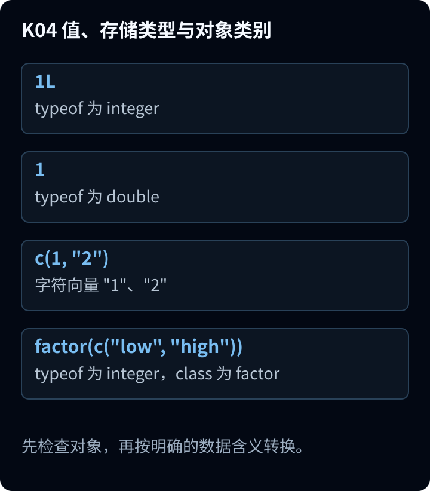

# K04 类型、类与类型转换

## 基本信息

- 所属单元为类型与缺失。
- 难度为核心。
- 前置知识为K01。
- 关联知识为K05、K06、K07、K08。
- 编写人为Codex，样品版本为1.0，日期为2026年11月15日。
- 例题和练习数据均为原创模拟教学数据。

## 学习目标

- 能够用`typeof()`与`class()`分别检查存储类型和对象类别。
- 能够预测逻辑值、数值和字符合并后的常见类型变化。
- 能够按已声明的缺失标记清理字符型分数，并核对转换结果。

## 先备检查

1. `1`与`"1"`在写法上有什么区别？预期回答为后一项带引号，表示字符。
2. 怎样查看一个已创建的对象？预期回答为使用`print()`或在交互控制台运行对象名。

## 直观理解

同样显示为一个数字，R内部保存的形式可能不同。`typeof()`查看底层存储，`class()`描述对象按什么类别参与操作。普通原子向量要采用统一类型，合并字符和数字时会发生类型转换。处理导入数据时，先检查原始值和缺失标记，再转换并核对结果，可以保留每一步的数据含义。

## 为什么

1. 为什么`c(1, "2")`得到字符向量？普通原子向量采用统一的底层类型，字符元素参与合并后，这些值一起以字符形式保存。
2. 为什么因子的`typeof()`与`class()`不同？因子使用整数编码存储类别，同时保存水平和类别属性，具体类别处理规则见K07。
3. 为什么转换前要统一缺失标记？像`absent`这样的文本无法直接解释为数值。明确其业务含义后映射到`NA`，才能记录数据处理的依据。

## 基础例题

比较整数、双精度数和字符，再观察混合向量与因子。`1L`末尾的`L`明确创建整数。

独立脚本见[K04_example_01.R](../../ai_tutor/content_assets/code/K04_example_01.R)。

```r
print(c(typeof(1L), typeof(1), typeof("1")))
mixed <- c(TRUE, 2, "3")
print(mixed)
print(typeof(mixed))
f <- factor(c("low", "high"))
print(typeof(f))
print(class(f))
```

### 预期输出（本次R 4.6.1实际运行记录）

```text
[1] "integer"   "double"    "character"
[1] "TRUE" "2"    "3"   
[1] "character"
[1] "integer"
[1] "factor"
```

### 逐步讲解

1. 前三项分别返回`integer`、`double`和`character`。
2. 合并逻辑值、数值和字符后，`mixed`各项都以字符保存。
3. 因子示例显示整数存储与`factor`类别，说明两个检查函数回答的问题不同。

## 应用例题

十项模拟成绩由文本导入，单位为分。`absent`表示教学设计的缺考标记，第三项附带空格，原始向量保留以供复查。

独立脚本见[K04_example_02.R](../../ai_tutor/content_assets/code/K04_example_02.R)。

```r
raw_scores <- c("55", "60", " 65 ", "70", "75", "80", "85", "90", "95", "absent")
cleaned <- trimws(raw_scores)
cleaned[cleaned == "absent"] <- NA_character_
scores <- as.numeric(cleaned)
print(typeof(raw_scores))
print(typeof(scores))
print(scores)
print(sum(is.na(scores)))
```

### 预期输出（本次R 4.6.1实际运行记录）

```text
[1] "character"
[1] "double"
 [1] 55 60 65 70 75 80 85 90 95 NA
[1] 1
```

### 逐步讲解

1. `trimws()`清除每个文本两端的空格，其作用限于首尾空白。
2. 条件索引定位明确约定的缺考标记，用字符型缺失值`NA_character_`替换。
3. `as.numeric()`生成数值向量，检查转换前后的底层类型。
4. `is.na()`识别缺失项，`sum()`统计其数量。这里用到的缺失检测会在K06展开。

最终得到九项有效成绩和一项缺失。缺考原因与成绩评价规则需要由具体课程记录确定。

## 图解方案

图名为“值、存储类型与对象类别”，采用对比图，使用独立R代码生成SVG。图片中文字与标签共同表达关系。



生成代码见[K04_visual_01.R](../../ai_tutor/content_assets/code/K04_visual_01.R)。在`content_assets/code`目录执行以下命令，可将图解生成到相邻图片目录。

```sh
Rscript --vanilla K04_visual_01.R ../images
```

每行将对象表达式与检查结果放在一起，既展示混合输入导致的转换，也标明因子的类别属性。学生可以据图选择先检查存储类型还是对象类别，再考虑合适的转换路径。

## 易错案例

直接把含有缺考文本的字符向量转换成数值。


```r
print(as.numeric(c("60", "absent")))
```

### 实际错误或异常结果

```text
[1] 60 NA
Warning message:
In print(as.numeric(c("60", "absent"))) : NAs introduced by coercion
```

输出中的`NA`伴随实际转换警告。应先确认无法转换文本的含义，再按约定处理。


```r
raw <- c("60", "absent")
raw[raw == "absent"] <- NA_character_
print(as.numeric(raw))
```

### 预期输出（本次R 4.6.1实际运行记录）

```text
[1] 60 NA
```

仅凭这条警告无法判断所有新增缺失是否合理。遇到其他未约定文本，应保留原始值并逐项核对。

## 完整练习

输入为十项文本成绩，单位为分。`pending`和空字符串均为本练习约定的缺失标记。要求保留原始向量、去除首尾空格、转换为数值、统计缺失数并计算已有成绩均值。

提示`%in%`可以一次判断是否属于两个约定标记。`na.rm = TRUE`用于本题约定的已有成绩汇总，详细含义见K06。

独立脚本见[K04_exercise.R](../../ai_tutor/content_assets/code/K04_exercise.R)。

```r
raw_scores <- c("60", " 64", "68 ", "72", "pending", "80", "84", "88", "", "96")
cleaned <- trimws(raw_scores)
cleaned[cleaned %in% c("pending", "")] <- NA_character_
scores <- as.numeric(cleaned)
print(scores)
print(typeof(scores))
print(sum(is.na(scores)))
print(mean(scores, na.rm = TRUE))
```

### 预期输出（本次R 4.6.1实际运行记录）

```text
 [1] 60 64 68 72 NA 80 84 88 NA 96
[1] "double"
[1] 2
[1] 76.5
```

评分共10分，保留原始输入得2分，处理空格和两种标记得3分，类型及缺失检查得3分，均值与处理说明得2分。常见错误是直接覆盖原始向量、只处理一种标记，或忽略转换警告。

## 自测题

1. 预测向量内容与底层类型。


```r
x <- c(TRUE, 2, "3")
print(x)
print(typeof(x))
```

### 预期输出（本次R 4.6.1实际运行记录）

```text
[1] "TRUE" "2"    "3"   
[1] "character"
```

答案为字符`"TRUE"`、`"2"`和`"3"`，底层类型为`character`。合并时进行了统一类型转换。

2. 因子的`typeof()`返回`integer`，它是否就具有普通整数的所有使用含义？答案为否。还要检查`class()`与水平，按类别规则理解对象。

## 追问建议

- 例题请求逐项比较带引号与未带引号的数据。
- 易错点请求定位转换后新增缺失的原始文本。
- 练习请求补充一种已约定的缺失标记并复核。
- 相关知识继续学习K07的因子内部编码。

## 来源与验证

- 课程来源为[S3《CH2R语言数据操作课件.pdf》PDF 9–14](../../成员一/CH2R语言数据操作课件.pdf#page=9)。
- 课程来源为[S4《R数据科学_译本.pdf》第15章 PDF 230–247](../../成员一/R数据科学_译本.pdf#page=230)。
- 补充来源为本机R 4.6.1官方帮助主题`help("typeof", package = "base")`、`help("class", package = "base")`、`help("numeric", package = "base")`、`help("c", package = "base")`、`help("factor", package = "base")`。
- R版本为4.6.1，平台为Windows x64，`base`、`stats`、`utils`、`tools`均为4.6.1。
- 验证环境采用进程级`LC_ALL=C`与`LANGUAGE=en`，时区为`Asia/Shanghai`，输出宽度为80。
- 图解脚本在字符区域缺少UTF-8支持时，为当前R进程设置Windows英文UTF-8字符区域，以正确写入中文标签。
- 验证命令为在代码目录运行`Rscript --vanilla --encoding=UTF-8 K04_example_01.R`，应用例题和练习使用各自同名前缀脚本。
- 验证记录见[K04_validation.txt](../../ai_tutor/content_assets/code/K04_validation.txt)，包含各段代码、实际输出、退出状态、边界断言及文件摘要。
- 代码验证结果为通过，包括基础例题、应用例题、参考修正、练习答案和自测预测。易错代码按预期产生错误或异常结果，详见记录。
- 本文输出为离线脚本实测记录。版本、会话信息和警告语言随验证环境变化，复核时应同时保存环境。
- 图解通过浏览器桌面与390像素窄屏核对，文字边界、连接关系和替代文本检查通过。
- 核验日期为2026年11月15日，核验人为Codex，核验方式为自动运行及内容审阅，课程适配由整合成员复核。
- 待核对事项为S3 PDF第9页采用“四个基本类型”的教学分类，并列出因子。正式知识库已区分原子存储类型和对象类别，本样品分别展示typeof与class，供整合线程核对术语。
