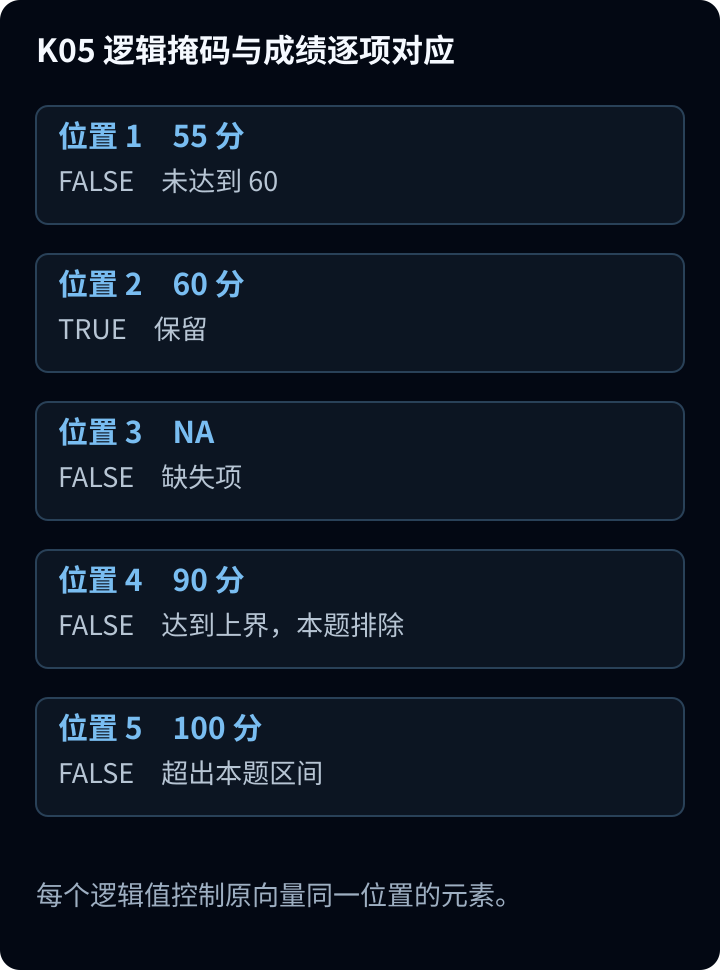

# K05 逻辑运算与条件筛选

## 基本信息

- 所属单元为类型与缺失。
- 难度为核心。
- 前置知识为K04。
- 关联知识为K04、K06、K10、K26、K36。
- 编写人为Codex，样品版本为1.0，日期为2026年11月15日。
- 例题和练习数据均为原创模拟教学数据。

## 学习目标

- 能够把文字筛选要求写成比较表达式与逻辑组合。
- 能够用同一个逻辑掩码提取对应的编号和数值。
- 能够解释含`NA`的三值逻辑，以及逐项运算和短路求值的适用位置。

## 先备检查

1. `60 >= 60`得到什么？预期回答为`TRUE`，因为边界值包含在内。
2. 怎样识别缺失项？预期回答为`is.na()`，本节会直接用它保证筛选条件明确。

## 直观理解

条件比较给每个位置贴上逻辑标签，索引再根据这些标签提取数据。多个条件同时满足时用`&`连接，满足任意条件时用`|`连接，`!`把逻辑结果取反。含缺失输入时，有些条件的真假暂时无法确定。先明确缺失记录的处理规则，再形成与原数据等长的逻辑向量，可以保持编号和数值的对应。

## 为什么

1. 为什么筛选向量通常使用`&`和`|`？它们逐项组合条件，为各位置生成结果。`&&`与`||`用于长度为一的逻辑判断，并采用短路求值。
2. 为什么`FALSE & NA`可以得到`FALSE`？只要一个必需条件已经为假，整体就为假。同理，`TRUE | NA`已经可以确定为真，而`TRUE & NA`仍需保留未知状态。
3. 为什么编号和成绩要共享掩码？同一位置表示同一条记录。共享条件才能使提取后的编号与成绩继续一一对应。

## 基础例题

筛选非缺失、至少60分且低于90分的成绩。五项模拟成绩包含一个专门设计的缺失值。

独立脚本见[K05_example_01.R](../../ai_tutor/content_assets/code/K05_example_01.R)。

```r
scores <- c(55, 60, NA, 90, 100)
keep <- !is.na(scores) & scores >= 60 & scores < 90
print(keep)
print(scores[keep])
print(c(any = any(keep), all = all(keep)))
```

### 预期输出（本次R 4.6.1实际运行记录）

```text
[1] FALSE  TRUE FALSE FALSE FALSE
[1] 60
  any   all 
 TRUE FALSE
```

### 逐步讲解

1. `!is.na(scores)`判断每个位置是否已有成绩。
2. 两个比较表达式分别检验下界与上界，90因为严格小于条件被排除。
3. 将三个条件逐项合并，`scores[keep]`只保留60。
4. `any()`回答是否至少保留一项，`all()`回答是否全部保留。

## 应用例题

筛选十条原创模拟问卷，要求年龄18至25周岁、明确同意使用数据、成绩至少60分。`id`为虚构编号，`age`单位为周岁，`score`单位为分，`consent`为逻辑值。缺失年龄、同意状态或成绩均按本题规则排除。

独立脚本见[K05_example_02.R](../../ai_tutor/content_assets/code/K05_example_02.R)。

```r
id <- c("Q01", "Q02", "Q03", "Q04", "Q05", "Q06", "Q07", "Q08", "Q09", "Q10")
age <- c(17, 18, 21, NA, 24, 30, 19, 22, 20, 18)
consent <- c(TRUE, TRUE, FALSE, TRUE, TRUE, TRUE, NA, TRUE, TRUE, TRUE)
score <- c(80, 60, 95, 70, NA, 88, 77, 90, 59, 100)
keep <- !is.na(age) & age >= 18 & age <= 25 &
  !is.na(consent) & consent & !is.na(score) & score >= 60
print(id[keep])
print(score[keep])
print(sum(keep))
```

### 预期输出（本次R 4.6.1实际运行记录）

```text
[1] "Q02" "Q08" "Q10"
[1]  60  90 100
[1] 3
```

### 逐步讲解

1. 四个等长向量用相同位置表示同一条问卷。
2. 年龄条件包含18和25两个边界。
3. 先明确各字段的缺失处理，再合并同意和成绩条件。
4. 提取编号与成绩并统计人数，结果为三条符合本题规则的记录。

此结果描述规则筛选后的模拟记录。问卷是否具有代表性还需要核对抽样过程。

## 图解方案

图名为“逻辑掩码与成绩逐项对应”，采用索引图，使用独立R代码生成SVG。图片中文字与标签共同表达关系。



生成代码见[K05_visual_01.R](../../ai_tutor/content_assets/code/K05_visual_01.R)。在`content_assets/code`目录执行以下命令，可将图解生成到相邻图片目录。

```sh
Rscript --vanilla K05_visual_01.R ../images
```

图将每个原始值与掩码值并排展示，标明边界和缺失项的去向。学生可以沿同一行核对每个条件，发现位置错位或漏写缺失检查的问题。

## 易错案例

把整列条件交给`&&`，在本次R版本中会触发长度错误。


```r
scores <- c(55, 60, 90)
print(scores >= 60 && scores < 90)
```

### 实际错误或异常结果

```text
Error in scores >= 60 && scores < 90 : 
  'length = 3' in coercion to 'logical(1)'
Calls: print
Execution halted
```

错误发生在条件求值阶段。逐项筛选的参考修正使用`&`。


```r
scores <- c(55, 60, 90)
print(scores >= 60 & scores < 90)
```

### 预期输出（本次R 4.6.1实际运行记录）

```text
[1] FALSE  TRUE FALSE
```

对旧版本行为的判断需要相应版本记录，本例错误文本来自R 4.6.1。复杂条件还需核对每个向量的长度和记录顺序。

## 完整练习

输入为十条模拟成绩和出勤状态，成绩单位为分。要求选出明确出勤且分数在闭区间60至90内的记录，返回编号、分数和人数。缺失出勤状态按本题规则排除。

提示分别测试59、60、90和91，再合并出勤条件。`sum()`在无缺失的逻辑向量上统计`TRUE`数量。

独立脚本见[K05_exercise.R](../../ai_tutor/content_assets/code/K05_exercise.R)。

```r
id <- c("S01", "S02", "S03", "S04", "S05", "S06", "S07", "S08", "S09", "S10")
scores <- c(59, 60, 90, 91, NA, 80, 100, 0, 60, 90)
attended <- c(TRUE, TRUE, TRUE, TRUE, TRUE, FALSE, TRUE, TRUE, NA, TRUE)
keep <- !is.na(scores) & scores >= 60 & scores <= 90 &
  !is.na(attended) & attended
print(id[keep])
print(scores[keep])
print(sum(keep))
```

### 预期输出（本次R 4.6.1实际运行记录）

```text
[1] "S02" "S03" "S10"
[1] 60 90 90
[1] 3
```

评分共10分，边界条件得3分，缺失规则得3分，编号与成绩对应得2分，人数及解释得2分。常见错误是把`<= 90`写成`< 90`，或编号和成绩使用不同掩码。

## 自测题

1. 预测三值逻辑结果，以及短路表达式会否执行`stop()`。


```r
print(c(FALSE & NA, TRUE | NA, TRUE & NA))
print(FALSE && stop("This branch is skipped"))
```

### 预期输出（本次R 4.6.1实际运行记录）

```text
[1] FALSE  TRUE    NA
[1] FALSE
```

答案依次为`FALSE TRUE NA`和`FALSE`。最后一行的左侧已经为假，因此右侧跳过求值。

2. 判断相等应该写`=`还是`==`？答案为`==`，条件比较应使用比较运算符。

## 追问建议

- 例题请求逐行核对问卷的保留原因。
- 易错点请求解释逻辑掩码中出现`NA`的来源。
- 练习请求更改区间端点后预测人数变化。
- 相关知识继续学习K10的逻辑索引与定位。

## 来源与验证

- 课程来源为[S3《CH2R语言数据操作课件.pdf》PDF 14、72](../../成员一/CH2R语言数据操作课件.pdf#page=14)。
- 课程来源为[S4《R数据科学_译本.pdf》第14章 PDF 219–222](../../成员一/R数据科学_译本.pdf#page=219)。
- 补充来源为本机R 4.6.1官方帮助主题`help("Logic", package = "base")`、`help("Comparison", package = "base")`、`help("any", package = "base")`、`help("all", package = "base")`、`help("Extract", package = "base")`。
- R版本为4.6.1，平台为Windows x64，`base`、`stats`、`utils`、`tools`均为4.6.1。
- 验证环境采用进程级`LC_ALL=C`与`LANGUAGE=en`，时区为`Asia/Shanghai`，输出宽度为80。
- 图解脚本在字符区域缺少UTF-8支持时，为当前R进程设置Windows英文UTF-8字符区域，以正确写入中文标签。
- 验证命令为在代码目录运行`Rscript --vanilla --encoding=UTF-8 K05_example_01.R`，应用例题和练习使用各自同名前缀脚本。
- 验证记录见[K05_validation.txt](../../ai_tutor/content_assets/code/K05_validation.txt)，包含各段代码、实际输出、退出状态、边界断言及文件摘要。
- 代码验证结果为通过，包括基础例题、应用例题、参考修正、练习答案和自测预测。易错代码按预期产生错误或异常结果，详见记录。
- 本文输出为离线脚本实测记录。版本、会话信息和警告语言随验证环境变化，复核时应同时保存环境。
- 图解通过浏览器桌面与390像素窄屏核对，文字边界、连接关系和替代文本检查通过。
- 核验日期为2026年11月15日，核验人为Codex，核验方式为自动运行及内容审阅，课程适配由整合成员复核。
