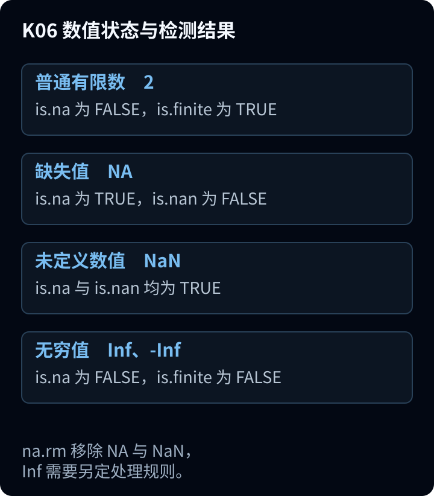

# K06 缺失、NaN与无穷值

## 基本信息

- 所属单元为类型与缺失。
- 难度为核心。
- 前置知识为K04、K05。
- 关联知识为K04、K05、K13、K28。
- 编写人为Codex，样品版本为1.0，日期为2026年11月15日。
- 例题和练习数据均为原创模拟教学数据。

## 学习目标

- 能够区分缺失、未定义数值计算结果和无穷值。
- 能够用检测函数统计数据状态，并解释检测集合的重叠。
- 能够按明确规则汇总有限测量值，解释全缺失和无穷值的边界。

## 先备检查

1. 比较结果暂时未知时，逻辑值可能是什么？预期回答为`NA`。
2. 怎样保留条件为真的位置？预期回答为使用形如`x[keep]`的逻辑索引。

## 直观理解

一个数值向量可以同时装着有效测量和不同状态的特殊值。`NA`表示缺失，`NaN`可由未定义的数值运算产生，`Inf`和`-Inf`表示正负无穷。清理前要逐项确认这些状态的含义，再决定纳入计算的范围。检测函数帮助记录现状，汇总参数则规定一次计算怎样处理缺失，原向量依然保存着原有数据。

## 为什么

1. 为什么`is.na(NaN)`也为真？R的缺失检测将`NaN`纳入其中，进一步识别这种数值状态可以使用`is.nan()`，因此两种计数会重叠。
2. 为什么`na.rm = TRUE`后仍可能出现无穷或`NaN`？该参数移除缺失项，`Inf`仍参加计算。正负无穷共同求和时也会形成`NaN`。
3. 为什么全缺失均值得到`NaN`？移除缺失后没有可用于求均值的观测。实际报告应明确标记缺少有效观测。

## 基础例题

观察普通数、缺失值、未定义数值和正负无穷的检测结果，再对含缺失的两项有效成绩求均值。

独立脚本见[K06_example_01.R](../../ai_tutor/content_assets/code/K06_example_01.R)。

```r
x <- c(2, NA_real_, NaN, Inf, -Inf)
print(is.na(x))
print(is.nan(x))
print(is.finite(x))
print(mean(c(60, NA, 80), na.rm = TRUE))
```

### 预期输出（本次R 4.6.1实际运行记录）

```text
[1] FALSE  TRUE  TRUE FALSE FALSE
[1] FALSE FALSE  TRUE FALSE FALSE
[1]  TRUE FALSE FALSE FALSE FALSE
[1] 70
```

### 逐步讲解

1. 五项输入按固定顺序保存，便于对应各检测向量。
2. `is.na()`标出`NA`和`NaN`，`is.nan()`只标出第三项。
3. `is.finite()`只保留第一项普通有限数。
4. 成绩均值在排除一个缺失项后为70分。

## 应用例题

十二条模拟实验测量以毫克为单位，特意加入一个`NA`、一个`NaN`和两个无穷值。为本次教学汇总约定仅使用有限值，原始数据保留以便复核。

独立脚本见[K06_example_02.R](../../ai_tutor/content_assets/code/K06_example_02.R)。

```r
measurement <- c(12, 13, NA, 14, Inf, 15, NaN, 16, -Inf, 17, 18, 19)
keep <- is.finite(measurement)
print(c(total = length(measurement), missing = sum(is.na(measurement)),
        nan = sum(is.nan(measurement)), infinite = sum(is.infinite(measurement)),
        finite = sum(keep)))
print(mean(measurement, na.rm = TRUE))
print(measurement[keep])
print(mean(measurement[keep]))
```

### 预期输出（本次R 4.6.1实际运行记录）

```text
   total  missing      nan infinite   finite 
      12        2        1        2        8 
[1] NaN
[1] 12 13 14 15 16 17 18 19
[1] 15.5
```

### 逐步讲解

1. 先保存有限值掩码，再统计各状态。
2. `missing`包括一个`NA`和一个`NaN`，`nan`已经包含在这个计数中。
3. 仅设置`na.rm`的均值依然为`NaN`，反映正负无穷同时参与运算。
4. 按本题规则选出八项有限测量，均值为15.5毫克。

这说明筛选后数据的计算结果。非有限值是否反映仪器故障、超量程或其他原因，需要结合实验记录判断。

## 图解方案

图名为“数值状态与检测结果”，采用对比图，使用独立R代码生成SVG。图片中文字与标签共同表达关系。



生成代码见[K06_visual_01.R](../../ai_tutor/content_assets/code/K06_visual_01.R)。在`content_assets/code`目录执行以下命令，可将图解生成到相邻图片目录。

```sh
Rscript --vanilla K06_visual_01.R ../images
```

图把四类状态与检测结果对应起来，并明确缺失检测的重叠关系。配合应用例题可以解释为什么各检测计数直接相加会重复统计，以及为何需要另行判断无穷值。

## 易错案例

使用等号比较识别缺失，得到未知逻辑值，后续索引也失去有效判断。


```r
x <- c(2, NA, 4)
print(x == NA)
print(x[x == NA])
```

### 实际错误或异常结果

```text
[1] NA NA NA
[1] NA NA NA
```

参考修正使用专门的检测函数。


```r
x <- c(2, NA, 4)
print(is.na(x))
print(x[!is.na(x)])
```

### 预期输出（本次R 4.6.1实际运行记录）

```text
[1] FALSE  TRUE FALSE
[1] 2 4
```

该修正用于识别缺失的位置，是否删除或填补仍需具体任务的处理规则。实际缺失机制也需要额外资料支持。

## 完整练习

十项模拟测量以毫克为单位，包含教学设计的四个非有限值。要求保留原始向量，按仅使用有限值的规则创建`clean`，报告总项数、保留数、排除数和均值，再解释全缺失均值的输出。

提示用`is.finite()`形成统一掩码，排除数可用`sum(!keep)`核对。全缺失测试另用一个短向量完成。

独立脚本见[K06_exercise.R](../../ai_tutor/content_assets/code/K06_exercise.R)。

```r
measurement <- c(20, 22, NA, Inf, 24, NaN, 26, -Inf, 28, 30)
keep <- is.finite(measurement)
clean <- measurement[keep]
print(c(total = length(measurement), kept = sum(keep), excluded = sum(!keep)))
print(clean)
print(mean(clean))
print(mean(c(NA_real_, NA_real_), na.rm = TRUE))
```

### 预期输出（本次R 4.6.1实际运行记录）

```text
   total     kept excluded 
      10        6        4 
[1] 20 22 24 26 28 30
[1] 25
[1] NaN
```

评分共10分，原始值保留得2分，掩码与清理结果得3分，数量记录得2分，均值和全缺失解释得3分。常见错误是认为`na.rm`会删除无穷值，或把`is.na`与`is.nan`计数直接相加。

## 自测题

1. 预测均值、原向量长度及三个检测结果。


```r
x <- c(NA_real_, NA_real_)
print(mean(x, na.rm = TRUE))
print(length(x))
print(c(is.na(NaN), is.nan(NA_real_), is.na(Inf)))
```

### 预期输出（本次R 4.6.1实际运行记录）

```text
[1] NaN
[1] 2
[1]  TRUE FALSE FALSE
```

答案依次为`NaN`、2和`TRUE FALSE FALSE`。汇总参数只作用于该次计算，原向量长度仍为2。

2. `!is.infinite(x)`能否直接作为只保留有限值的条件？答案为否。对`NA`和`NaN`还需要处理，直接使用`is.finite()`更符合本题要求。

## 追问建议

- 例题请求分别观察只含正无穷和正负无穷时的均值。
- 易错点请求解释缺失检测计数为何重叠。
- 练习请求为空清理结果补充明确的报告说明。
- 相关知识继续学习K28的缺失与异常处理记录。

## 来源与验证

- 课程来源为[S3《r-data-operations-ch02.pdf》PDF 11、73](../sources/r-data-operations-ch02.pdf#page=11)。
- 课程来源为[S4《r-for-data-science-zh.pdf》第15章 PDF 233–234](../sources/r-for-data-science-zh.pdf#page=233)。
- 补充来源为本机R 4.6.1官方帮助主题`help("NA", package = "base")`、`help("is.finite", package = "base")`、`help("mean", package = "base")`、`help("Arithmetic", package = "base")`。
- R版本为4.6.1，平台为Windows x64，`base`、`stats`、`utils`、`tools`均为4.6.1。
- 验证环境采用进程级`LC_ALL=C`与`LANGUAGE=en`，时区为`Asia/Shanghai`，输出宽度为80。
- 图解脚本在字符区域缺少UTF-8支持时，为当前R进程设置Windows英文UTF-8字符区域，以正确写入中文标签。
- 验证命令为在代码目录运行`Rscript --vanilla --encoding=UTF-8 K06_example_01.R`，应用例题和练习使用各自同名前缀脚本。
- 验证记录见[K06_validation.txt](../../ai_tutor/content_assets/code/K06_validation.txt)，包含各段代码、实际输出、退出状态、边界断言及文件摘要。
- 代码验证结果为通过，包括基础例题、应用例题、参考修正、练习答案和自测预测。易错代码按预期产生错误或异常结果，详见记录。
- 本文输出为离线脚本实测记录。版本、会话信息和警告语言随验证环境变化，复核时应同时保存环境。
- 图解通过浏览器桌面与390像素窄屏核对，文字边界、连接关系和替代文本检查通过。
- 核验日期为2026年11月15日，核验人为Codex，核验方式为自动运行及内容审阅，课程适配由整合成员复核。
