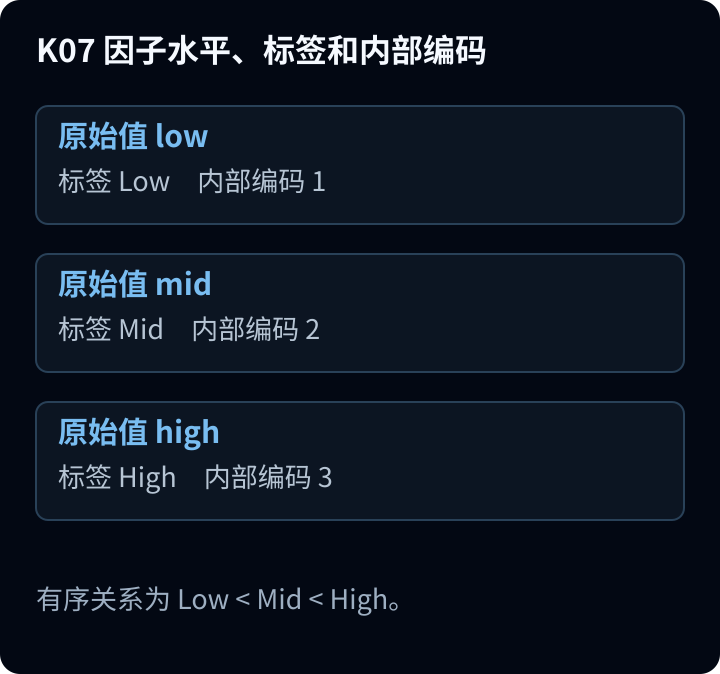

# K07 普通因子与有序因子

## 基本信息

- 所属单元为类型与缺失。
- 难度为核心。
- 前置知识为K04。
- 关联知识为K04、K14、K15、K30。
- 编写人为Codex，样品版本为1.0，日期为2026年11月15日。
- 例题和练习数据均为原创模拟教学数据。

## 学习目标

- 能够用显式水平和标签创建普通因子与有序因子。
- 能够按约定顺序汇总问卷等级，并定位未识别类别。
- 能够解释内部编码与显示值的关系，正确处理数值标签的转换。

## 先备检查

1. 因子的`typeof()`通常返回什么？预期回答为`integer`，其`class()`还保存类别信息。
2. `"low"`这样的输入属于什么形式？预期回答为字符值，可用来表示原始类别。

## 直观理解

问卷等级有固定选项，常常还约定从低到高的顺序。因子把这些选项保存为水平，观测通过整数编码指向某个水平。`labels`可以设置展示名称，`ordered = TRUE`进一步保存等级关系。显式约定允许的原始值与顺序，能让排序和汇总遵循问卷设计，也方便发现拼写错误或超出选项的输入。

## 为什么

1. 为什么显式指定`levels`？默认生成水平时可能受字符排序规则影响。指定顺序能让结果对应课程约定或问卷设计。
2. 为什么还要设置`labels`？原始编码和展示名称可以有不同用途，标签按`levels`给出的顺序对应，长度和对应关系都要核对。
3. 为什么直接`as.numeric(f)`会得到1、2等数？函数读取因子的内部编码。要恢复数值标签，应先取得字符标签并确认标签能够解释为数值。

## 基础例题

把三条等级记录转为有序因子，原始选项为`low`、`mid`和`high`，展示名称使用首字母大写。

独立脚本见[K07_example_01.R](../../ai_tutor/content_assets/code/K07_example_01.R)。

```r
f <- factor(c("low", "high", "mid"),
            levels = c("low", "mid", "high"),
            labels = c("Low", "Mid", "High"), ordered = TRUE)
print(f)
print(levels(f))
print(as.integer(f))
print(f > "Low")
```

### 预期输出（本次R 4.6.1实际运行记录）

```text
[1] Low  High Mid 
Levels: Low < Mid < High
[1] "Low"  "Mid"  "High"
[1] 1 3 2
[1] FALSE  TRUE  TRUE
```

### 逐步讲解

1. `levels`规定允许的原始值及从低到高的顺序。
2. `labels`按同一顺序映射为展示名称。
3. 内部编码随观测位置为1、3、2。
4. 有序比较检验每项是否高于`Low`。普通因子主要保存类别，等级比较需要有序信息。

## 应用例题

整理十二条原创模拟满意度回答。`other`为故意加入的未识别选项，另有一项原始缺失。任务是按低、中、高顺序汇总，并单独找出未识别文本。

独立脚本见[K07_example_02.R](../../ai_tutor/content_assets/code/K07_example_02.R)。

```r
raw <- c("high", "low", "mid", "high", "mid", "low", "high", "mid", "other", "high", NA, "mid")
satisfaction <- factor(raw, levels = c("low", "mid", "high"),
                       labels = c("Low", "Mid", "High"), ordered = TRUE)
invalid <- !is.na(raw) & is.na(satisfaction)
print(satisfaction)
print(table(satisfaction, useNA = "ifany"))
print(raw[invalid])
```

### 预期输出（本次R 4.6.1实际运行记录）

```text
 [1] High Low  Mid  High Mid  Low  High Mid  <NA> High <NA> Mid 
Levels: Low < Mid < High
satisfaction
 Low  Mid High <NA> 
   2    4    4    2 
[1] "other"
```

### 逐步讲解

1. 保留`raw`，再依据问卷允许选项创建有序因子。
2. 未列入`levels`的`other`转为缺失，原有缺失也保留。
3. `invalid`只标记转换新增的缺失，便于区分原始空缺与未识别类别。
4. `table(..., useNA = "ifany")`显示各水平人数及缺失数，结果为2、4、4和2。

这里的等级次数描述模拟问卷分布。等级间的数值距离需要独立的量表依据，编码1、2、3本身只记录水平位置。

## 图解方案

图名为“因子水平、标签和内部编码”，采用数据结构映射图，使用独立R代码生成SVG。图片中文字与标签共同表达关系。



生成代码见[K07_visual_01.R](../../ai_tutor/content_assets/code/K07_visual_01.R)。在`content_assets/code`目录执行以下命令，可将图解生成到相邻图片目录。

```sh
Rscript --vanilla K07_visual_01.R ../images
```

每行把原始值、展示标签和编码对应起来，再用明确的大小关系表示有序信息。学生可以沿映射回查结果，理解更换水平顺序为什么会改变编码及等级关系。

## 易错案例

希望恢复标签10和20，却直接对因子使用数值转换。


```r
f <- factor(c("10", "20", "10"), levels = c("10", "20"))
print(as.numeric(f))
```

### 实际错误或异常结果

```text
[1] 1 2 1
```

代码正常执行，结果为内部编码。参考修正先恢复字符标签。


```r
f <- factor(c("10", "20", "10"), levels = c("10", "20"))
print(as.numeric(as.character(f)))
```

### 预期输出（本次R 4.6.1实际运行记录）

```text
[1] 10 20 10
```

这个恢复方法适用于标签本身可解释为数值的场景。对于满意度文字标签，需要按问卷规则另行定义分值映射。

## 完整练习

十项实验剂量等级使用字符标签`10`、`20`、`30`，本练习约定单位为毫克。最后一项`unknown`为教学设计的未知选项。创建有序因子，报告各水平数量、未知文本、内部编码与恢复后的剂量数值。

提示先保存原始文本，再定义允许水平。用转换前后缺失状态的变化找出未知项。

独立脚本见[K07_exercise.R](../../ai_tutor/content_assets/code/K07_exercise.R)。

```r
raw <- c("10", "20", "30", "10", "20", "30", "20", "10", "30", "unknown")
f <- factor(raw, levels = c("10", "20", "30"), ordered = TRUE)
invalid <- !is.na(raw) & is.na(f)
values <- as.numeric(as.character(f))
print(table(f, useNA = "ifany"))
print(raw[invalid])
print(as.integer(f))
print(values)
```

### 预期输出（本次R 4.6.1实际运行记录）

```text
f
  10   20   30 <NA> 
   3    3    3    1 
[1] "unknown"
 [1]  1  2  3  1  2  3  2  1  3 NA
 [1] 10 20 30 10 20 30 20 10 30 NA
```

评分共10分，水平顺序得2分，频数及缺失记录得2分，未知项定位得2分，编码和数值恢复各2分。常见错误是直接把内部编码当剂量，或把未知选项静默并入某个已有类别。

## 自测题

1. 预测内部编码与水平顺序。


```r
f <- factor(c("a", "b", "a"), levels = c("b", "a"))
print(as.integer(f))
print(levels(f))
```

### 预期输出（本次R 4.6.1实际运行记录）

```text
[1] 2 1 2
[1] "b" "a"
```

答案为`2 1 2`与`"b" "a"`。编码跟随显式给定的水平位置。

2. 给`factor()`设置`ordered = TRUE`会自动把等级间隔定义为相等吗？答案为否。该设置保存类别次序，间隔解释需要额外依据。

## 追问建议

- 例题请求修改水平顺序并观察编码变化。
- 易错点请求解释未知文本与原始缺失的区别。
- 练习请求增加一个合法等级并重新汇总。
- 相关知识继续学习K15的区间分组与标签。

## 来源与验证

- 课程来源为[S3《CH2R语言数据操作课件.pdf》PDF 15–19](../../成员一/CH2R语言数据操作课件.pdf#page=15)。
- 课程来源为[S4《R数据科学_译本.pdf》第11章 PDF 183–188](../../成员一/R数据科学_译本.pdf#page=183)。
- 补充来源为本机R 4.6.1官方帮助主题`help("factor", package = "base")`、`help("ordered", package = "base")`、`help("numeric", package = "base")`、`help("table", package = "base")`。
- R版本为4.6.1，平台为Windows x64，`base`、`stats`、`utils`、`tools`均为4.6.1。
- 验证环境采用进程级`LC_ALL=C`与`LANGUAGE=en`，时区为`Asia/Shanghai`，输出宽度为80。
- 图解脚本在字符区域缺少UTF-8支持时，为当前R进程设置Windows英文UTF-8字符区域，以正确写入中文标签。
- 验证命令为在代码目录运行`Rscript --vanilla --encoding=UTF-8 K07_example_01.R`，应用例题和练习使用各自同名前缀脚本。
- 验证记录见[K07_validation.txt](../../ai_tutor/content_assets/code/K07_validation.txt)，包含各段代码、实际输出、退出状态、边界断言及文件摘要。
- 代码验证结果为通过，包括基础例题、应用例题、参考修正、练习答案和自测预测。易错代码按预期产生错误或异常结果，详见记录。
- 本文输出为离线脚本实测记录。版本、会话信息和警告语言随验证环境变化，复核时应同时保存环境。
- 图解通过浏览器桌面与390像素窄屏核对，文字边界、连接关系和替代文本检查通过。
- 核验日期为2026年11月15日，核验人为Codex，核验方式为自动运行及内容审阅，课程适配由整合成员复核。
