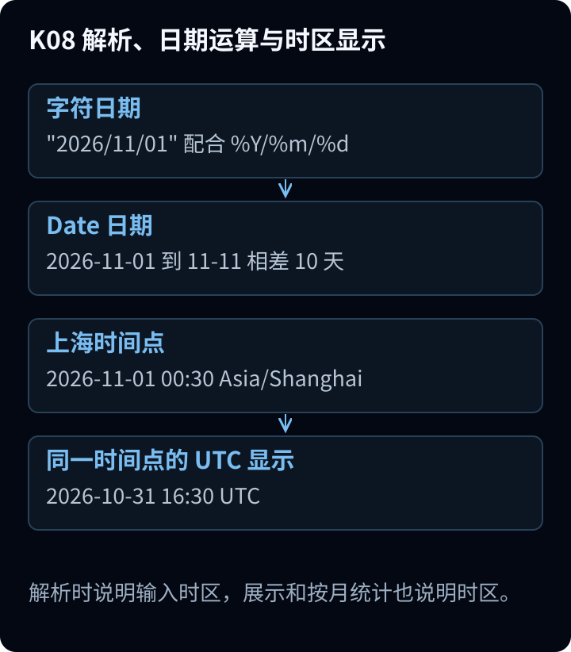

# K08 日期、时间与格式

## 基本信息

- 所属单元为类型与缺失。
- 难度为核心。
- 前置知识为K04。
- 关联知识为K04、K38、K43。
- 编写人为Codex，样品版本为1.0，日期为2026年11月15日。
- 例题和练习数据均为原创模拟教学数据。

## 学习目标

- 能够用与输入相符的格式解析日期和时间字符串。
- 能够计算实验间隔、提取月份，并区分日期对象与展示文本。
- 能够解释`Date`、`POSIXct`、`POSIXlt`的基本用途和时区假设。

## 先备检查

1. `"2026/11/01"`刚写入向量时属于什么类型？预期回答为字符。
2. 转换后怎样检查对象类别？预期回答为使用`class()`。

## 直观理解

日期文本的外观并不能自动确定其含义，解析需要对应的年、月、日格式。`Date`适合保存日历日期，`POSIXct`适合保存具体时间点，`POSIXlt`便于按时间成分访问。把时间点按某个时区显示时，日期也可能变化。计算间隔、提取月份和制作报告前，先明确数据表示日期还是时间点，并说明时区。

## 为什么

1. 为什么格式符要匹配输入？解析函数需要知道年月日的位置与分隔符。`%m`表示月份，`%M`表示分钟，大小写改变会影响解释。
2. 为什么`format()`之后要留意类型？它生成用于显示的字符文本。日期运算应继续使用原来的日期或时间对象。
3. 为什么按月统计还要声明时区？同一时间点在不同时区可能落在不同日历日期，月初附近尤其需要统一解释规则。

## 基础例题

把两次实验日期解析为`Date`，计算间隔并提取月份。日期均为原创教学设定，间隔单位为天。

独立脚本见[K08_example_01.R](../../ai_tutor/content_assets/code/K08_example_01.R)。

```r
dates <- as.Date(c("2026/11/01", "2026/11/11"), format = "%Y/%m/%d")
print(dates)
print(class(dates))
print(as.numeric(difftime(dates[2], dates[1], units = "days")))
print(format(dates, "%m"))
```

### 预期输出（本次R 4.6.1实际运行记录）

```text
[1] "2026-11-01" "2026-11-11"
[1] "Date"
[1] 10
[1] "11" "11"
```

### 逐步讲解

1. `%Y/%m/%d`依次读取四位年、月和日。
2. 查看解析后的日期和类别，确认转换成功。
3. `difftime()`指定间隔单位，`as.numeric()`提取数值10。
4. `format(..., "%m")`提取月份显示文本，结果为两个`"11"`。

## 应用例题

十条模拟实验时间戳都按上海当地时间记录。要求按上海时区汇总月份，计算前两次实验间隔，并查看时间成分和UTC显示。

独立脚本见[K08_example_02.R](../../ai_tutor/content_assets/code/K08_example_02.R)。

```r
raw_time <- c("2026-10-31 23:30:00", "2026-11-01 00:30:00",
              "2026-11-01 08:00:00", "2026-11-02 08:00:00",
              "2026-11-03 08:00:00", "2026-11-04 08:00:00",
              "2026-11-05 08:00:00", "2026-11-06 08:00:00",
              "2026-11-07 08:00:00", "2026-11-08 08:00:00")
times <- as.POSIXct(raw_time, format = "%Y-%m-%d %H:%M:%S", tz = "Asia/Shanghai")
print(table(format(times, "%Y-%m", tz = "Asia/Shanghai")))
print(format(times[1], "%Y-%m-%d %H:%M", tz = "UTC"))
print(as.numeric(difftime(times[2], times[1], units = "hours")))
parts <- as.POSIXlt(times, tz = "Asia/Shanghai")
print(parts$mon + 1L)
```

### 预期输出（本次R 4.6.1实际运行记录）

```text

2026-10 2026-11 
      1       9 
[1] "2026-10-31 15:30"
[1] 1
 [1] 10 11 11 11 11 11 11 11 11 11
```

### 逐步讲解

1. `as.POSIXct()`同时指定格式和输入时区，建立时间点。
2. 按上海时区生成月份键，统计得到十月1条、十一月9条。
3. 首项换成UTC显示为当日15时30分，计算前两项间隔得到1小时。
4. `as.POSIXlt()`提供成分访问，`mon`从0开始，因此加1得到通常使用的月份编号。

这些结果依赖输入确为上海当地时间的约定。原始时间若来自其他时区，应先核实来源再解释。

## 图解方案

图名为“解析、日期运算与时区显示”，采用日期与时间对应图，使用独立R代码生成SVG。图片中文字与标签共同表达关系。



生成代码见[K08_visual_01.R](../../ai_tutor/content_assets/code/K08_visual_01.R)。在`content_assets/code`目录执行以下命令，可将图解生成到相邻图片目录。

```sh
Rscript --vanilla K08_visual_01.R ../images
```

图上半部分展示字符解析和日期间隔，下半部分用应用例题的第二个时间点演示上海与UTC之间的跨日显示。两组对应关系帮助学生区分日历日期与具体时间点。

## 易错案例

输入使用斜杠，格式却要求短横线。


```r
print(as.Date("2026/11/05", format = "%Y-%m-%d"))
```

### 实际错误或异常结果

```text
[1] NA
```

本例匹配失败得到`NA`。参考修正让格式与已知输入对应。


```r
print(as.Date("2026/11/05", format = "%Y/%m/%d"))
```

### 预期输出（本次R 4.6.1实际运行记录）

```text
[1] "2026-11-05"
```

实际混合格式数据还需要先识别各输入约定。一次成功解析也应结合原始文本核对，特别留意年月日顺序、附加文本和时区信息。

## 完整练习

输入为十条模拟实验日期，按年/月/日记录，其中`bad`为故意设置的异常文本，另有一项原始缺失。保留原始向量，解析日期，定位新增解析失败项，统计总缺失数，计算相对2026年11月1日的持续天数并提取月份。

提示`which()`返回逻辑条件为真的位置，便于回查输入。原始缺失与解析失败要分别识别，持续时间统一使用天。

独立脚本见[K08_exercise.R](../../ai_tutor/content_assets/code/K08_exercise.R)。

```r
raw <- c("2026/11/01", "2026/11/03", "2026/11/05", "2026/11/07", "bad",
         "2026/11/11", "2026/11/13", NA, "2026/11/17", "2026/11/19")
dates <- as.Date(raw, format = "%Y/%m/%d")
invalid <- !is.na(raw) & is.na(dates)
baseline <- as.Date("2026-11-01")
days <- as.numeric(difftime(dates, baseline, units = "days"))
print(dates)
print(which(invalid))
print(sum(is.na(dates)))
print(days)
print(format(dates, "%m"))
```

### 预期输出（本次R 4.6.1实际运行记录）

```text
 [1] "2026-11-01" "2026-11-03" "2026-11-05" "2026-11-07" NA          
 [6] "2026-11-11" "2026-11-13" NA           "2026-11-17" "2026-11-19"
[1] 5
[1] 2
 [1]  0  2  4  6 NA 10 12 NA 16 18
 [1] "11" "11" "11" "11" NA   "11" "11" NA   "11" "11"
```

评分共10分，原始数据和正确格式得2分，失败项与缺失记录得3分，持续天数得3分，月份及单位说明得2分。常见错误是混淆`%m`与`%M`、对格式化后的文本直接作日期运算，或省略时间戳的时区假设。

## 自测题

1. 预测结果类别与间隔数值。


```r
d <- as.Date("2026-11-01")
print(class(format(d, "%Y/%m/%d")))
print(as.numeric(difftime(d + 2, d, units = "days")))
```

### 预期输出（本次R 4.6.1实际运行记录）

```text
[1] "character"
[1] 2
```

答案依次为`character`和2。对`Date`加2表示向后移动两天，格式化生成展示文本。

2. 看到一条没有时区的时间戳，能否直接确认它对应的全球时间点？答案为否。还需要数据来源的时区约定。

## 追问建议

- 例题请求比较月初时间点在上海与UTC的月份。
- 易错点请求解释格式符大小写和分隔符的影响。
- 练习请求分别报告原始缺失与新增解析失败。
- 相关知识继续学习K43的时间成分提取与取整。

## 来源与验证

- 课程来源为[S3《r-data-operations-ch02.pdf》PDF 20–27](../sources/r-data-operations-ch02.pdf#page=20)。
- 课程来源为[S4《r-for-data-science-zh.pdf》第12章 PDF 189–204](../sources/r-for-data-science-zh.pdf#page=189)。
- 补充来源为本机R 4.6.1官方帮助主题`help("as.Date", package = "base")`、`help("as.POSIXct", package = "base")`、`help("strptime", package = "base")`、`help("difftime", package = "base")`、`help("DateTimeClasses", package = "base")`。
- R版本为4.6.1，平台为Windows x64，`base`、`stats`、`utils`、`tools`均为4.6.1。
- 验证环境采用进程级`LC_ALL=C`与`LANGUAGE=en`，时区为`Asia/Shanghai`，输出宽度为80。
- 图解脚本在字符区域缺少UTF-8支持时，为当前R进程设置Windows英文UTF-8字符区域，以正确写入中文标签。
- 验证命令为在代码目录运行`Rscript --vanilla --encoding=UTF-8 K08_example_01.R`，应用例题和练习使用各自同名前缀脚本。
- 验证记录见[K08_validation.txt](../../ai_tutor/content_assets/code/K08_validation.txt)，包含各段代码、实际输出、退出状态、边界断言及文件摘要。
- 代码验证结果为通过，包括基础例题、应用例题、参考修正、练习答案和自测预测。易错代码按预期产生错误或异常结果，详见记录。
- 本文输出为离线脚本实测记录。版本、会话信息和警告语言随验证环境变化，复核时应同时保存环境。
- 图解通过浏览器桌面与390像素窄屏核对，文字边界、连接关系和替代文本检查通过。
- 核验日期为2026年11月15日，核验人为Codex，核验方式为自动运行及内容审阅，课程适配由整合成员复核。
