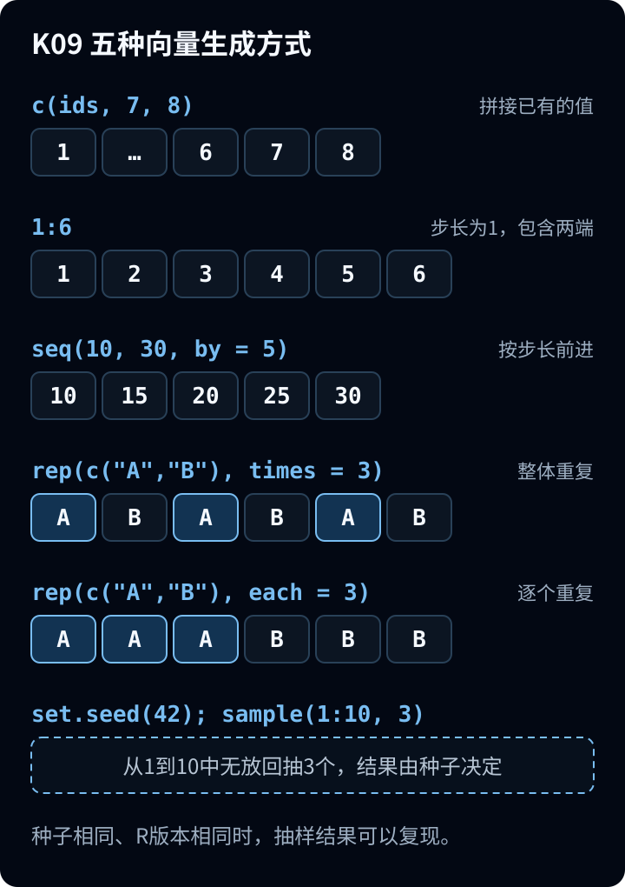

# K09 创建向量与随机抽样

## 基本信息

- 所属单元为向量与字符串。
- 难度为核心。
- 前置知识为K04。
- 关联知识为K10、K11、K12、K13、K15。
- 编写人为Claude（AI辅助编写），样品版本为1.0，日期为2026年11月15日。
- 例题和练习数据均为原创模拟教学数据。
- 验证状态为待R实测。

## 学习目标

- 能够根据需要选择`c()`、`:`、`seq()`、`rep()`创建向量，并预测结果长度。
- 能够用`set.seed()`让抽样结果可以复现，并说明种子只保证同一环境下结果一致。
- 能够避开`1:n`在`n`为0时的陷阱，改用`seq_len()`。

## 先备检查

1. `c(1, "2")`的类型是什么？预期回答为字符型，混合时会统一转换成更通用的类型。
2. 向量`c(5, 8, 2)`有几个元素？预期回答为3个，可以用`length()`核对。

## 直观理解

向量像一排编了号的格子，每个格子放一个同类型的值。`c()`把已有的值逐个放进去，`:`生成步长为1的整数序列，`seq()`可以指定步长或总个数，`rep()`把一段内容重复多次。抽样是从这排格子里随机挑选，计算机的“随机”其实由一个起点决定，`set.seed()`固定这个起点，所以同样的代码能抽出同样的结果，方便别人复核。

## 为什么

1. 为什么抽样前要先调用`set.seed()`？随机数由种子推算而来。固定种子后，在同一R版本和随机算法下，每次运行抽到的元素相同，作业和报告的结果才可以复核。
2. 为什么`rep(x, times = 2)`和`rep(x, each = 2)`结果顺序不同？`times`把整个向量整体重复，`each`先把每个元素就地重复，再进入下一个元素。
3. 为什么循环中常用`seq_len(n)`而不是`1:n`？当`n`为0时，`1:0`得到`c(1, 0)`这两个数，`seq_len(0)`才得到空序列。

## 基础例题

用五种方式生成实验编号、等距刻度和分组标签，比较结果的顺序与长度。

独立脚本见[K09_example_01.R](../ai_tutor/content_assets/code/K09_example_01.R)。

```r
ids <- 1:6
print(ids)
print(seq(10, 30, by = 5))
print(seq(0, 1, length.out = 5))
print(rep(c("A", "B"), times = 3))
print(rep(c("A", "B"), each = 3))
print(c(ids, 7, 8))
```

### 预期输出（待R实测）

```text
[1] 1 2 3 4 5 6
[1] 10 15 20 25 30
[1] 0.00 0.25 0.50 0.75 1.00
[1] "A" "B" "A" "B" "A" "B"
[1] "A" "A" "A" "B" "B" "B"
[1] 1 2 3 4 5 6 7 8
```

### 逐步讲解

1. `1:6`包含两端，得到6个整数。
2. `seq(10, 30, by = 5)`按步长5前进，30恰好落在终点上，因此被保留。
3. `length.out = 5`指定总个数，R自动计算步长0.25。为了对齐，所有值都显示两位小数。
4. `times`与`each`得到的元素相同，排列顺序不同。
5. `c()`把已有向量和新值拼接，结果长度为8。

## 应用例题

从10名学生中随机抽取3人参加访谈，要求换一台电脑重新运行时抽到同样的人，便于老师复核。

独立脚本见[K09_example_02.R](../ai_tutor/content_assets/code/K09_example_02.R)。

```r
students <- sprintf("S%02d", 1:10)
set.seed(42)
picked <- students[sample(1:10, 3)]
print(picked)
set.seed(42)
again <- students[sample(1:10, 3)]
print(identical(picked, again))
print(length(unique(picked)))
```

### 预期输出（待R实测）

```text
[1] "S01" "S05" "S10"
[1] TRUE
[1] 3
```

### 逐步讲解

1. `sprintf("S%02d", 1:10)`生成两位补零的学号`S01`到`S10`。
2. `sample(1:10, 3)`默认无放回抽取3个位置，再用这些位置取出学号。
3. 第二次抽样前重新设定同一个种子，因此`identical()`返回`TRUE`。
4. 无放回抽样不会重复，`unique()`后仍为3人。

这个结果只说明抽样过程可以复现，不说明这3人能代表全班。课程资料记录的`set.seed(42); sample(1:10, 3)`结果为`1 5 10`，不同R版本若更换默认随机算法，具体抽中的人可能不同，因此报告中应同时记录R版本。

## 图解方案

图名为“五种向量生成方式”，采用对比图，以SVG手绘。每一行列出一种写法及其生成的格子序列，`sample`一行用虚线框提示结果依赖种子。



图把“写法—结果顺序”放在同一行，便于对照基础例题逐行预测输出。`sample`一行只展示抽取动作，不画具体抽中的值，提醒学生随机结果需要实际运行。

## 易错案例

按人数`n`生成编号，当某个班级人数为0时，仍然得到两个编号。

```r
n <- 0
print(1:n)
print(length(1:n))
```

### 实际错误或异常结果（待R实测）

```text
[1] 1 0
[1] 2
```

参考修正使用`seq_len()`，人数为0时得到空序列。

```r
n <- 0
print(seq_len(n))
print(length(seq_len(n)))
```

### 预期输出（待R实测）

```text
integer(0)
[1] 0
```

`1:n`在`n`大于等于1时与`seq_len(n)`结果相同，问题只在空输入时暴露，因此检查代码时要专门测试`n`为0的情况。如果`n`来自数据计算，还需确认它确实是非负整数。

## 完整练习

12名受试者按编号前6人为对照组、后6人为实验组。要求生成分组标签并统计每组人数，再用种子2026抽取8人作为训练样本、其余作为测试样本，报告两部分人数和重叠人数，并验证重新抽样结果一致。

提示用`rep(..., each = 6)`生成分组，测试样本可用`setdiff()`得到，重叠人数用`intersect()`核对。

独立脚本见[K09_exercise.R](../ai_tutor/content_assets/code/K09_exercise.R)。

```r
id <- 1:12
group <- rep(c("control", "treat"), each = 6)
print(table(group))
set.seed(2026)
train <- sample(id, 8)
test <- setdiff(id, train)
print(c(train = length(train), test = length(test), overlap = length(intersect(train, test))))
set.seed(2026)
print(identical(train, sample(id, 8)))
```

### 预期输出（待R实测）

```text
group
control   treat 
      6       6 
  train    test overlap 
      8       4       0 
[1] TRUE
```

评分共10分，分组标签正确得3分，抽样设定种子得2分，训练与测试人数及重叠检查得3分，复现验证得2分。参考答案没有打印抽中的具体编号，这些编号需要以实际运行为准。常见错误是把`each`写成`times`，导致两组交替排列；或者第二次抽样前忘记重新设定种子。

## 自测题

1. 预测下面三行的输出。

```r
print(seq(2, 11, by = 3))
print(rep(1:2, times = c(3, 1)))
print(length(seq(1, 2, by = 0.25)))
```

### 预期输出（待R实测）

```text
[1]  2  5  8 11
[1] 1 1 1 2
[1] 5
```

答案依次为`2 5 8 11`、`1 1 1 2`和5。`times`可以是与元素一一对应的次数向量。

2. 不调用`set.seed()`，连续两次运行`sample(1:10, 3)`，结果一定不同吗？答案为否。两次结果通常不同，但也可能偶然相同，只是无法保证复现。

## 追问建议

- 例题请求用`seq()`生成从100递减到60、步长为10的序列。
- 易错点请求解释`1:length(x)`在空向量时会发生什么。
- 练习请求改为按组各抽4人的分层抽样。
- 相关知识继续学习K10的向量索引，用抽到的位置取出对应数据。

## 来源与验证

- 课程来源为[S3《CH2R语言数据操作课件.pdf》PDF 30–31](../../成员一/CH2R语言数据操作课件.pdf#page=30)。
- 课程来源为[S2《CH12R语言安装.pdf》PDF 1–5](../../成员一/CH12R语言安装.pdf#page=1)。
- 补充来源为R官方帮助主题`help("seq")`、`help("rep")`、`help("sample")`、`help("Random")`。
- 本文代码尚未在R中运行，输出为编写者依据R规则推算的预期结果，应用例题的抽样结果引自课程资料中已实测的`set.seed(42)`记录。
- 核对方法为在ai_tutor目录运行`python scripts/check_r_outputs.py K09`，全部通过后加`--write`标记为已实测。
- 图解为SVG手绘，未附生成脚本。
