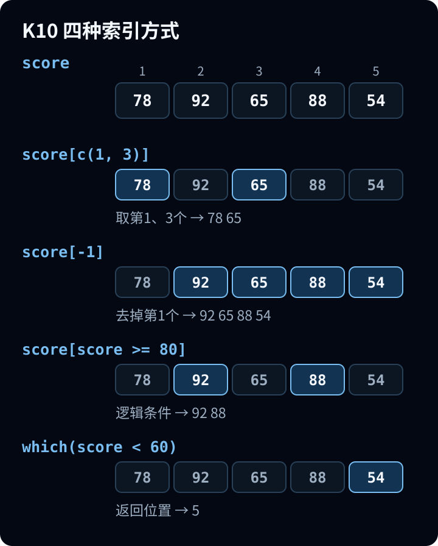

# K10 向量索引与定位

## 基本信息

- 所属单元为向量与字符串。
- 难度为核心。
- 前置知识为K05、K09。
- 关联知识为K12、K14、K19、K26、K31。
- 编写人为Claude（AI辅助编写），样品版本为1.0，日期为2026年11月15日。
- 例题和练习数据均为原创模拟教学数据。
- 验证状态为待R实测。

## 学习目标

- 能够用正位置、负位置、逻辑条件和名称四种方式取出向量元素。
- 能够用`which()`、`which.max()`把条件转换为位置，并解释缺失值对结果的影响。
- 能够识别`x[-which(...)]`在没有命中时返回空向量的边界情况。

## 先备检查

1. `c(78, 92, 65) > 80`的结果是什么？预期回答为`FALSE TRUE FALSE`。
2. R向量的第一个元素编号是0还是1？预期回答为1。

## 直观理解

索引就是告诉R“要哪几个格子”。写数字表示按位置取，负数表示去掉这些位置，写一串`TRUE`/`FALSE`表示逐格决定保留与否，写名字表示按标签取。`which()`把逻辑条件翻译回位置编号，适合回答“第几个出了问题”。条件中出现缺失值时，逻辑索引会把它变成一个`NA`元素，而`which()`会直接跳过它。

## 为什么

1. 为什么`score[score > 80]`可能混进`NA`？比较遇到缺失值得到`NA`，逻辑索引无法判断该保留还是丢弃，只能返回一个缺失元素占位。
2. 为什么正负位置不能混用？正数表示“只要这些”，负数表示“除了这些都要”，两种含义同时出现时R无法确定结果，会直接报错，0除外。
3. 为什么`which()`结果带有名称？对命名向量使用`which()`时，R保留被选中元素的名称，便于直接看出是哪一项。

## 基础例题

用位置、负位置、条件和`which()`从五名学生的成绩中取值。

独立脚本见[K10_example_01.R](../ai_tutor/content_assets/code/K10_example_01.R)。

```r
score <- c(78, 92, 65, 88, 54)
print(score[2])
print(score[c(1, 3)])
print(score[-1])
print(score[score >= 80])
print(which(score < 60))
```

### 预期输出（待R实测）

```text
[1] 92
[1] 78 65
[1] 92 65 88 54
[1] 92 88
[1] 5
```

### 逐步讲解

1. `score[2]`取第2个位置。
2. `c(1, 3)`一次取两个位置，结果顺序跟随索引顺序。
3. `-1`去掉第1个元素，其余按原顺序保留。
4. `score >= 80`先得到逻辑向量，再保留为`TRUE`的两个成绩。
5. `which()`返回不及格成绩的位置5，而不是成绩本身。

## 应用例题

五名学生的成绩以学号命名，其中S02缺考、S03录入成105分。需要按学号查询，定位缺失和越界记录，并找出不及格学生。

独立脚本见[K10_example_02.R](../ai_tutor/content_assets/code/K10_example_02.R)。

```r
score <- c(S01 = 78, S02 = NA, S03 = 105, S04 = 88, S05 = 54)
print(score["S04"])
print(which(is.na(score)))
print(which(score < 0 | score > 100))
print(names(score)[score < 60 & !is.na(score)])
print(which.max(score))
```

### 预期输出（待R实测）

```text
S04 
 88 
S02 
  2 
S03 
  3 
[1] "S05"
S03 
  3 
```

### 逐步讲解

1. 名称索引`score["S04"]`保留名称一起显示。
2. `which(is.na(score))`定位缺考记录，结果同时给出名称S02和位置2。
3. 越界条件对S02得到`NA`，`which()`跳过它，只返回S03。
4. 条件中加入`!is.na(score)`后，逻辑向量不含缺失，可以安全地取出名称。
5. `which.max()`忽略缺失值，返回最大值105所在位置，这个最大值本身就是录入错误。

结果说明了哪些记录需要复核，不能说明S03的真实成绩是多少。越界值应退回原始记录核对，而不是直接改成100。

## 图解方案

图名为“四种索引方式”，采用索引图，以SVG手绘。上方画出五个成绩格子及位置编号，下方四行分别高亮正位置、负位置、逻辑条件和`which()`选中的格子。



图把“写什么索引”和“哪些格子被选中”画在同一列，对应基础例题的每一行输出。

## 易错案例

成绩中有缺考记录，直接用条件筛选高分，结果混进了缺失值。

```r
score <- c(78, NA, 92)
print(score[score > 80])
```

### 实际错误或异常结果（待R实测）

```text
[1] NA 92
```

参考修正在条件中排除缺失，或先用`which()`转换为位置。

```r
score <- c(78, NA, 92)
print(score[!is.na(score) & score > 80])
print(score[which(score > 80)])
```

### 预期输出（待R实测）

```text
[1] 92
[1] 92
```

两种修正都把缺考视为“不满足条件”。如果分析需要单独报告缺考人数，应另外统计`sum(is.na(score))`，不能只看筛选结果。

## 完整练习

六天体温记录以日期标签命名，单位为摄氏度，其中D3漏测。规则规定低于35.5或高于40.0视为异常。要求定位缺失和异常记录，去掉这些记录后计算平均体温并保留两位小数。

提示先分别保存两类位置，再一次性用负索引去掉。

独立脚本见[K10_exercise.R](../ai_tutor/content_assets/code/K10_exercise.R)。

```r
temp <- c(D1 = 36.5, D2 = 37.2, D3 = NA, D4 = 41.8, D5 = 36.9, D6 = 35.1)
missing_pos <- which(is.na(temp))
abnormal_pos <- which(temp < 35.5 | temp > 40)
print(missing_pos)
print(abnormal_pos)
kept <- temp[-c(missing_pos, abnormal_pos)]
print(kept)
print(round(mean(kept), 2))
```

### 预期输出（待R实测）

```text
D3 
 3 
D4 D6 
 4  6 
  D1   D2   D5 
36.5 37.2 36.9 
[1] 36.87
```

评分共10分，缺失定位得2分，异常条件写对得3分，正确去除记录得3分，均值计算与保留小数得2分。常见错误是用`temp[temp > 35.5]`筛选，导致缺失值混入；或者在没有异常时写`temp[-which(...)]`，结果意外变成空向量。

## 自测题

1. 预测下面两行的输出。

```r
x <- c(5, 8, 2)
print(x[-which(x > 10)])
print(x[!(x > 10)])
```

### 预期输出（待R实测）

```text
numeric(0)
[1] 5 8 2
```

`which(x > 10)`没有命中，得到空的位置向量，负号作用于空向量后什么也没选，因此第一行为空。逻辑取反的写法保留全部元素。

2. `x[c(-1, 2)]`能否运行？答案为否。正负位置混用会报错，应改成只用正位置或只用负位置。

## 追问建议

- 例题请求用名称一次取出S01和S05两人的成绩。
- 易错点请求解释`which()`与逻辑索引在缺失值上的差异。
- 练习请求把异常记录的日期和数值整理成一条提示语。
- 相关知识继续学习K12的`%in%`，按名单批量定位元素。

## 来源与验证

- 课程来源为[S3《CH2R语言数据操作课件.pdf》PDF 32](../../成员一/CH2R语言数据操作课件.pdf#page=32)。
- 课程来源为[S4《R数据科学_译本.pdf》第15章 PDF 237–239](../../成员一/R数据科学_译本.pdf#page=237)。
- 补充来源为R官方帮助主题`help("[")`、`help("which")`、`help("which.max")`。
- 本文代码尚未在R中运行，输出为编写者依据R规则推算的预期结果。
- 核对方法为在ai_tutor目录运行`python scripts/check_r_outputs.py K10`，全部通过后加`--write`标记为已实测。
- 图解为SVG手绘，未附生成脚本。
