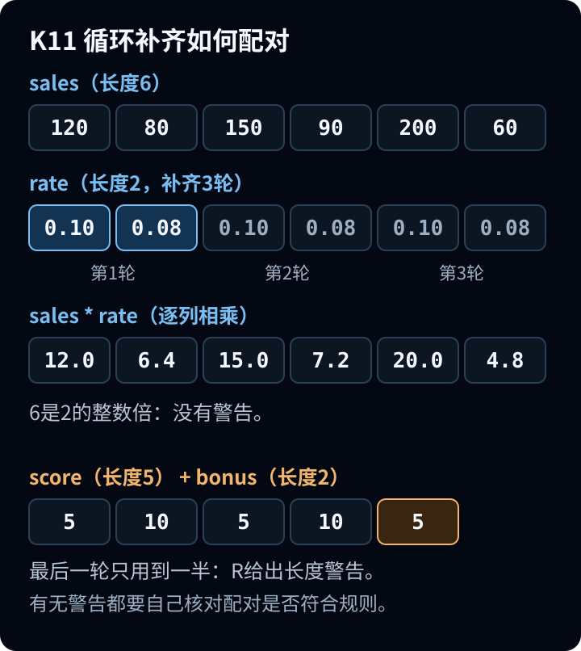

# K11 向量运算与循环补齐

## 基本信息

- 所属单元为向量与字符串。
- 难度为核心。
- 前置知识为K09。
- 关联知识为K09、K13、K21、K33。
- 编写人为Claude（AI辅助编写），样品版本为1.0，日期为2026年11月15日。
- 例题和练习数据均为原创模拟教学数据。
- 验证状态为待R实测。

## 学习目标

- 能够用向量化运算一次完成逐元素计算，不写循环。
- 能够解释循环补齐规则，并预测长度不同的两个向量运算的结果。
- 能够在计算前主动检查长度，区分“有警告的错误”和“没有警告的错误”。

## 先备检查

1. `c(1, 2, 3) * 2`的结果是什么？预期回答为`2 4 6`。
2. 怎样得到一个向量有几个元素？预期回答为使用`length()`。

## 直观理解

两个向量做加减乘除时，R把它们按位置一一配对，第1个对第1个，第2个对第2个。长度不同时，短的那个会从头开始重复使用，直到补齐长的那个，这就是循环补齐。长度为1的向量重复使用最常见，例如给所有价格打九折。只有长的长度不是短的整数倍时R才会警告，整数倍时即使配对不符合业务含义也不会提醒。

## 为什么

1. 为什么`price * 0.9`能对每个价格打折？0.9是长度为1的向量，循环补齐后与每个价格配对。
2. 为什么`1:6 + c(10, 20)`没有警告？6是2的整数倍，补齐恰好完整，R认为这是有意为之。
3. 为什么出现长度警告后仍然返回了结果？警告只提示可能有问题，计算照常进行，所以必须阅读警告并判断结果是否可用。

## 基础例题

四种商品的单价和数量逐项相乘得到金额，再演示长度为1和长度为2的补齐。

独立脚本见[K11_example_01.R](../ai_tutor/content_assets/code/K11_example_01.R)。

```r
price <- c(12, 8, 15, 20)
qty <- c(3, 5, 2, 1)
print(price * qty)
print(sum(price * qty))
print(price * 0.9)
print(price + c(1, 2))
```

### 预期输出（待R实测）

```text
[1] 36 40 30 20
[1] 126
[1] 10.8  7.2 13.5 18.0
[1] 13 10 16 22
```

### 逐步讲解

1. `price * qty`按位置相乘，得到每种商品的金额。
2. `sum()`把四项金额加总为126元。
3. 0.9循环使用四次，所有价格统一打九折，输出统一显示一位小数。
4. `c(1, 2)`被补齐为`1 2 1 2`，第1、3项加1，第2、4项加2。

## 应用例题

六条销售记录按A店、B店交替排列，A店佣金率为10%，B店为8%。需要计算每条记录的佣金，并确认简写的费率向量与完整写法结果一致。

独立脚本见[K11_example_02.R](../ai_tutor/content_assets/code/K11_example_02.R)。

```r
sales <- c(120, 80, 150, 90, 200, 60)
rate <- c(0.10, 0.08)
print(length(sales) %% length(rate) == 0)
commission <- sales * rate
print(commission)
print(sum(commission))
rate_full <- rep(c(0.10, 0.08), times = 3)
print(identical(commission, sales * rate_full))
```

### 预期输出（待R实测）

```text
[1] TRUE
[1] 12.0  6.4 15.0  7.2 20.0  4.8
[1] 65.4
[1] TRUE
```

### 逐步讲解

1. 先用余数检查6能否被2整除，确认补齐完整。
2. 费率按`0.10 0.08 0.10 0.08 0.10 0.08`配对，得到每条佣金。
3. 六条佣金合计65.4元。
4. 用`rep()`写出完整费率后结果完全相同，说明简写确实表达了交替规则。

这个写法成立的前提是记录严格按A、B交替排列。如果数据经过排序或删除，交替关系被打破，补齐不会报警，结果却会错配，因此更稳妥的做法是为每条记录保存门店列，再按门店取费率。

## 图解方案

图名为“循环补齐如何配对”，采用对齐图，以SVG手绘。上排是长度为6的销售额，下排是长度为2的费率，下排用两种颜色和编号标出重复的第1轮、第2轮、第3轮。



图同时给出“整数倍、无警告”和“非整数倍、有警告”两种情况，提醒学生两种情况都要自己确认配对是否符合业务含义。

## 易错案例

给五名学生加分，本想第1名加5分、其余加10分，却只写了两个数，R补齐后发出警告。

```r
score <- c(80, 90, 70, 60, 85)
bonus <- c(5, 10)
print(score + bonus)
```

### 实际错误或异常结果（待R实测）

```text
[1]  85 100  75  70  90
Warning message:
In score + bonus :
  longer object length is not a multiple of shorter object length
```

参考修正写出与成绩等长的加分向量，并在计算前检查长度。

```r
score <- c(80, 90, 70, 60, 85)
bonus <- c(5, 10, 10, 10, 10)
stopifnot(length(bonus) == length(score))
print(score + bonus)
```

### 预期输出（待R实测）

```text
[1]  85 100  80  70  95
```

警告来自长度不成整数倍，但即使长度恰好是整数倍，交替补齐也可能与本意不符。加分规则应该写成与数据一一对应的形式，`stopifnot()`可以在长度不符时立即停下。

## 完整练习

向量`a`为`1:6`。要求判断它分别与长度为1、2、3、4的向量运算时是否会完整补齐，并计算`a`乘以`c(1, -1)`、`a`加上`c(1, 2, 3)`的结果，说明哪一种结果最可能是“看起来正常、实际错配”。

提示使用`%%`求余数，名称可以让判断结果更易读。

独立脚本见[K11_exercise.R](../ai_tutor/content_assets/code/K11_exercise.R)。

```r
a <- 1:6
lens <- c(scalar = 1, pair = 2, triple = 3, four = 4)
print(length(a) %% lens == 0)
print(a * c(1, -1))
print(a + c(1, 2, 3))
```

### 预期输出（待R实测）

```text
scalar   pair triple   four 
  TRUE   TRUE   TRUE  FALSE 
[1]  1 -2  3 -4  5 -6
[1] 2 4 6 5 7 9
```

评分共10分，余数判断得3分，两项运算结果正确得4分，能说明“长度为2和3时没有警告，但必须对照业务规则确认配对”得3分。常见错误是认为没有警告就一定正确，或者把余数判断写成`length(a) / lens`。

## 自测题

1. 预测下面三行的输出。

```r
print(c(1, 2, 3, 4) * c(10, 100))
print(c(2, 4, 6) / 2)
print(length(1:10 + 1))
```

### 预期输出（待R实测）

```text
[1]  10 200  30 400
[1] 1 2 3
[1] 10
```

答案依次为`10 200 30 400`、`1 2 3`和10。补齐后结果长度等于较长的向量。

2. 两个向量运算时没有出现警告，能否说明它们的长度相等？答案为否。长度成整数倍时也不会警告，例如长度6与长度2。

## 追问建议

- 例题请求用向量化写法把一组摄氏温度换算成华氏温度。
- 易错点请求解释什么情况下补齐会悄悄错配。
- 练习请求为加分规则写一个长度检查并给出中文提示。
- 相关知识继续学习K21，比较元素乘法`*`与矩阵乘法`%*%`。

## 来源与验证

- 课程来源为[S4《R数据科学_译本.pdf》第15章 PDF 235–237](../../成员一/R数据科学_译本.pdf#page=235)。
- 课程来源为[S3《CH2R语言数据操作课件.pdf》PDF 34](../../成员一/CH2R语言数据操作课件.pdf#page=34)。
- 补充来源为R官方帮助主题`help("Arithmetic")`、`help("stopifnot")`。
- 本文代码尚未在R中运行，输出为编写者依据R规则推算的预期结果。警告文字的换行方式可能随平台不同，核对脚本只比对文字内容。
- 核对方法为在ai_tutor目录运行`python scripts/check_r_outputs.py K11`，全部通过后加`--write`标记为已实测。
- 图解为SVG手绘，未附生成脚本。
