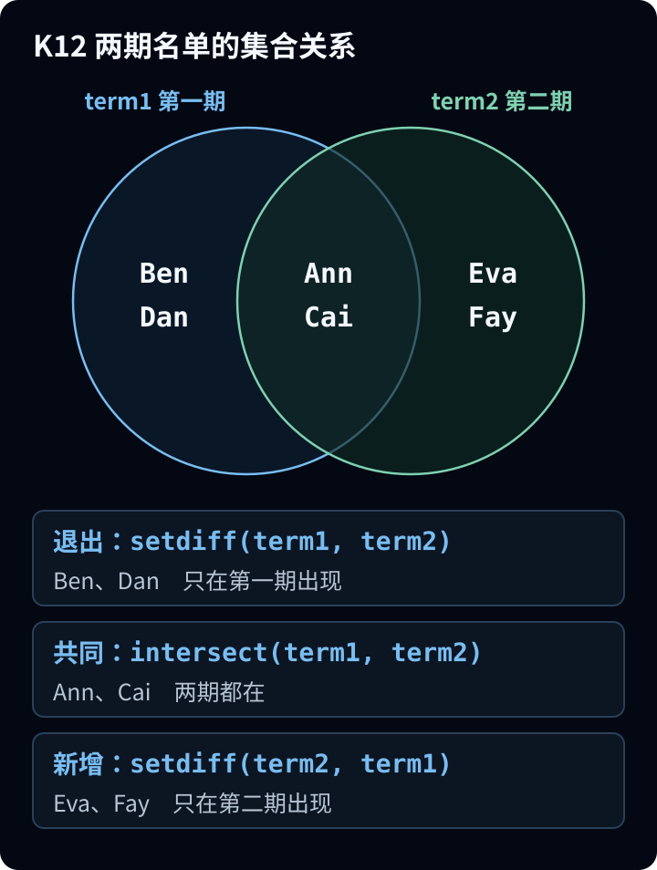

# K12 集合、匹配与成员判断

## 基本信息

- 所属单元为向量与字符串。
- 难度为核心。
- 前置知识为K09、K10。
- 关联知识为K10、K27、K34。
- 编写人为Claude（AI辅助编写），样品版本为1.0，日期为2026年11月15日。
- 例题和练习数据均为原创模拟教学数据。
- 验证状态为待R实测。

## 学习目标

- 能够用`unique()`、`%in%`判断名单中的重复与成员关系。
- 能够用`match()`把一张表的数据按另一张名单的顺序对齐，并识别未匹配的位置。
- 能够正确选择`setdiff()`的方向，得到“新增”或“退出”人员。

## 先备检查

1. `c(TRUE, FALSE, TRUE)`取反后是什么？预期回答为`FALSE TRUE FALSE`。
2. `x[c(2, 1)]`返回什么顺序？预期回答为先第2个、后第1个。

## 直观理解

处理名单时常问三类问题：谁在里面，谁在两边都有，谁只在一边。`%in%`对左边每个元素回答“在不在右边”，结果和左边一样长。`match()`更进一步，回答“在右边第几个位置”，找不到就给`NA`，于是可以按这些位置把另一张表的数据搬过来对齐。集合函数`union()`、`intersect()`、`setdiff()`只关心出现与否，结果会去重。

## 为什么

1. 为什么`setdiff(a, b)`和`setdiff(b, a)`不同？它表示“在第一个里面、但不在第二个里面”，方向决定了要找的是哪一边独有的人。
2. 为什么`match()`遇到重复值只返回第一个位置？它的任务是给出可以用来取值的单个位置，所以在查找表中遇到重复时只取第一次出现。查找表本身有重复时，应先检查是否为录入错误。
3. 为什么`%in%`比`==`更适合判断名单成员？`==`按位置逐个比较，两个名单长度不同会循环补齐；`%in%`把右边当作整体集合来查找。

## 基础例题

班级名单有5人，签到记录中有人重复签到。找出实际到场的人、未到的人，以及两个人在名单中的位置。

独立脚本见[K12_example_01.R](../ai_tutor/content_assets/code/K12_example_01.R)。

```r
roster <- c("Ann", "Ben", "Cai", "Dan", "Eva")
present <- c("Ben", "Eva", "Ann", "Ben")
print(unique(present))
print(roster %in% present)
print(roster[!roster %in% present])
print(match(c("Eva", "Zoe"), roster))
```

### 预期输出（待R实测）

```text
[1] "Ben" "Eva" "Ann"
[1]  TRUE  TRUE FALSE FALSE  TRUE
[1] "Cai" "Dan"
[1]  5 NA
```

### 逐步讲解

1. `unique()`去掉重复签到，按首次出现的顺序保留3人。
2. `%in%`对名单的每个人回答是否签到，结果长度与名单相同。
3. 取反后作为逻辑索引，得到未到的Cai和Dan。
4. `match()`找到Eva在第5位，Zoe不在名单中，得到`NA`。

## 应用例题

成绩表的学生顺序与班级名单不同，且Cai没有成绩。需要把成绩按名单顺序对齐，并列出缺少成绩的人。

独立脚本见[K12_example_02.R](../ai_tutor/content_assets/code/K12_example_02.R)。

```r
roster <- c("Ann", "Ben", "Cai", "Dan")
grade_id <- c("Dan", "Ann", "Ben")
grade <- c(88, 92, 75)
pos <- match(roster, grade_id)
print(pos)
aligned <- grade[pos]
print(aligned)
print(roster[is.na(aligned)])
```

### 预期输出（待R实测）

```text
[1]  2  3 NA  1
[1] 92 75 NA 88
[1] "Cai"
```

### 逐步讲解

1. `match(roster, grade_id)`按名单顺序给出每人在成绩表中的位置。
2. 用这些位置取成绩，Cai对应`NA`，成绩自动按名单排好。
3. 对齐后的缺失位置就是缺少成绩的学生。

这里只能说明成绩表中没有Cai的记录，不能说明他缺考，也可能是录入遗漏。数据框的合并在K27学习，原理与这里的按键对齐相同。

## 图解方案

图名为“两期名单的集合关系”，采用维恩图，以SVG手绘。左圆为第一期名单，右圆为第二期名单，三块区域分别标出`setdiff(term1, term2)`、`intersect()`和`setdiff(term2, term1)`的结果。



图把函数调用写在对应区域旁边，强调`setdiff()`的方向就是“从哪个圆里扣掉重叠部分”。

## 易错案例

想找出本期退出的人，却把`setdiff()`的两个参数写反，得到的是新加入的人。

```r
old <- c("Ann", "Ben", "Cai")
new <- c("Ben", "Cai", "Dan", "Eva")
left <- setdiff(new, old)
print(left)
```

### 实际错误或异常结果（待R实测）

```text
[1] "Dan" "Eva"
```

参考修正把旧名单放在第一个参数，表示“在旧名单中、不在新名单中”。

```r
old <- c("Ann", "Ben", "Cai")
new <- c("Ben", "Cai", "Dan", "Eva")
left <- setdiff(old, new)
print(left)
```

### 预期输出（待R实测）

```text
[1] "Ann"
```

这段代码没有报错，只有对照题意才能发现方向错误。名单中的姓名还要先统一大小写和空格，否则同一个人可能被当成两个人。

## 完整练习

两学期选课名单如下，第一期名单中Ben重复录入。要求输出新增人员、退出人员、两期都在的人员，以及两期合计涉及的不同人数。

提示：集合函数会自动去重，新增与退出要注意参数方向。

独立脚本见[K12_exercise.R](../ai_tutor/content_assets/code/K12_exercise.R)。

```r
term1 <- c("Ann", "Ben", "Cai", "Dan", "Ben")
term2 <- c("Cai", "Eva", "Ann", "Fay")
print(setdiff(term2, term1))
print(setdiff(term1, term2))
print(intersect(term1, term2))
print(length(union(term1, term2)))
```

### 预期输出（待R实测）

```text
[1] "Eva" "Fay"
[1] "Ben" "Dan"
[1] "Ann" "Cai"
[1] 6
```

评分共10分，新增与退出方向正确各得3分，共同人员得2分，合计人数得2分。常见错误是用`length(term1) + length(term2)`计算人数，重复录入和两期都在的人都会被多算。

## 自测题

1. 预测下面三行的输出。

```r
x <- c(3, 1, 3, 2)
print(unique(x))
print(match(3, x))
print(c(2, 5) %in% x)
```

### 预期输出（待R实测）

```text
[1] 3 1 2
[1] 1
[1]  TRUE FALSE
```

`unique()`保留首次出现的顺序，`match()`只返回第一个3的位置，`%in%`结果长度跟随左边。

2. `intersect(c(1, 1, 2), c(1, 2, 2))`的结果有几个元素？答案为2个，即`1 2`，集合运算的结果不含重复。

## 追问建议

- 例题请求用`match()`把学号对应到姓名。
- 易错点请求说明`==`与`%in%`在名单比较中的区别。
- 练习请求把新增和退出人员分别整理成一句汇报文字。
- 相关知识继续学习K27的数据框合并，理解连接键与未匹配行。

## 来源与验证

- 课程来源为[S3《CH2R语言数据操作课件.pdf》PDF 33、38](../../成员一/CH2R语言数据操作课件.pdf#page=33)。
- 补充来源为R官方帮助主题`help("match")`、`help("sets")`、`help("unique")`。
- 本文代码尚未在R中运行，输出为编写者依据R规则推算的预期结果。
- 核对方法为在ai_tutor目录运行`python scripts/check_r_outputs.py K12`，全部通过后加`--write`标记为已实测。
- 图解为SVG手绘，未附生成脚本。
