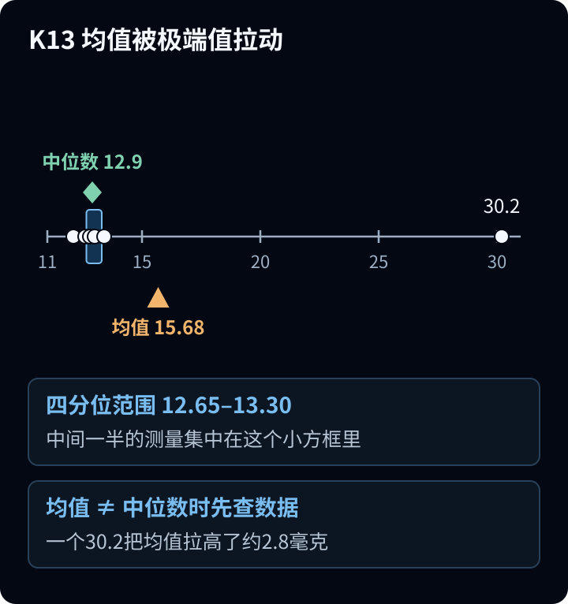

# K13 数值汇总

## 基本信息

- 所属单元为向量与字符串。
- 难度为核心。
- 前置知识为K06、K09。
- 关联知识为K06、K28、K30、K32、K35。
- 编写人为Claude（AI辅助编写），样品版本为1.0，日期为2026年11月15日。
- 例题和练习数据均为原创模拟教学数据。
- 验证状态为待R实测。

## 学习目标

- 能够计算均值、中位数、标准差、极差和分位数，并说明各自概括的是什么。
- 能够解释极端值对均值和中位数的不同影响。
- 能够在有缺失值时正确统计有效样本数，并报告`na.rm`的处理规则。

## 先备检查

1. `mean(c(60, NA, 80))`的结果是什么？预期回答为`NA`。
2. `sum(c(TRUE, FALSE, TRUE))`等于多少？预期回答为2，逻辑值求和时`TRUE`按1计算。

## 直观理解

汇总是用几个数概括一组数。均值和中位数描述“中间在哪里”，标准差和极差描述“分散得多开”，分位数描述“排在某个百分位的值是多少”。均值会被个别极端值拉动，中位数只看排在中间的值，因此两者差距大时要回头检查数据。计算前先确认单位和缺失值，报告时写明用了多少个有效值。

## 为什么

1. 为什么两组均值相同，结论仍可能不同？均值只描述中心位置，波动大小要看标准差或极差，两组可能一组稳定、一组忽高忽低。
2. 为什么`length(x)`不等于有效样本数？`length()`数的是元素个数，缺失值也算一个元素。有效样本数应写成`sum(!is.na(x))`。
3. 为什么R的`sd()`除以`n - 1`？`sd()`计算样本标准差，用于根据样本估计总体波动。教材或软件使用总体标准差时结果会略有差异。

## 基础例题

两组各5名学生的成绩均值和中位数都是78分，比较它们的波动。

独立脚本见[K13_example_01.R](../ai_tutor/content_assets/code/K13_example_01.R)。

```r
a <- c(72, 75, 78, 80, 85)
b <- c(55, 68, 78, 90, 99)
print(c(mean = mean(a), median = median(a), sd = round(sd(a), 2)))
print(c(mean = mean(b), median = median(b), sd = round(sd(b), 2)))
print(range(b))
```

### 预期输出（待R实测）

```text
  mean median     sd 
 78.00  78.00   4.95 
  mean median     sd 
 78.00  78.00  17.42 
[1] 55 99
```

### 逐步讲解

1. 两组总分都是390分，均值都是78分。
2. 排序后第3个值都是78，中位数相同。
3. A组标准差约4.95分，B组约17.42分，B组成绩分散得多。
4. `range()`给出最小值和最大值，B组跨度为44分。
5. 同一向量中的数值统一显示两位小数，所以78显示为78.00。

## 应用例题

七次实验测量值的单位为毫克，其中一次漏测，另一次记录为30.2毫克，明显偏高。需要报告有效次数，并比较均值、中位数和四分位数。

独立脚本见[K13_example_02.R](../ai_tutor/content_assets/code/K13_example_02.R)。

```r
x <- c(12.1, 13.4, NA, 12.8, 30.2, 13.0, 12.6)
print(c(n = length(x), valid = sum(!is.na(x))))
print(mean(x))
print(round(mean(x, na.rm = TRUE), 2))
print(median(x, na.rm = TRUE))
print(quantile(x, c(0.25, 0.75), na.rm = TRUE))
```

### 预期输出（待R实测）

```text
    n valid 
    7     6 
[1] NA
[1] 15.68
[1] 12.9
  25%   75% 
12.65 13.30 
```

### 逐步讲解

1. 共7条记录，有效值6个。
2. 不处理缺失时均值为`NA`，提醒存在缺失。
3. 去掉缺失后均值约15.68毫克，被30.2明显拉高。
4. 中位数12.9毫克更接近大多数测量值。
5. 四分位数说明中间一半的测量集中在12.65到13.30毫克之间。

结果提示30.2值得复核，但不能据此断定它是错误数据，需要查看实验记录。报告中应写明“排除1个缺失值，有效样本6个”。

## 图解方案

图名为“均值被极端值拉动”，采用数轴对比图，以SVG手绘。数轴上标出6个有效测量点，用三角形标出均值15.68、用菱形标出中位数12.9，并用方框标出四分位范围。



图把应用例题的统计量直接标在数据旁边，说明为什么报告偏态数据时要同时给出中位数。

## 易错案例

用`length()`当作样本数手动求均值，把缺失值也算了进去，结果偏低。

```r
x <- c(60, NA, 80, 90)
print(sum(x, na.rm = TRUE) / length(x))
```

### 实际错误或异常结果（待R实测）

```text
[1] 57.5
```

参考修正直接使用`mean()`并去掉缺失值，或者用有效个数作分母。

```r
x <- c(60, NA, 80, 90)
print(mean(x, na.rm = TRUE))
print(sum(x, na.rm = TRUE) / sum(!is.na(x)))
```

### 预期输出（待R实测）

```text
[1] 76.66667
[1] 76.66667
```

修正只说明按有效值计算的平均分。缺考是否应按0分计入，取决于课程评分规则，不能由代码自动决定。

## 完整练习

八次称重的单位为克，第4次漏记。要求制作一份汇总：记录数、有效数、均值、中位数、标准差、最小值和最大值，全部保留两位小数。

提示先取出有效值，再把各统计量放进一个命名向量统一取整。

独立脚本见[K13_exercise.R](../ai_tutor/content_assets/code/K13_exercise.R)。

```r
w <- c(50.2, 49.8, 51.0, NA, 50.5, 49.9, 50.1, 52.4)
valid <- w[!is.na(w)]
res <- c(n = length(w), valid = length(valid), mean = mean(valid),
         median = median(valid), sd = sd(valid), min = min(valid), max = max(valid))
print(round(res, 2))
```

### 预期输出（待R实测）

```text
     n  valid   mean median     sd    min    max 
  8.00   7.00  50.56  50.20   0.91  49.80  52.40 
```

评分共10分，有效值筛选得2分，七项统计量正确得5分，命名与保留小数得3分。常见错误是`n`与`valid`都写成`length(w)`，或者忘记处理缺失导致全部结果为`NA`。

## 自测题

1. 预测均值和中位数。

```r
x <- c(1, 2, 3, 100)
print(mean(x))
print(median(x))
```

### 预期输出（待R实测）

```text
[1] 26.5
[1] 2.5
```

一个极端值把均值拉到26.5，中位数仍为中间两个数2和3的平均值2.5。

2. 分位数`quantile(x, 0.5)`一定等于`median(x)`吗？答案为是。默认算法下0.5分位数就是中位数；其他分位数会因`type`参数不同而略有差异。

## 追问建议

- 例题请求用`summary()`一次得到多个统计量，并比较与手动计算的差异。
- 易错点请求解释样本标准差与总体标准差的区别。
- 练习请求按两个班级分组计算同样的汇总，衔接K30。
- 相关知识继续学习K28的异常值策略，决定30.2这类值如何处理。

## 来源与验证

- 课程来源为[S3《CH2R语言数据操作课件.pdf》PDF 34](../../成员一/CH2R语言数据操作课件.pdf#page=34)。
- 课程来源为S4《R数据科学_译本.pdf》第3章汇总部分。
- 补充来源为R官方帮助主题`help("mean")`、`help("median")`、`help("sd")`、`help("quantile")`。
- 本文代码尚未在R中运行，输出为编写者依据R规则推算的预期结果，均值、标准差和分位数已用Python独立计算核对数值。
- 核对方法为在ai_tutor目录运行`python scripts/check_r_outputs.py K13`，全部通过后加`--write`标记为已实测。
- 图解为SVG手绘，未附生成脚本。
