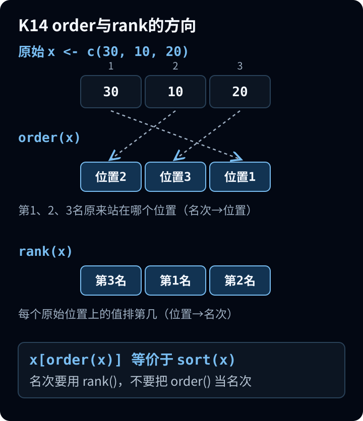

# K14 sort、order与rank

## 基本信息

- 所属单元为向量与字符串。
- 难度为核心。
- 前置知识为K10。
- 关联知识为K10、K27、K39。
- 编写人为Claude（AI辅助编写），样品版本为1.0，日期为2026年11月15日。
- 例题和练习数据均为原创模拟教学数据。
- 验证状态为待R实测。

## 学习目标

- 能够区分`sort()`返回排好的值、`order()`返回排列所需的原位置、`rank()`返回每个原始元素的名次。
- 能够用`order()`让姓名与成绩同步排序，保持一一对应。
- 能够用`ties.method`和`na.last`处理并列名次和缺失值。

## 先备检查

1. `x[c(3, 1, 2)]`的含义是什么？预期回答为按第3、第1、第2的顺序取出元素。
2. `-c(78, 92)`的结果是什么？预期回答为`-78 -92`。

## 直观理解

三个函数回答三个不同问题。`sort()`回答“排好后是哪些值”；`order()`回答“第一名原来站在第几个位置，第二名原来在第几个”，它给的是一份取值顺序表；`rank()`回答“每个人按原来的顺序站着，各自排第几”。要让姓名跟着成绩一起排序，就用`order()`拿到顺序表，再分别去取姓名和成绩。

## 为什么

1. 为什么不能分别对姓名和成绩调用`sort()`？两次排序各按各的规则，姓名按字母、成绩按数值，排完后对应关系就被打乱了。
2. 为什么默认的并列名次是小数？`rank()`默认把并列者的名次取平均，例如并列第4、5名都记为4.5。比赛常用的“并列取最小名次”需要设置`ties.method = "min"`。
3. 为什么`order(x)`和`rank(x)`有时看起来一样？两者互为逆操作，在某些排列下数字恰好相同，但含义不同，不能互相替代。

## 基础例题

五个成绩中有两个并列的92分，比较三个函数的结果。

独立脚本见[K14_example_01.R](../ai_tutor/content_assets/code/K14_example_01.R)。

```r
score <- c(78, 92, 65, 92, 88)
print(sort(score))
print(sort(score, decreasing = TRUE))
print(order(score, decreasing = TRUE))
print(rank(score))
```

### 预期输出（待R实测）

```text
[1] 65 78 88 92 92
[1] 92 92 88 78 65
[1] 2 4 5 1 3
[1] 2.0 4.5 1.0 4.5 3.0
```

### 逐步讲解

1. `sort()`返回升序排列后的成绩。
2. `decreasing = TRUE`改为降序。
3. 降序的顺序表为`2 4 5 1 3`，表示最高分来自第2和第4个位置，并列时保持原来的先后。
4. `rank()`按升序给出名次，两个92分并列第4、5名，都记为4.5。

## 应用例题

五名学生的姓名与成绩分别保存。需要按成绩从高到低列出姓名，并按“并列取最小名次”给每人排名。

独立脚本见[K14_example_02.R](../ai_tutor/content_assets/code/K14_example_02.R)。

```r
name <- c("Ann", "Ben", "Cai", "Dan", "Eva")
score <- c(78, 92, 65, 92, 88)
o <- order(score, decreasing = TRUE)
print(name[o])
print(score[o])
place <- rank(-score, ties.method = "min")
names(place) <- name
print(place)
```

### 预期输出（待R实测）

```text
[1] "Ben" "Dan" "Eva" "Ann" "Cai"
[1] 92 92 88 78 65
Ann Ben Cai Dan Eva 
  4   1   5   1   3 
```

### 逐步讲解

1. `o`是一份共用的顺序表，姓名和成绩都按它取值，对应关系不会被打乱。
2. 高分在前的排名需要对相反数排名，所以写`rank(-score)`。
3. `ties.method = "min"`让Ben和Dan并列第1，下一名Eva为第3名。
4. 给名次加上姓名后，每人的名次一目了然。

排名只反映这五个成绩的相对位置，不能说明成绩差距大小。Ben和Dan并列第一，下一名直接是第3名，这是常见的“跳号”排名方式。

## 图解方案

图名为“order与rank的方向”，采用映射图，以SVG手绘。上排是原始成绩及位置，中间一列用箭头说明`order()`从排序结果指回原位置，下方一列说明`rank()`从原位置指向名次。



图使用自测题中的三个数，箭头方向是理解两者差异的关键：`order()`从“名次”指向“原位置”，`rank()`从“原位置”指向“名次”。

## 易错案例

想得到每个人的名次，却用了`order()`，把顺序表误当作名次。

```r
score <- c(78, 92, 65)
place <- order(score)
print(place)
```

### 实际错误或异常结果（待R实测）

```text
[1] 3 1 2
```

参考修正使用`rank()`，第1个人78分排第2，第2个人92分排第3，第3个人65分排第1。

```r
score <- c(78, 92, 65)
place <- rank(score)
print(place)
```

### 预期输出（待R实测）

```text
[1] 2 3 1
```

两段代码都能运行，只有对照每个人的实际名次才能发现错误。检查方法是挑一个人手算名次，看结果是否对得上。

## 完整练习

六名选手的百米成绩以秒为单位，用时越短越好，其中R3未完成比赛。要求列出从快到慢的出场顺序（未完成者排最后），给出并列取最小名次的排名并保留缺失，最后列出所有有效成绩。

提示`order()`默认把缺失值放在最后，`rank()`需要设置`na.last = "keep"`才能保留缺失。

独立脚本见[K14_exercise.R](../ai_tutor/content_assets/code/K14_exercise.R)。

```r
runner <- c("R1", "R2", "R3", "R4", "R5", "R6")
time <- c(12.8, 11.9, NA, 12.8, 13.5, 11.9)
o <- order(time)
print(runner[o])
place <- rank(time, ties.method = "min", na.last = "keep")
names(place) <- runner
print(place)
print(sort(time))
```

### 预期输出（待R实测）

```text
[1] "R2" "R6" "R1" "R4" "R5" "R3"
R1 R2 R3 R4 R5 R6 
 3  1 NA  3  5  1 
[1] 11.9 11.9 12.8 12.8 13.5
```

评分共10分，顺序正确得3分，排名的并列与缺失处理得4分，有效成绩列表得3分。常见错误是对用时使用`decreasing = TRUE`，把最慢的选手排在第一；或者未处理缺失，让R3得到一个名次。注意`sort()`默认会直接去掉缺失值。

## 自测题

1. 预测下面三行的输出。

```r
x <- c(30, 10, 20)
print(order(x))
print(rank(x))
print(x[order(x)])
```

### 预期输出（待R实测）

```text
[1] 2 3 1
[1] 3 1 2
[1] 10 20 30
```

`order()`说最小值在位置2，`rank()`说位置1的30排第3，用`order()`的结果取值等价于`sort(x)`。

2. 想按两个条件排序，先按班级、再按成绩，可以只用一次`order()`吗？答案为可以，写成`order(class, score)`，前面的参数优先。

## 追问建议

- 例题请求按成绩降序、成绩相同时按姓名升序排列。
- 易错点请求比较`ties.method`的average、min、first三种结果。
- 练习请求为前三名选手生成颁奖名单。
- 相关知识继续学习K27的数据框排序与合并。

## 来源与验证

- 课程来源为[S3《CH2R语言数据操作课件.pdf》PDF 35–37](../../成员一/CH2R语言数据操作课件.pdf#page=35)。
- 补充来源为R官方帮助主题`help("sort")`、`help("order")`、`help("rank")`。
- 本文代码尚未在R中运行，输出为编写者依据R规则推算的预期结果。
- 核对方法为在ai_tutor目录运行`python scripts/check_r_outputs.py K14`，全部通过后加`--write`标记为已实测。
- 图解为SVG手绘，未附生成脚本。
