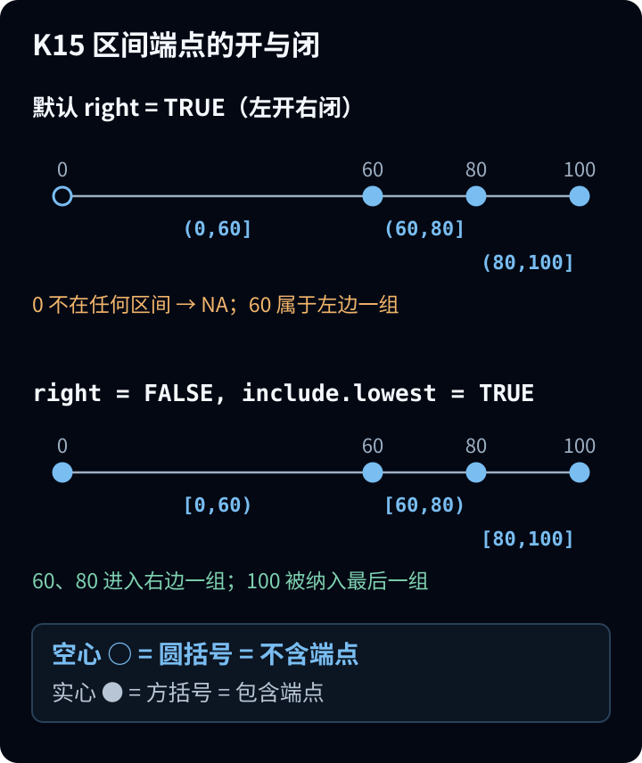

# K15 cut分组与区间边界

## 基本信息

- 所属单元为向量与字符串。
- 难度为核心。
- 前置知识为K07、K09。
- 关联知识为K07、K09、K30。
- 编写人为Claude（AI辅助编写），样品版本为1.0，日期为2026年11月15日。
- 例题和练习数据均为原创模拟教学数据。
- 验证状态为待R实测。

## 学习目标

- 能够读懂`(60,90]`和`[60,90)`这类区间标记，判断端点归属哪一组。
- 能够用`right`和`include.lowest`控制边界值的分组。
- 能够用专门的边界测试值和`anyNA()`检查分组规则是否完整。

## 先备检查

1. 因子的“水平”是什么？预期回答为因子可能取到的类别及其顺序。
2. `60 <= 60`和`60 < 60`分别是什么？预期回答为`TRUE`和`FALSE`。

## 直观理解

`cut()`把一条数轴按分界点切成几段，再把每个数字放进它所在的那一段，得到一个因子。关键是分界点本身归哪一段：圆括号表示不含端点，方括号表示包含端点。默认`right = TRUE`是“左开右闭”，60落在`(0,60]`；改成`right = FALSE`变成“左闭右开”，60落在`[60,90)`。最外侧的端点默认不含，需要`include.lowest = TRUE`才会被纳入，否则会变成`NA`。

## 为什么

1. 为什么默认分组中最小的0分变成了`NA`？默认第一段是`(0,60]`，圆括号表示不含0，0不在任何一段里。
2. 为什么`right = FALSE`时还要`include.lowest = TRUE`？左闭右开时，最后一段的右端点不含，满分100会落空。此时`include.lowest`实际作用于最高端点。
3. 为什么`labels`的数量要比`breaks`少1？n个分界点切出n-1段，每段对应一个标签。

## 基础例题

用同一组分界点，比较默认的“左开右闭”和`right = FALSE`的“左闭右开”对临界分数的影响。

独立脚本见[K15_example_01.R](../ai_tutor/content_assets/code/K15_example_01.R)。

```r
score <- c(59, 60, 75, 89, 90, 100)
g1 <- cut(score, breaks = c(0, 60, 90, 100))
print(g1)
g2 <- cut(score, breaks = c(0, 60, 90, 100), right = FALSE)
print(g2)
```

### 预期输出（待R实测）

```text
[1] (0,60]   (0,60]   (60,90]  (60,90]  (60,90]  (90,100]
Levels: (0,60] (60,90] (90,100]
[1] [0,60)   [60,90)  [60,90)  [60,90)  [90,100) <NA>    
Levels: [0,60) [60,90) [90,100)
```

### 逐步讲解

1. 默认右闭时，60归入`(0,60]`，90归入`(60,90]`。
2. 改为左闭后，60归入`[60,90)`，90归入`[90,100)`。
3. 左闭右开时最后一段不含100，满分变成了`<NA>`。
4. 第二个结果说明只改`right`会带来新的缺口，需要配合`include.lowest`。

## 应用例题

按“60分及以上为B、80分及以上为A”评级，满分100分也要得A，0分也要有等级。用临界值专门测试规则。

独立脚本见[K15_example_02.R](../ai_tutor/content_assets/code/K15_example_02.R)。

```r
score <- c(0, 59.5, 60, 79.9, 80, 100)
grade <- cut(score, breaks = c(0, 60, 80, 100), labels = c("C", "B", "A"),
             right = FALSE, include.lowest = TRUE)
print(grade)
print(table(grade))
```

### 预期输出（待R实测）

```text
[1] C C B B A A
Levels: C B A
grade
C B A 
2 2 2 
```

### 逐步讲解

1. `right = FALSE`让区间变为`[0,60)`、`[60,80)`、`[80,100]`，60和80分别进入较高一档。
2. `include.lowest = TRUE`在左闭时把最高端点100纳入最后一段。
3. 测试值覆盖了0、刚低于60、恰好60、刚低于80、恰好80和100，每个边界都有落点。
4. `table()`确认每档各有2个测试值，没有`NA`。

这组测试只能证明分组规则符合设定，不能说明59.5分是否应该四舍五入为60分，那是评分政策问题。

## 图解方案

图名为“区间端点的开与闭”，采用数轴图，以SVG手绘。数轴标出0、60、80、100，空心圆表示不含端点，实心圆表示包含端点，分别画出默认右闭与应用例题中的左闭写法。



空心与实心圆和区间标记的圆括号、方括号一一对应，学生可以对照图判断任意临界值的归属。

## 易错案例

按默认设置分组，0分被丢失，而且60分进入了低分组，与“60分及格”的规则不符。

```r
score <- c(0, 45, 60, 100)
g <- cut(score, breaks = c(0, 60, 100), labels = c("low", "high"))
print(g)
print(sum(is.na(g)))
```

### 实际错误或异常结果（待R实测）

```text
[1] <NA> low  low  high
Levels: low high
[1] 1
```

参考修正改为左闭并纳入最高端点，0分进入低分组，60分进入高分组。

```r
score <- c(0, 45, 60, 100)
g <- cut(score, breaks = c(0, 60, 100), labels = c("low", "high"),
         right = FALSE, include.lowest = TRUE)
print(g)
print(sum(is.na(g)))
```

### 预期输出（待R实测）

```text
[1] low  low  high high
Levels: low high
[1] 0
```

代码没有报错，只有用临界值测试才能发现问题。如果原始数据可能超出0到100，还要另外检查区间外的值，它们同样会成为`NA`。

## 完整练习

为问卷受访者按年龄分组：18岁以下、18到35岁、36到59岁、60岁及以上。要求每个边界年龄都落在正确的组中，统计各组人数，并检查没有遗漏。

提示两端用`-Inf`和`Inf`作分界点，可以避免极端年龄落空。

独立脚本见[K15_exercise.R](../ai_tutor/content_assets/code/K15_exercise.R)。

```r
age <- c(17, 18, 25, 35, 36, 59, 60, 75)
group <- cut(age, breaks = c(-Inf, 18, 36, 60, Inf),
             labels = c("under18", "18-35", "36-59", "60plus"), right = FALSE)
print(table(group))
print(as.character(group[age %in% c(18, 36, 60)]))
print(anyNA(group))
```

### 预期输出（待R实测）

```text
group
under18   18-35   36-59  60plus 
      1       3       2       2 
[1] "18-35"  "36-59"  "60plus"
[1] FALSE
```

评分共10分，分界点和`right`设置正确得4分，标签数量与顺序得2分，边界检查得2分，无遗漏检查得2分。常见错误是使用默认右闭，导致18岁被分到“18岁以下”；或者分界点只写到60，75岁变成`NA`。

## 自测题

1. 预测输出。

```r
print(cut(c(10, 20), breaks = c(10, 20, 30)))
```

### 预期输出（待R实测）

```text
[1] <NA>    (10,20]
Levels: (10,20] (20,30]
```

默认左开，10不属于`(10,20]`；20是第一段的右端点，被包含在内。

2. `breaks = c(0, 50, 100)`配`labels = c("low", "mid", "high")`能运行吗？答案为否。两个区间配三个标签，数量不一致会报错。

## 追问建议

- 例题请求用`breaks = 3`让R自动等宽分成三组，并解释边界的来源。
- 易错点请求说明`right`与`include.lowest`组合时各端点的归属。
- 练习请求按年龄组计算平均收入，衔接K30分组汇总。
- 相关知识继续学习K07因子，修改分组后的水平顺序。

## 来源与验证

- 课程来源为[S3《CH2R语言数据操作课件.pdf》PDF 38–39](../../成员一/CH2R语言数据操作课件.pdf#page=38)。
- 补充来源为R官方帮助主题`help("cut")`、`help("table")`。
- 本文代码尚未在R中运行，输出为编写者依据R规则推算的预期结果。
- 核对方法为在ai_tutor目录运行`python scripts/check_r_outputs.py K15`，全部通过后加`--write`标记为已实测。
- 图解为SVG手绘，未附生成脚本。
