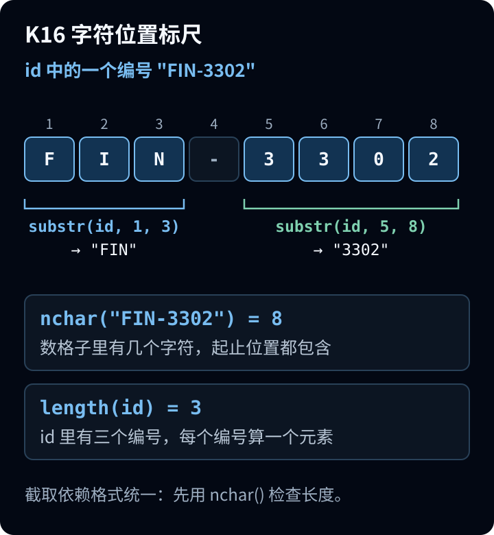

# K16 字符长度与截取

## 基本信息

- 所属单元为向量与字符串。
- 难度为核心。
- 前置知识为K04、K09。
- 关联知识为K04、K08、K17、K18。
- 编写人为Claude（AI辅助编写），样品版本为1.0，日期为2026年11月15日。
- 例题和练习数据均为原创模拟教学数据。
- 验证状态为待R实测。

## 学习目标

- 能够区分`length()`统计元素个数与`nchar()`统计每个字符串的字符数。
- 能够用`substr()`按起止位置截取，并预测截取范围超出字符串长度时的结果。
- 能够从格式统一的编号中拆出各部分，并在截取前检查长度是否一致。

## 先备检查

1. `c("ab", "cde")`有几个元素？预期回答为2个。
2. `as.integer("2026")`的结果是什么类型？预期回答为整数型。

## 直观理解

一个字符向量像一排盒子，每个盒子里放一段文字。`length()`数盒子有几个，`nchar()`数每个盒子里的文字有几个字符。`substr(x, start, stop)`在每段文字上放一把标尺，取出从第`start`个到第`stop`个字符，两端都包含。中文、英文和数字都按一个字符计算，但在文件中占用的字节数不同，所以统计长度时应使用默认的字符计数。

## 为什么

1. 为什么`length("Data Science")`是1？整段文字是一个元素，`length()`不看文字内部。
2. 为什么截取位置超出文字长度时不报错？`substr()`只返回实际存在的部分，超出范围的位置得到空字符串，因此长度不一致的编号会悄悄得到错误结果。
3. 为什么`nchar("R语言")`是3而不是更大的数？默认`type = "chars"`统计字符个数；改用`type = "bytes"`时，UTF-8编码下的中文字符会占多个字节。

## 基础例题

三个课程代码长度不同，比较元素个数、每个代码的字符数，以及截取前4个字符和第5个字符以后的结果。

独立脚本见[K16_example_01.R](../ai_tutor/content_assets/code/K16_example_01.R)。

```r
code <- c("STAT101", "MATH2", "R语言")
print(length(code))
print(nchar(code))
print(substr(code, 1, 4))
print(substr(code, 5, nchar(code)))
```

### 预期输出（待R实测）

```text
[1] 3
[1] 7 5 3
[1] "STAT"  "MATH"  "R语言"
[1] "101" "2"   ""
```

### 逐步讲解

1. `length()`得到3个代码。
2. `nchar()`逐个统计，中文字符也按1个计算。
3. 截取1到4位时，“R语言”只有3个字符，原样返回。
4. `stop`使用每个元素自己的长度，第3个代码从第5位开始已经没有字符，得到空字符串。
5. 中文字符在屏幕上较宽，R按显示宽度对齐，所以第3行的间距看起来不同。

## 应用例题

财务科目编号统一为“三位字母-四位数字”，例如`ECO-2101`。需要拆出院系代码和课程序号，取出序号的首位数字判断年级，并确认所有编号长度都为8。

独立脚本见[K16_example_02.R](../ai_tutor/content_assets/code/K16_example_02.R)。

```r
id <- c("ECO-2101", "FIN-3302", "ACC-1105")
print(all(nchar(id) == 8))
dept <- substr(id, 1, 3)
num <- substr(id, 5, 8)
print(dept)
print(num)
print(as.integer(substr(num, 1, 1)))
```

### 预期输出（待R实测）

```text
[1] TRUE
[1] "ECO" "FIN" "ACC"
[1] "2101" "3302" "1105"
[1] 2 3 1
```

### 逐步讲解

1. 先确认所有编号长度相同，位置截取才可靠。
2. 第1到3位是院系代码，第4位是连字符，第5到8位是数字序号。
3. 截取结果仍为字符型，前导的数字不会丢失。
4. 序号首位转换为整数后，可以按年级比较或分组。

截取依赖“格式完全统一”这一前提。如果编号中混入`FIN-302`这类缺位记录，长度检查会返回`FALSE`，应先找出这些记录，再考虑用K18的正则表达式按模式拆分。

## 图解方案

图名为“字符位置标尺”，采用标尺图，以SVG手绘。把`FIN-3302`的8个字符放进带编号的格子，上方用括号标出`substr(id, 1, 3)`和`substr(id, 5, 8)`覆盖的范围，下方对比`nchar()`与`length()`统计的对象。



标尺让学生在写`substr()`参数前先数清位置，两端包含的规则在图上通过括号覆盖的格子直接体现。

## 易错案例

想知道标题有多少个字符，却用了`length()`，得到的是元素个数。

```r
title <- "Data Science"
print(length(title))
```

### 实际错误或异常结果（待R实测）

```text
[1] 1
```

参考修正使用`nchar()`，空格也算一个字符。

```r
title <- "Data Science"
print(nchar(title))
```

### 预期输出（待R实测）

```text
[1] 12
```

两个函数都不会报错，判断依据是问题本身问的是“几段文字”还是“文字里几个字符”。如果文字是从文件读入的，还需确认编码正确，乱码会让字符数失真。

## 完整练习

三张发票编号的格式为`INV`加四位年份、连字符和四位流水号，例如`INV2026-0012`。要求提取年份和流水号并转为整数，确认所有编号长度为12，最后列出2026年的发票编号。

提示先数清年份所在的位置，流水号转整数后会去掉前导零。

独立脚本见[K16_exercise.R](../ai_tutor/content_assets/code/K16_exercise.R)。

```r
inv <- c("INV2026-0012", "INV2025-0307", "INV2026-1150")
print(all(nchar(inv) == 12))
year <- as.integer(substr(inv, 4, 7))
seq_no <- as.integer(substr(inv, 9, 12))
print(year)
print(seq_no)
print(inv[year == 2026])
```

### 预期输出（待R实测）

```text
[1] TRUE
[1] 2026 2025 2026
[1]   12  307 1150
[1] "INV2026-0012" "INV2026-1150"
```

评分共10分，长度检查得2分，年份与流水号位置正确各得3分，按年份筛选得2分。常见错误是把年份写成`substr(inv, 3, 6)`，把字母V也截进来，转整数时得到`NA`并伴随警告。

## 自测题

1. 预测下面三行的输出。

```r
x <- c("apple", "kiwi")
print(nchar(x))
print(substr(x, 2, 3))
print(length(x))
```

### 预期输出（待R实测）

```text
[1] 5 4
[1] "pp" "iw"
[1] 2
```

`substr()`对每个元素分别截取第2到第3个字符，`length()`统计元素个数。

2. `substr("2026-11-15", 6, 7)`能取到月份吗？答案为能，结果为字符`"11"`。但日期处理更推荐K08的日期函数，它能检查日期是否合法。

## 追问建议

- 例题请求从文件名`report_2026Q3.csv`中截取季度。
- 易错点请求解释`nchar(type = "bytes")`在中文文本中的结果。
- 练习请求处理长度不一致的编号，并列出需要人工复核的记录。
- 相关知识继续学习K17，把截取出的部分重新拼接成新编号。

## 来源与验证

- 课程来源为[S3《CH2R语言数据操作课件.pdf》PDF 40–41](../../成员一/CH2R语言数据操作课件.pdf#page=40)。
- 课程来源为[S4《R数据科学_译本.pdf》第10章 PDF 160–163](../../成员一/R数据科学_译本.pdf#page=160)。
- 补充来源为R官方帮助主题`help("nchar")`、`help("substr")`。
- 本文代码尚未在R中运行，输出为编写者依据R规则推算的预期结果。含中文字符的输出对齐依赖UTF-8区域设置，核对时需在UTF-8环境运行。
- 核对方法为在ai_tutor目录运行`python scripts/check_r_outputs.py K16`，全部通过后加`--write`标记为已实测。
- 图解为SVG手绘，未附生成脚本。
