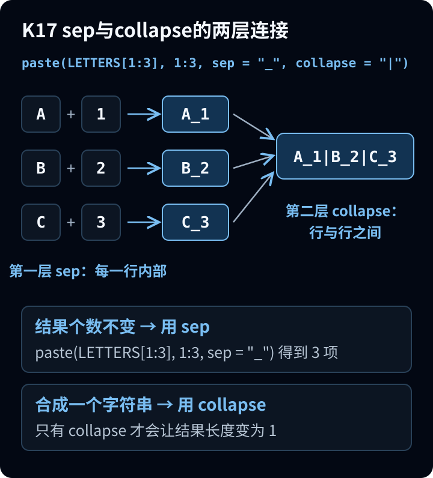

# K17 paste与paste0

## 基本信息

- 所属单元为向量与字符串。
- 难度为核心。
- 前置知识为K09、K16。
- 关联知识为K09、K11、K16、K38。
- 编写人为Claude（AI辅助编写），样品版本为1.0，日期为2026年11月15日。
- 例题和练习数据均为原创模拟教学数据。
- 验证状态为待R实测。

## 学习目标

- 能够区分`sep`负责同一组内部的连接、`collapse`负责把整个结果合成一个字符串。
- 能够利用向量化和循环补齐，一次生成一批规范文件名。
- 能够用`paste0()`省去默认空格，并预测拼接结果的长度。

## 先备检查

1. `rep(c("a", "b"), each = 2)`的结果是什么？预期回答为`"a" "a" "b" "b"`。
2. `1:3`与长度为1的向量运算时会发生什么？预期回答为长度1的向量被循环补齐。

## 直观理解

`paste()`像一台按位置工作的拼字机。给它几列材料，它把每列的第1个拼在一起，再把每列的第2个拼在一起，中间用`sep`隔开，默认是一个空格。短的那列会循环使用，所以前缀只写一次就能用到每一项上。得到一排拼好的文字后，如果还想把这一排连成一整句，就用`collapse`指定各项之间的连接符。`paste0()`等同于`sep = ""`。

## 为什么

1. 为什么`paste("S", 1:3)`得到3个结果？`"S"`长度为1，循环补齐成3个，与`1:3`逐项拼接。
2. 为什么只给一个向量时`sep`不起作用？`sep`连接的是同一位置上来自不同参数的材料，只有一个参数时没有可以连接的对象。
3. 为什么拼接数字时不用先转换成字符？`paste()`会自动把各参数转换为字符，再进行拼接。

## 基础例题

用学号前缀和编号，比较默认空格、`sep = ""`、`paste0()`和`collapse`的结果。

独立脚本见[K17_example_01.R](../ai_tutor/content_assets/code/K17_example_01.R)。

```r
id <- 1:3
print(paste("S", id))
print(paste("S", id, sep = ""))
print(paste0("S", id))
print(paste0("S", id, collapse = ","))
```

### 预期输出（待R实测）

```text
[1] "S 1" "S 2" "S 3"
[1] "S1" "S2" "S3"
[1] "S1" "S2" "S3"
[1] "S1,S2,S3"
```

### 逐步讲解

1. 默认`sep = " "`，前缀与编号之间有一个空格。
2. 把`sep`设为空字符串后，两者紧挨着。
3. `paste0()`得到同样的结果，写法更短。
4. `collapse = ","`把3个结果合成1个字符串，结果长度变为1。

## 应用例题

第一季度每月导出一份销售数据，需要按统一规则生成3个文件名，再用一句话汇总文件数量和月份。

独立脚本见[K17_example_02.R](../ai_tutor/content_assets/code/K17_example_02.R)。

```r
month <- c("01", "02", "03")
files <- paste0("sales_2026_", month, ".csv")
print(files)
title <- paste0("2026年第一季度共", length(files), "个文件，月份：", paste(month, collapse = "、"))
print(title)
```

### 预期输出（待R实测）

```text
[1] "sales_2026_01.csv" "sales_2026_02.csv" "sales_2026_03.csv"
[1] "2026年第一季度共3个文件，月份：01、02、03"
```

### 逐步讲解

1. 前缀和后缀各写一次，循环补齐后与3个月份逐项拼接。
2. 月份用字符`"01"`保存，保留前导零，文件名排序时顺序正确。
3. 内层`paste(month, collapse = "、")`先把月份合成一段文字。
4. 外层`paste0()`把说明文字、文件个数和月份拼成一句完整的标题。

生成文件名只是拼接字符串，并不检查这些文件是否存在。实际读取前可以用`file.exists(files)`核对，相关内容见K38。

## 图解方案

图名为“sep与collapse的两层连接”，采用对比图，以SVG手绘。左侧三行展示`LETTERS[1:3]`与`1:3`按位置用`sep`连接得到三项，右侧箭头把三项用`collapse`连成一个字符串。



图把两个参数画成两个层次，帮助学生判断该用哪一个参数：想让结果个数不变用`sep`，想合成一个字符串用`collapse`。

## 易错案例

想把三个字母用加号连成一个字符串，却设置了`sep`，结果仍是三个独立元素。

```r
x <- c("A", "B", "C")
print(paste(x, sep = "+"))
```

### 实际错误或异常结果（待R实测）

```text
[1] "A" "B" "C"
```

参考修正使用`collapse`。

```r
x <- c("A", "B", "C")
print(paste(x, collapse = "+"))
```

### 预期输出（待R实测）

```text
[1] "A+B+C"
```

R没有报错，判断方法是看结果的元素个数：要求得到一个字符串时，结果长度应为1。拼接含缺失值的向量时，`NA`会变成文字"NA"，需要先处理缺失。

## 完整练习

完成三个任务：复现课件中的`"A 1_B 2_C 3_D 4"`；为两个部门FIN、ACC和两个季度Q1、Q2生成全部4个组合标签；把部门代码连成一个报告文件名`report_FIN-ACC.pdf`。

提示第一题同时使用默认`sep`和`collapse`，第二题结合K09的`rep()`构造组合。

独立脚本见[K17_exercise.R](../ai_tutor/content_assets/code/K17_exercise.R)。

```r
print(paste(LETTERS[1:4], 1:4, collapse = "_"))
dept <- c("FIN", "ACC")
quarter <- c("Q1", "Q2")
print(paste(rep(dept, each = 2), rep(quarter, times = 2), sep = "_"))
print(paste0("report_", paste(dept, collapse = "-"), ".pdf"))
```

### 预期输出（待R实测）

```text
[1] "A 1_B 2_C 3_D 4"
[1] "FIN_Q1" "FIN_Q2" "ACC_Q1" "ACC_Q2"
[1] "report_FIN-ACC.pdf"
```

评分共10分，第一题得3分，第二题的组合完整且无重复得4分，第三题嵌套拼接正确得3分。常见错误是第二题直接写`paste(dept, quarter, sep = "_")`，只得到`FIN_Q1`和`ACC_Q2`两项。

## 自测题

1. 预测下面三行的输出。

```r
print(paste("a", c("x", "y"), sep = "-"))
print(paste0(c("a", "b"), 1:4))
print(paste(c("a", "b"), collapse = ""))
```

### 预期输出（待R实测）

```text
[1] "a-x" "a-y"
[1] "a1" "b2" "a3" "b4"
[1] "ab"
```

第二行中`c("a", "b")`循环补齐到4项，第三行用空字符串作`collapse`，把两个字母直接连在一起。

2. `paste0("x", character(0))`的结果长度是多少？答案为1，结果为`"x"`。零长度参数在拼接中会被当作空字符串，这一点与算术运算不同。

## 追问建议

- 例题请求用`sprintf()`生成补零的三位编号，并与`paste0()`比较。
- 易错点请求解释拼接含`NA`的向量时会发生什么。
- 练习请求为每个文件名加上当天日期。
- 相关知识继续学习K38，用生成的文件名批量读取文件。

## 来源与验证

- 课程来源为[S3《CH2R语言数据操作课件.pdf》PDF 42–44](../../成员一/CH2R语言数据操作课件.pdf#page=42)。
- 补充来源为R官方帮助主题`help("paste")`。
- 本文代码尚未在R中运行，输出为编写者依据R规则推算的预期结果。含中文字符的输出需在UTF-8环境核对。
- 核对方法为在ai_tutor目录运行`python scripts/check_r_outputs.py K17`，全部通过后加`--write`标记为已实测。
- 图解为SVG手绘，未附生成脚本。
