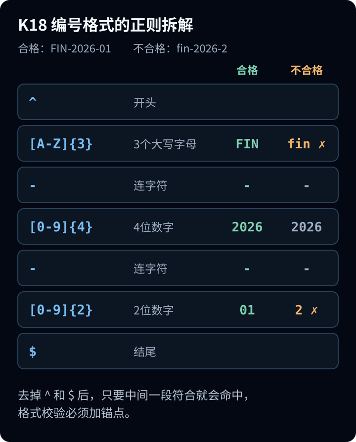

# K18 查找、替换与正则

## 基本信息

- 所属单元为向量与字符串。
- 难度为核心。
- 前置知识为K16。
- 关联知识为K16、K17、K39。
- 编写人为Claude（AI辅助编写），样品版本为1.0，日期为2026年11月15日。
- 例题和练习数据均为原创模拟教学数据。
- 验证状态为待R实测。

## 学习目标

- 能够区分`grep()`返回位置、`grepl()`返回逻辑值，`sub()`只替换首次匹配、`gsub()`替换全部匹配。
- 能够读懂并写出常用正则：字符类`[0-9]`、数量`+`和`{n}`、锚点`^`与`$`、空白`\\s`。
- 能够正确转义点号等特殊字符，或用`fixed = TRUE`按普通文字匹配。

## 先备检查

1. `substr("ID-2026", 4, 7)`的结果是什么？预期回答为`"2026"`。
2. 逻辑向量可以直接用作索引吗？预期回答为可以，保留为`TRUE`的位置。

## 直观理解

正则表达式是描述“文字长什么样”的模式。`[0-9]`表示任意一个数字，`+`表示前面的东西出现一次或多次，`{4}`表示恰好4次，`^`和`$`分别钉住开头和结尾，`.`表示任意一个字符。`grepl()`逐个回答“像不像这个模式”，适合做筛选条件；`sub()`和`gsub()`把命中的部分换成新文字。R的字符串里反斜杠要写两次，所以正则中的`\s`写成`"\\s"`。

## 为什么

1. 为什么`grepl(".csv", x)`会匹配到`"reportXcsv"`？正则中的点表示任意字符，X也算。要匹配真正的点，应写`"\\.csv"`或加`fixed = TRUE`。
2. 为什么校验格式时要加`^`和`$`？不加锚点时，只要文字中某一段符合模式就算命中，`"xFIN-2026-01y"`也会被判为合格。
3. 为什么`sub()`和`gsub()`结果可能不同？`sub()`在每个字符串中只换第一处命中，`gsub()`换掉所有命中。

## 基础例题

对四个字符串比较查找与替换函数的返回值。

独立脚本见[K18_example_01.R](../ai_tutor/content_assets/code/K18_example_01.R)。

```r
x <- c("  Alice ", "Bob  Lee", "cat.dog", "ID-2026")
print(grepl("e", x))
print(grep("[0-9]", x))
print(sub(" ", "_", x))
print(gsub(" ", "_", x))
```

### 预期输出（待R实测）

```text
[1]  TRUE  TRUE FALSE FALSE
[1] 4
[1] "_ Alice " "Bob_ Lee" "cat.dog"  "ID-2026"
[1] "__Alice_" "Bob__Lee" "cat.dog"  "ID-2026"
```

### 逐步讲解

1. `grepl()`对每个元素返回是否含有字母e，区分大小写。
2. `grep()`只返回含数字的元素位置4。
3. `sub()`在每个字符串中只把第一个空格换成下划线。
4. `gsub()`把所有空格都替换掉，没有空格的元素保持不变。

## 应用例题

问卷中的姓名有多余空格，部门编号要求格式为“三位大写字母-四位年份-两位序号”。需要清理姓名，并找出不合格的编号。

独立脚本见[K18_example_02.R](../ai_tutor/content_assets/code/K18_example_02.R)。

```r
raw <- c("  Wang  Fang ", "Li Lei", " Zhao   Min", "Sun Li ")
clean <- gsub("\\s+", " ", trimws(raw))
print(clean)
code <- c("FIN-2026-01", "fin-2026-2", "ACC-2025-11", "N/A")
ok <- grepl("^[A-Z]{3}-[0-9]{4}-[0-9]{2}$", code)
print(ok)
print(code[!ok])
```

### 预期输出（待R实测）

```text
[1] "Wang Fang" "Li Lei"    "Zhao Min"  "Sun Li"
[1]  TRUE FALSE  TRUE FALSE
[1] "fin-2026-2" "N/A"
```

### 逐步讲解

1. `trimws()`去掉首尾空格，`gsub("\\s+", " ", ...)`把中间连续的空白压成一个空格。
2. 编号模式从头到尾规定了每一段的字符类型和个数。
3. 第2个编号字母为小写且序号只有一位，第4个完全不符合格式。
4. 用取反后的逻辑值取出不合格的编号，交给人工复核。

格式校验只能说明编号“长得对”，不能说明编号真实存在。`fin-2026-2`可能只是录入时大小写和补零不规范，是否自动修正应由数据负责人决定。

## 图解方案

图名为“编号格式的正则拆解”，采用拆解图，以SVG手绘。把模式`^[A-Z]{3}-[0-9]{4}-[0-9]{2}$`按段拆开，每段下方对应`FIN-2026-01`中被命中的字符，并标出`fin-2026-2`在哪一段失败。



图让学生逐段读正则，而不是把整串符号当作一个整体记忆，同时说明锚点保证整串都要符合模式。

## 易错案例

想找出扩展名为`.csv`的文件，没有转义点号，错误地匹配了`reportXcsv`。

```r
f <- c("report.csv", "reportXcsv", "data.txt")
print(grepl(".csv", f))
```

### 实际错误或异常结果（待R实测）

```text
[1]  TRUE  TRUE FALSE
```

参考修正转义点号并锚定结尾，或使用`fixed = TRUE`按普通文字查找。

```r
f <- c("report.csv", "reportXcsv", "data.txt")
print(grepl("\\.csv$", f))
print(grepl(".csv", f, fixed = TRUE))
```

### 预期输出（待R实测）

```text
[1]  TRUE FALSE FALSE
[1]  TRUE FALSE FALSE
```

`fixed = TRUE`不能再使用`$`等正则符号，`"a.csv.bak"`这样的文件名也会被判为含有`.csv`。需要判断“以.csv结尾”时，应使用带锚点的正则写法。

## 完整练习

一组产品名称存在多余空格，部分记录没有型号数字。要求清理空格，用正则提取型号数字，无法识别型号的记录保留为`NA`，并统计需要人工处理的记录数。

提示`sub("^.* ([0-9]+).*$", "\\1", x)`中，括号捕获的内容可以在替换文字中用`\\1`引用。没有命中的字符串会原样返回，因此要另外判断是否含有数字。

独立脚本见[K18_exercise.R](../ai_tutor/content_assets/code/K18_exercise.R)。

```r
name <- c(" Alpha 15 ", "Beta  60 Pro", "unknown", "GAMMA 14", "")
clean <- gsub("\\s+", " ", trimws(name))
model <- sub("^.* ([0-9]+).*$", "\\1", clean)
model[!grepl("[0-9]", clean)] <- NA
print(clean)
print(model)
print(sum(is.na(model)))
```

### 预期输出（待R实测）

```text
[1] "Alpha 15"    "Beta 60 Pro" "unknown"     "GAMMA 14"    ""
[1] "15" "60" NA   "14" NA
[1] 2
```

评分共10分，空格清理得3分，捕获与引用正确得3分，无法识别的记录保留为`NA`得2分，统计人工处理数量得2分。常见错误是把无法识别的记录直接删除，导致后续核对时找不到原始条目；或者没有先清理空格，`"Beta  60 Pro"`中的两个空格让模式命中位置出错。

## 自测题

1. 预测下面三行的输出。

```r
s <- "a1b22c333"
print(gsub("[0-9]", "", s))
print(sub("[0-9]+", "#", s))
print(gsub("[0-9]+", "#", s))
```

### 预期输出（待R实测）

```text
[1] "abc"
[1] "a#b22c333"
[1] "a#b#c#"
```

第一行删除所有数字；第二行只替换第一段连续数字；第三行把每一段连续数字都换成一个井号。

2. `grep("R", x, value = TRUE)`返回什么？答案为含有R的元素本身，而不是它们的位置。

## 追问建议

- 例题请求用`regmatches()`和`regexpr()`取出第一段数字。
- 易错点请求列出正则中需要转义的常见特殊字符。
- 练习请求把编号统一改成大写并补齐两位序号。
- 相关知识继续学习K39综合任务，在电影数据清洗中使用这些写法。

## 来源与验证

- 课程来源为[S3《CH2R语言数据操作课件.pdf》PDF 45–47](../../成员一/CH2R语言数据操作课件.pdf#page=45)。
- 课程来源为[S4《R数据科学_译本.pdf》第10章 PDF 164–181](../../成员一/R数据科学_译本.pdf#page=164)。
- 补充来源为R官方帮助主题`help("grep")`、`help("regex")`、`help("trimws")`。
- 本文代码尚未在R中运行，输出为编写者依据R规则推算的预期结果。
- 核对方法为在ai_tutor目录运行`python scripts/check_r_outputs.py K18`，全部通过后加`--write`标记为已实测。
- 图解为SVG手绘，未附生成脚本。
