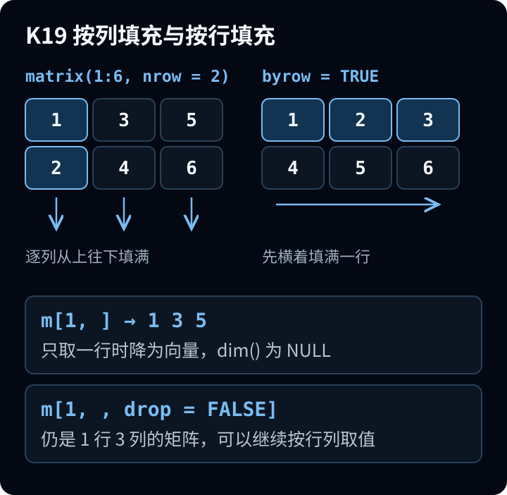

# K19 创建矩阵与保留维度

## 基本信息

- 所属单元为矩阵与数组。
- 难度为核心。
- 前置知识为K09、K10。
- 关联知识为K20、K21、K24、K25。
- 编写人为Claude（AI辅助编写），样品版本为1.0，日期为2026年11月16日。
- 例题和练习数据均为原创模拟教学数据。
- 验证状态为待R实测。

## 学习目标

- 能够用`matrix()`创建矩阵，并预测默认按列填充与`byrow = TRUE`按行填充的差异。
- 能够用`[行, 列]`、行名和列名取值，并用`drop = FALSE`保留矩阵结构。
- 能够解释矩阵中所有元素必须同类型，混入字符会让整个矩阵变成字符型。

## 先备检查

1. `1:6`有几个元素？预期回答为6个。
2. `x[c(1, 3)]`表示什么？预期回答为取出第1和第3个元素。

## 直观理解

矩阵就是一个向量，加上了“几行几列”的维度信息。R默认先把第1列从上到下填满，再填第2列，这叫按列填充；如果原始数据是一行一行抄下来的，就加`byrow = TRUE`。取值时用`[行, 列]`，逗号一侧留空表示这一维全要。只取一行或一列时，R会自动把结果降成普通向量，想保留行列结构就写`drop = FALSE`。

## 为什么

1. 为什么`matrix(1:6, nrow = 2)`第一行是`1 3 5`？默认按列填充，1、2先填满第1列，3、4填第2列，所以第一行依次是1、3、5。
2. 为什么取单行后`dim()`返回`NULL`？单行结果被降为向量，失去了维度属性。后续代码如果需要`nrow()`或继续按矩阵取值，就会出错。
3. 为什么矩阵不能像表格一样同时放学号和成绩？基础矩阵只能有一种类型，学号这类文字更适合作为行名，或者改用K25的数据框。

## 基础例题

用同一组数字比较按列和按行填充，并查看维度和单个元素。

独立脚本见[K19_example_01.R](../ai_tutor/content_assets/code/K19_example_01.R)。

```r
m <- matrix(1:6, nrow = 2)
print(m)
m2 <- matrix(1:6, nrow = 2, byrow = TRUE)
print(m2)
print(dim(m))
print(m[2, 3])
```

### 预期输出（待R实测）

```text
     [,1] [,2] [,3]
[1,]    1    3    5
[2,]    2    4    6
     [,1] [,2] [,3]
[1,]    1    2    3
[2,]    4    5    6
[1] 2 3
[1] 6
```

### 逐步讲解

1. 只给了行数2，R自动算出需要3列。
2. 默认按列填充，第一行是1、3、5。
3. `byrow = TRUE`按行填充，第一行是1、2、3。
4. `dim()`先给行数、再给列数。
5. `m[2, 3]`取第2行第3列，值为6。

## 应用例题

三名学生的期中和期末成绩放在一个带行名、列名的矩阵里。需要查询Ben的成绩，并在筛选期末80分以上的学生时保持矩阵结构。

独立脚本见[K19_example_02.R](../ai_tutor/content_assets/code/K19_example_02.R)。

```r
score <- matrix(c(78, 92, 65, 88, 95, 70), nrow = 3,
                dimnames = list(c("Ann", "Ben", "Cai"), c("mid", "final")))
print(score)
print(score["Ben", ])
one <- score["Ben", , drop = FALSE]
print(one)
print(dim(one))
high <- score[score[, "final"] >= 80, , drop = FALSE]
print(nrow(high))
```

### 预期输出（待R实测）

```text
    mid final
Ann  78    88
Ben  92    95
Cai  65    70
  mid final 
   92    95 
    mid final
Ben  92    95
[1] 1 2
[1] 2
```

### 逐步讲解

1. `dimnames`接收一个列表，依次是行名和列名。
2. `score["Ben", ]`只取一行，结果降为带名称的向量。
3. 加上`drop = FALSE`后仍是1行2列的矩阵，`dim()`返回`1 2`。
4. 筛选条件写在行的位置，列的位置留空表示保留所有列。
5. 筛选结果有2行，`nrow()`能正常工作。

如果某次筛选恰好只剩一名学生，不写`drop = FALSE`时结果会变成向量，`nrow()`返回`NULL`。因此在不确定结果行数的代码中，应始终保留这个参数。

## 图解方案

图名为“按列填充与按行填充”，采用填充顺序图，以SVG手绘。左右两个2行3列的网格分别标出1到6的填入顺序，箭头表示先竖着填还是先横着填，下方说明`drop = FALSE`对取单行的影响。



图让学生在写`matrix()`前先确认原始数据是按行还是按列排列的，避免把成绩表填错位置。

## 易错案例

想把学号放进成绩矩阵的第一格，结果整个矩阵变成字符型，后续加分时报错。

```r
m <- matrix(c(1, 2, 85, 90), nrow = 2)
m[1, 1] <- "S01"
print(m)
print(m[, 2] + 5)
```

### 实际错误或异常结果（待R实测）

```text
     [,1]  [,2]
[1,] "S01" "85"
[2,] "2"   "90"
Error in m[, 2] + 5 : non-numeric argument to binary operator
```

参考修正把学号作为行名，矩阵中只保留数值。

```r
m <- matrix(c(85, 90), nrow = 2, dimnames = list(c("S01", "S02"), "score"))
print(m[, "score"] + 5)
```

### 预期输出（待R实测）

```text
S01 S02 
 90  95 
```

报错发生在加分这一步，但真正的问题出在赋值那一步。打印时如果看到数字带着引号，就说明矩阵已经变成了字符型，应该回头检查数据来源。

## 完整练习

三个区域四个季度的销售额（万元）是按区域一行一行记录的。要求按行填充创建矩阵并命名，取出第二季度这一列并保留矩阵结构，查询South区域第四季度的值，最后报告矩阵的行数和列数。

提示原始数据是按行记录的，需要`byrow = TRUE`。

独立脚本见[K19_exercise.R](../ai_tutor/content_assets/code/K19_exercise.R)。

```r
sales <- matrix(c(12, 15, 11, 14,
                  20, 18, 22, 25,
                   9, 10, 12, 11), nrow = 3, byrow = TRUE,
                dimnames = list(c("North", "South", "West"), c("Q1", "Q2", "Q3", "Q4")))
print(sales)
print(sales[, "Q2", drop = FALSE])
print(sales["South", "Q4"])
print(c(rows = nrow(sales), cols = ncol(sales)))
```

### 预期输出（待R实测）

```text
      Q1 Q2 Q3 Q4
North 12 15 11 14
South 20 18 22 25
West   9 10 12 11
      Q2
North 15
South 18
West  10
[1] 25
rows cols 
   3    4 
```

评分共10分，按行填充与命名正确得4分，保留结构取列得2分，单值查询得2分，维度报告得2分。常见错误是漏写`byrow = TRUE`，导致North一行变成12、14、10、22这类错位数据；仔细核对第一行就能发现。

## 自测题

1. 预测下面三行的输出。

```r
m <- matrix(1:6, ncol = 2)
print(dim(m))
print(m[3, 1])
print(m[, 2])
```

### 预期输出（待R实测）

```text
[1] 3 2
[1] 3
[1] 4 5 6
```

只给列数2时，R算出需要3行；按列填充后第1列是1到3，第2列是4到6。

2. `matrix(1:5, nrow = 2)`会出现什么情况？答案为R发出警告，5个数不能整除2行，R会循环补齐，用第1个数填满最后一格。

## 追问建议

- 例题请求用`rownames()`和`colnames()`给已有矩阵补上名称。
- 易错点请求解释`drop = FALSE`在函数内部为什么特别重要。
- 练习请求计算每个区域全年的销售总额，衔接K24的`apply()`。
- 相关知识继续学习K20，用`rbind()`给矩阵增加新的区域。

## 来源与验证

- 课程来源为[S3《CH2R语言数据操作课件.pdf》PDF 48–52](../../成员一/CH2R语言数据操作课件.pdf#page=48)。
- 补充来源为R官方帮助主题`help("matrix")`、`help("[")`、`help("dimnames")`。
- 本文代码尚未在R中运行，输出为编写者依据R规则推算的预期结果，基础例题第一个矩阵与课程资料中已实测的输出一致。
- 核对方法为在ai_tutor目录运行`python scripts/check_r_outputs.py K19`，全部通过后加`--write`标记为已实测。
- 图解为SVG手绘，未附生成脚本。
