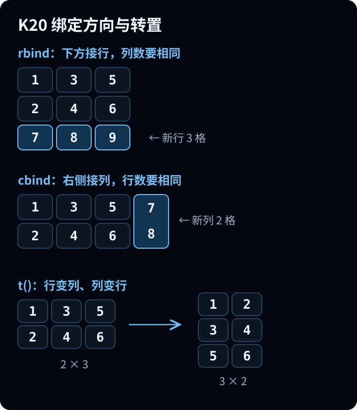

# K20 矩阵绑定、命名与转置

## 基本信息

- 所属单元为矩阵与数组。
- 难度为核心。
- 前置知识为K19。
- 关联知识为K12、K21、K27。
- 编写人为Claude（AI辅助编写），样品版本为1.0，日期为2026年11月16日。
- 例题和练习数据均为原创模拟教学数据。
- 验证状态为待R实测。

## 学习目标

- 能够用`rbind()`追加行、`cbind()`追加列，并在绑定前检查另一维的长度是否相容。
- 能够用`rownames()`、`colnames()`命名矩阵，用`t()`转置并说出转置后的维度。
- 能够识别按位置绑定造成的错配，在绑定前按名称对齐。

## 先备检查

1. `matrix(1:6, nrow = 2)`有几列？预期回答为3列。
2. `match(c("b", "a"), c("a", "b"))`的结果是什么？预期回答为`2 1`。

## 直观理解

`rbind()`像在表格底部再接一行，所以新行的格子数必须和原来的列数一样；`cbind()`像在右边再贴一列，新列的长度必须和行数一样。绑定只看位置，第1行接第1行，它不知道这一行属于哪个学生。转置`t()`把表格沿对角线翻过来，行变列、列变行，2行3列变成3行2列。`diag()`给一个向量时，会生成对角线上放着这些数、其余为0的方阵。

## 为什么

1. 为什么`cbind()`可以给新列起名字？写成`cbind(m, extra = c(5, 6))`时，参数名会成为新列的列名。
2. 为什么两张成绩表直接`cbind()`可能出错却不报错？只要行数相同，R就逐行拼接。两张表的学生顺序不同时，每一行就会把不同学生的成绩拼在一起。
3. 为什么转置常用于报告？有时人们习惯把季度放在行、区域放在列，转置不改变数据，只改变阅读方向。

## 基础例题

用一个2行2列矩阵演示追加行、追加命名列、转置和构造对角矩阵。

独立脚本见[K20_example_01.R](../ai_tutor/content_assets/code/K20_example_01.R)。

```r
m <- matrix(1:4, 2)
colnames(m) <- c("a", "b")
print(rbind(m, m))
print(cbind(m, extra = c(5, 6)))
print(t(m))
print(diag(c(2, 3)))
```

### 预期输出（待R实测）

```text
     a b
[1,] 1 3
[2,] 2 4
[3,] 1 3
[4,] 2 4
     a b extra
[1,] 1 3     5
[2,] 2 4     6
  [,1] [,2]
a    1    2
b    3    4
     [,1] [,2]
[1,]    2    0
[2,]    0    3
```

### 逐步讲解

1. `rbind(m, m)`在下方再接两行，列名保留。
2. `cbind()`追加一列，参数名`extra`成为列名。
3. 转置后原来的列名`a`、`b`变成了行名。
4. `diag(c(2, 3))`生成2行2列的对角矩阵。

## 应用例题

两个区域两个季度的销售额（万元）已有记录，现在需要追加West区域，增加一列合计，再转置成“季度在行、区域在列”的报告格式。

独立脚本见[K20_example_02.R](../ai_tutor/content_assets/code/K20_example_02.R)。

```r
q <- matrix(c(120, 135, 98, 110), nrow = 2,
            dimnames = list(c("North", "South"), c("Q1", "Q2")))
q <- rbind(q, West = c(105, 99))
q <- cbind(q, total = q[, "Q1"] + q[, "Q2"])
print(q)
print(t(q))
print(dim(t(q)))
```

### 预期输出（待R实测）

```text
       Q1  Q2 total
North 120  98   218
South 135 110   245
West  105  99   204
      North South West
Q1      120   135  105
Q2       98   110   99
total   218   245  204
[1] 3 3
```

### 逐步讲解

1. `rbind()`中的参数名`West`成为新行的行名，新行有2个数，与列数一致。
2. 合计列由两列逐元素相加得到，长度为3，与行数一致。
3. 转置后季度和合计成为行，区域成为列。
4. 3行3列的矩阵转置后维度仍为`3 3`。

追加的West必须按Q1、Q2的顺序给值，`rbind()`不会检查数字属于哪个季度。合计列是计算结果，原始数据更新后需要重新计算，不能手工修改。

## 图解方案

图名为“绑定方向与转置”，采用示意图，以SVG手绘。左侧展示`rbind()`在下方接行、`cbind()`在右侧接列，并标出各自要求相同的维度；右侧展示2行3列矩阵转置为3行2列。



图把“要求相同的那一维”用颜色标出，提醒学生绑定前先核对这一维的长度。

## 易错案例

数学成绩表和英语成绩表的学生顺序不同，直接按列拼接后，Ann拿到了Ben的英语成绩。

```r
a <- matrix(c(80, 90), ncol = 1, dimnames = list(c("Ann", "Ben"), "math"))
b <- matrix(c(70, 85), ncol = 1, dimnames = list(c("Ben", "Ann"), "eng"))
print(cbind(a, b))
```

### 实际错误或异常结果（待R实测）

```text
    math eng
Ann   80  70
Ben   90  85
```

参考修正先按`a`的行名重新排列`b`，再拼接。

```r
a <- matrix(c(80, 90), ncol = 1, dimnames = list(c("Ann", "Ben"), "math"))
b <- matrix(c(70, 85), ncol = 1, dimnames = list(c("Ben", "Ann"), "eng"))
print(cbind(a, b[rownames(a), , drop = FALSE]))
```

### 预期输出（待R实测）

```text
    math eng
Ann   80  85
Ben   90  70
```

错误版本没有任何警告，结果只保留第一个矩阵的行名，看起来很正常。如果两张表的学生名单可能不完全相同，应使用K27的数据框合并，未匹配的学生会被明确标出。

## 完整练习

创建一个2行3列、带行名和列名的矩阵，追加一行各列合计，转置后打印，并用一个小矩阵对比转置前后的维度。

提示`colSums()`可以得到每列的合计，结果是带列名的向量，可以直接作为新行。

独立脚本见[K20_exercise.R](../ai_tutor/content_assets/code/K20_exercise.R)。

```r
m <- matrix(1:6, nrow = 2, dimnames = list(c("r1", "r2"), c("x", "y", "z")))
m3 <- rbind(m, r3 = colSums(m))
print(m3)
print(t(m3))
print(rbind(before = dim(m), after = dim(t(m))))
```

### 预期输出（待R实测）

```text
   x y  z
r1 1 3  5
r2 2 4  6
r3 3 7 11
  r1 r2 r3
x  1  2  3
y  3  4  7
z  5  6 11
       [,1] [,2]
before    2    3
after     3    2
```

评分共10分，命名与合计行正确得4分，转置结果正确得3分，维度对比得3分。常见错误是把合计写成`rowSums()`，得到的长度为2，与列数3不相容，R会循环补齐或警告。

## 自测题

1. 预测下面三行的输出。

```r
a <- matrix(0, nrow = 2, ncol = 3)
print(dim(rbind(a, a)))
print(dim(cbind(a, 1:2)))
print(dim(t(a)))
```

### 预期输出（待R实测）

```text
[1] 4 3
[1] 2 4
[1] 3 2
```

`rbind`使行数相加，`cbind`追加一列，转置交换行数和列数。

2. `rbind(matrix(0, 2, 3), c(1, 2))`会怎样？答案为长度2的向量被循环补齐到3列，并给出警告，这通常意味着数据准备有误。

## 追问建议

- 例题请求给矩阵追加一行平均值，并保留两位小数。
- 易错点请求说明`rbind()`对数据框和矩阵的行为有什么不同。
- 练习请求把转置后的报告按合计从高到低排序。
- 相关知识继续学习K21，区分转置后的矩阵乘法与逐元素乘法。

## 来源与验证

- 课程来源为[S3《CH2R语言数据操作课件.pdf》PDF 51–55](../../成员一/CH2R语言数据操作课件.pdf#page=51)。
- 补充来源为R官方帮助主题`help("cbind")`、`help("t")`、`help("diag")`、`help("colSums")`。
- 本文代码尚未在R中运行，输出为编写者依据R规则推算的预期结果，基础例题与课程资料中已实测的输出一致。
- 核对方法为在ai_tutor目录运行`python scripts/check_r_outputs.py K20`，全部通过后加`--write`标记为已实测。
- 图解为SVG手绘，未附生成脚本。
