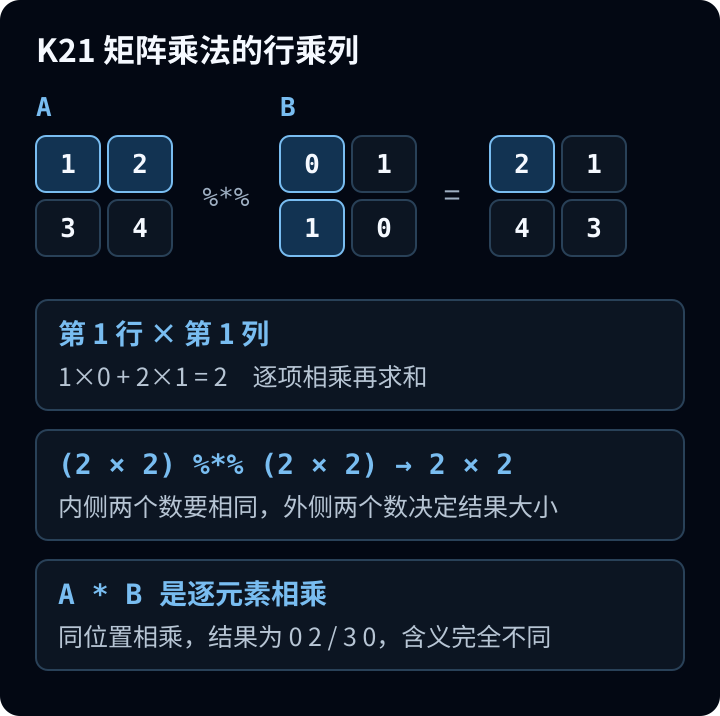

# K21 矩阵乘法与线性方程

## 基本信息

- 所属单元为矩阵与数组。
- 难度为核心。
- 前置知识为K19、K20。
- 关联知识为K11、K20、K22。
- 编写人为Claude（AI辅助编写），样品版本为1.0，日期为2026年11月16日。
- 例题和练习数据均为原创模拟教学数据。
- 验证状态为待R实测。

## 学习目标

- 能够区分逐元素乘法`*`与矩阵乘法`%*%`，并预测结果的维度。
- 能够用`solve(A, b)`求解线性方程组，并把解代回原方程验证。
- 能够在维度不相容报错时，通过检查`dim()`找到需要转置的一方。

## 先备检查

1. `c(1, 2) * c(3, 4)`的结果是什么？预期回答为`3 8`，逐元素相乘。
2. 2行3列的矩阵转置后是几行几列？预期回答为3行2列。

## 直观理解

`*`把两个同样大小的矩阵对应位置的数相乘，和向量运算一样。`%*%`是线性代数里的矩阵乘法：结果第i行第j列的数，等于左矩阵第i行与右矩阵第j列逐项相乘再求和。所以它要求左边的列数等于右边的行数，结果的行数来自左边、列数来自右边。线性方程组`Ax = b`就是在问：哪个`x`经过`A`的矩阵乘法后正好得到`b`。`solve(A, b)`直接给出答案。

## 为什么

1. 为什么`A %*% B`一般不等于`B %*% A`？矩阵乘法先取左边的行、再取右边的列，交换顺序后参与配对的行和列完全不同。
2. 为什么推荐用`solve(A, b)`而不是先求逆再相乘？直接求解更稳定，计算量也更小。求逆矩阵只在确实需要逆矩阵本身时使用。
3. 为什么验证解时要用`all.equal()`而不是`==`？计算过程有浮点误差，`all.equal()`允许极小的差异。

## 基础例题

用同一对矩阵比较逐元素乘法与矩阵乘法。右边的矩阵`B`恰好起到“交换两列”的作用。

独立脚本见[K21_example_01.R](../ai_tutor/content_assets/code/K21_example_01.R)。

```r
A <- matrix(c(1, 3, 2, 4), nrow = 2)
B <- matrix(c(0, 1, 1, 0), nrow = 2)
print(A)
print(A * B)
print(A %*% B)
```

### 预期输出（待R实测）

```text
     [,1] [,2]
[1,]    1    2
[2,]    3    4
     [,1] [,2]
[1,]    0    2
[2,]    3    0
     [,1] [,2]
[1,]    2    1
[2,]    4    3
```

### 逐步讲解

1. 按列填充后，`A`的第一行是1、2，第二行是3、4。
2. `A * B`只保留`B`中为1的位置，其他位置变成0。
3. `A %*% B`第1行第1列为`1×0 + 2×1 = 2`，第1行第2列为`1×1 + 2×0 = 1`。
4. 结果正好是`A`交换两列，这是逐元素乘法做不到的。

## 应用例题

两种套餐的价格未知：3份甲加2份乙共18元，1份甲加4份乙共16元。用矩阵表示方程组并求解单价，再代回验证。

独立脚本见[K21_example_02.R](../ai_tutor/content_assets/code/K21_example_02.R)。

```r
A <- matrix(c(3, 1, 2, 4), nrow = 2)
b <- c(18, 16)
x <- solve(A, b)
print(x)
print(A %*% x)
print(all.equal(as.vector(A %*% x), b))
```

### 预期输出（待R实测）

```text
[1] 4 3
     [,1]
[1,]   18
[2,]   16
[1] TRUE
```

### 逐步讲解

1. `A`的每一行对应一个方程，每一列对应一个未知数的份数。
2. `solve(A, b)`给出甲4元、乙3元。
3. 把解代回，`A %*% x`得到一个2行1列的矩阵，正好是18和16。
4. `as.vector()`去掉维度后，再用`all.equal()`与`b`比较。

这个结论只对这两个方程成立。如果两种购买组合成比例，例如第二行是第一行的两倍，方程组就没有唯一解，`solve()`会报告矩阵奇异。

## 图解方案

图名为“矩阵乘法的行乘列”，采用计算过程图，以SVG手绘。左矩阵高亮第1行，右矩阵高亮第1列，箭头指向结果矩阵的第1行第1列，旁边写出逐项相乘再求和的算式，下方标出维度相容规则。



图把维度规则写成“内侧两个数相同，外侧两个数决定结果”，学生可以在动手前先判断能否相乘。

## 易错案例

两个2行3列的矩阵直接做矩阵乘法，维度不相容导致报错。

```r
A <- matrix(1:6, nrow = 2)
B <- matrix(1:6, nrow = 2)
print(A %*% B)
```

### 实际错误或异常结果（待R实测）

```text
Error in A %*% B : non-conformable arguments
```

参考修正先检查维度，把右侧矩阵转置成3行2列。

```r
A <- matrix(1:6, nrow = 2)
B <- matrix(1:6, nrow = 2)
print(dim(A))
print(dim(t(B)))
print(A %*% t(B))
```

### 预期输出（待R实测）

```text
[1] 2 3
[1] 3 2
     [,1] [,2]
[1,]   35   44
[2,]   44   56
```

转置能让运算成立，但是否应该转置要看计算的含义。如果本意是逐元素相乘，应改用`A * B`，结果仍是2行3列。

## 完整练习

一个投资组合由股票和债券组成，权重分别为60%和40%。已知三天中两种资产的日收益率，要求用矩阵乘法计算组合每天的收益率，保留四位小数，检查权重之和为1，并计算三天的平均收益率。

提示收益率矩阵每行是一天、每列是一种资产，权重向量的顺序必须与列的顺序一致。

独立脚本见[K21_exercise.R](../ai_tutor/content_assets/code/K21_exercise.R)。

```r
R <- matrix(c(0.010, -0.020,  0.015,
              0.005,  0.010, -0.010), nrow = 3,
            dimnames = list(c("Mon", "Tue", "Wed"), c("stock", "bond")))
w <- c(stock = 0.6, bond = 0.4)
port <- R %*% w
print(round(port, 4))
print(sum(w))
print(round(mean(port), 4))
```

### 预期输出（待R实测）

```text
      [,1]
Mon  0.008
Tue -0.008
Wed  0.005
[1] 1
[1] 0.0017
```

评分共10分，矩阵与权重构造正确得3分，矩阵乘法得3分，权重检查得2分，平均收益率得2分。常见错误是把收益率按行填写却没有加`byrow = TRUE`，导致每天的数据错位；或者权重顺序与列顺序相反。此结果只是模拟数据的计算练习，不构成投资判断。

## 自测题

1. 预测两个结果的维度。

```r
A <- matrix(1:6, nrow = 3)
B <- matrix(1:4, nrow = 2)
print(dim(A %*% B))
print(dim(crossprod(A)))
```

### 预期输出（待R实测）

```text
[1] 3 2
[1] 2 2
```

`A`是3行2列，`B`是2行2列，内侧维度都是2，结果为3行2列。`crossprod(A)`等于`t(A) %*% A`，结果为2行2列。

2. `solve(matrix(c(1, 2, 2, 4), 2), c(1, 2))`能得到唯一解吗？答案为不能。第二列是第一列的两倍，矩阵奇异，R会报错。

## 追问建议

- 例题请求用`solve(A)`求逆矩阵，并验证`A %*% solve(A)`是单位矩阵。
- 易错点请求解释“奇异矩阵”在实际数据中意味着什么。
- 练习请求把组合权重改为50%和50%，比较收益率的变化。
- 相关知识继续学习K22，用特征分解进一步理解矩阵的结构。

## 来源与验证

- 课程来源为[S3《CH2R语言数据操作课件.pdf》PDF 53–56](../../成员一/CH2R语言数据操作课件.pdf#page=53)。
- 补充来源为R官方帮助主题`help("matmult")`、`help("solve")`、`help("crossprod")`、`help("all.equal")`。
- 本文代码尚未在R中运行，输出为编写者依据R规则推算的预期结果，组合收益率已用Python独立计算核对。
- 核对方法为在ai_tutor目录运行`python scripts/check_r_outputs.py K21`，全部通过后加`--write`标记为已实测。
- 图解为SVG手绘，未附生成脚本。
