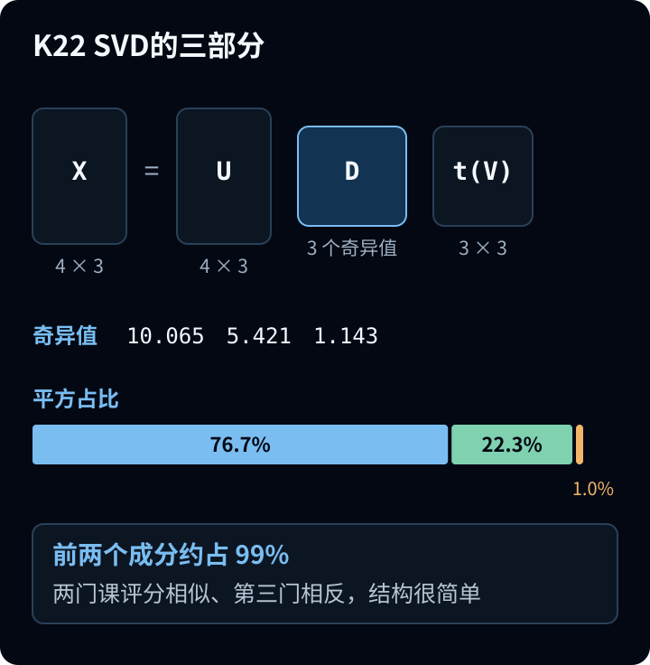

# K22 特征分解与SVD

## 基本信息

- 所属单元为矩阵与数组。
- 难度为扩展。
- 前置知识为K21。
- 关联知识为K21、K23。
- 编写人为Claude（AI辅助编写），样品版本为1.0，日期为2026年11月16日。
- 例题和练习数据均为原创模拟教学数据。
- 验证状态为待R实测。

## 学习目标

- 能够用`eigen()`求方阵的特征值和特征向量，并用矩阵乘法验证`Av = λv`。
- 能够用`svd()`分解长方形矩阵，说出U、D、V各部分的维度，并计算各成分的占比。
- 能够在比较分解结果时使用容差，理解特征向量的正负号可以整体翻转。

## 先备检查

1. `A %*% x`要求什么条件？预期回答为`A`的列数等于`x`的长度或行数。
2. `all.equal(0.1 + 0.2, 0.3)`的结果是什么？预期回答为`TRUE`，它允许极小的浮点误差。

## 直观理解

矩阵乘法通常会同时改变一个向量的方向和长度，但总有一些特殊方向，乘完以后方向不变，只是被拉长或缩短，这些方向就是特征向量，拉伸的倍数就是特征值。特征分解只适用于方阵。奇异值分解（SVD）适用于任何长方形矩阵，它把矩阵拆成“几种主要模式”，每种模式的强度由奇异值表示，最大的几个奇异值通常就能概括数据的主要结构。

## 为什么

1. 为什么只看几个最大的奇异值就够？奇异值平方的占比表示每种模式解释了多少变化，前一两个占绝大部分时，其余模式主要是细节或噪声。
2. 为什么不能直接把特征向量与参考答案逐个比较？一个特征向量乘以-1仍满足`Av = λv`，不同软件或版本可能返回相反的符号，应验证方程本身。
3. 为什么用`symmetric = TRUE`要谨慎？它让R按对称矩阵的方法计算，矩阵并不对称时结果是错的，而且不会报错。

## 基础例题

对一个2阶对称矩阵求特征值和奇异值，用分解结果重建原矩阵，并验证第一个特征向量满足特征方程。

独立脚本见[K22_example_01.R](../ai_tutor/content_assets/code/K22_example_01.R)。

```r
A <- matrix(c(2, 1, 1, 2), 2)
e <- eigen(A, symmetric = TRUE)
print(e$values)
s <- svd(A)
print(s$d)
print(s$u %*% diag(s$d) %*% t(s$v))
v1 <- e$vectors[, 1]
print(all.equal(as.vector(A %*% v1), e$values[1] * v1))
```

### 预期输出（待R实测）

```text
[1] 3 1
[1] 3 1
     [,1] [,2]
[1,]    2    1
[2,]    1    2
[1] TRUE
```

### 逐步讲解

1. 对称矩阵`A`的特征值为3和1，从大到小排列。
2. 对称且正定的矩阵，奇异值与特征值相同。
3. `U × D × t(V)`重建出原矩阵，说明分解没有丢失信息。
4. `A %*% v1`与`3 × v1`在容差内相等，验证了特征方程。这样检查不依赖特征向量的正负号。

## 应用例题

四名学生对三门课的兴趣评分（1到5分）组成4行3列的矩阵。用SVD查看分解后各部分的维度，并计算每个成分解释的比例。

独立脚本见[K22_example_02.R](../ai_tutor/content_assets/code/K22_example_02.R)。

```r
X <- matrix(c(5, 4, 1, 1,
              4, 5, 1, 2,
              1, 1, 5, 4), nrow = 4)
s <- svd(X)
print(c(dim(s$u), length(s$d), dim(s$v)))
print(round(s$d, 3))
share <- s$d^2 / sum(s$d^2)
print(round(share, 3))
```

### 预期输出（待R实测）

```text
[1] 4 3 3 3 3
[1] 10.065  5.421  1.143
[1] 0.767 0.223 0.010
```

### 逐步讲解

1. 按列填充后，每一列是一门课，每一行是一名学生。
2. `U`为4行3列，`D`有3个奇异值，`V`为3行3列。
3. 奇异值从大到小排列。
4. 第一个成分解释约76.7%的平方和，前两个合计约99%。

前两门课的评分高度相似，第三门与它们相反，所以两个成分就能概括大部分结构。这是对4个模拟样本的描述，不能推广为真实课程偏好的结论。

## 图解方案

图名为“SVD的三部分”，采用分解示意图，以SVG手绘。左边是4行3列的X，等号右边依次是U（4行3列）、D（对角线上的奇异值）和V的转置（3行3列），下方的横条按占比画出三个成分的长度。



图把维度写在每个方块上，学生可以核对“内侧维度相同”的乘法规则，横条直观显示前两个成分占了绝大部分。

## 易错案例

对一个2行3列的矩阵使用`eigen()`，特征分解要求方阵，因此报错。

```r
X <- matrix(1:6, nrow = 2)
e <- eigen(X)
```

### 实际错误或异常结果（待R实测）

```text
Error in eigen(X) : non-square matrix in 'eigen'
```

参考修正对长方形矩阵改用SVD，并检查各部分的维度。

```r
X <- matrix(1:6, nrow = 2)
s <- svd(X)
print(length(s$d))
print(dim(s$u))
print(dim(s$v))
```

### 预期输出（待R实测）

```text
[1] 2
[1] 2 2
[1] 3 2
```

2行3列的矩阵最多有2个奇异值，所以默认的`U`是2行2列、`V`是3行2列。如果分析的是协方差矩阵这类本身就对称的方阵，特征分解才是合适的选择。

## 完整练习

对3阶对称矩阵求特征值并保留三位小数，验证特征值之和等于矩阵的迹（对角线之和）、乘积等于行列式，并检查所有特征向量都满足特征方程。

提示`diag(A)`取出对角线，`det(A)`计算行列式，比较时使用`all.equal()`或容差。

独立脚本见[K22_exercise.R](../ai_tutor/content_assets/code/K22_exercise.R)。

```r
A <- matrix(c(4, 1, 0,
              1, 3, 0,
              0, 0, 2), nrow = 3)
e <- eigen(A, symmetric = TRUE)
print(round(e$values, 3))
print(all.equal(sum(e$values), sum(diag(A))))
print(all.equal(prod(e$values), det(A)))
resid <- A %*% e$vectors - e$vectors %*% diag(e$values)
print(max(abs(resid)) < 1e-10)
```

### 预期输出（待R实测）

```text
[1] 4.618 2.382 2.000
[1] TRUE
[1] TRUE
[1] TRUE
```

评分共10分，特征值正确得3分，迹与行列式验证各得2分，特征方程的整体验证得3分。常见错误是用`==`比较乘积与行列式，浮点误差会让结果变成`FALSE`；或者把残差写成`A %*% e$vectors - e$values * e$vectors`，循环补齐的方向不对。

## 自测题

1. 预测对角矩阵的奇异值和特征值。

```r
D <- diag(c(3, 5))
print(svd(D)$d)
print(eigen(D)$values)
```

### 预期输出（待R实测）

```text
[1] 5 3
[1] 5 3
```

两者都按从大到小排列，所以5在前。

2. 一个4行3列的矩阵最多有几个非零奇异值？答案为3个，不会超过行数和列数中较小的那个。

## 追问建议

- 例题请求只保留第一个成分重建评分矩阵，比较与原矩阵的差异。
- 易错点请求解释为什么不同电脑上特征向量的正负号可能不同。
- 练习请求把对称矩阵改为非对称矩阵，观察`symmetric = TRUE`带来的问题。
- 相关知识继续学习K23，了解大规模稀疏矩阵的存储方式。

## 来源与验证

- 课程来源为[S3《CH2R语言数据操作课件.pdf》PDF 54–57](../../成员一/CH2R语言数据操作课件.pdf#page=54)。
- 补充来源为R官方帮助主题`help("eigen")`、`help("svd")`、`help("det")`。
- 本文代码尚未在R中运行，输出为编写者依据R规则推算的预期结果。基础例题前三项与课程资料中已实测的输出一致，奇异值、占比与特征值已用Python（NumPy）独立计算核对。
- 核对方法为在ai_tutor目录运行`python scripts/check_r_outputs.py K22`，全部通过后加`--write`标记为已实测。
- 图解为SVG手绘，未附生成脚本。
