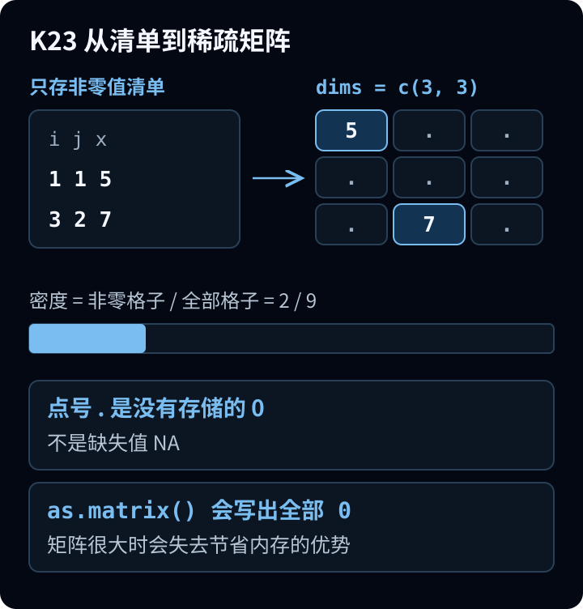

# K23 稀疏矩阵

## 基本信息

- 所属单元为矩阵与数组。
- 难度为扩展。
- 前置知识为K19、K21。
- 关联知识为K19、K21、K22。
- 编写人为Claude（AI辅助编写），样品版本为1.0，日期为2026年11月16日。
- 例题和练习数据均为原创模拟教学数据。
- 验证状态为待R实测。

## 学习目标

- 能够用`Matrix::sparseMatrix()`根据非零值的行号、列号和数值创建稀疏矩阵。
- 能够计算非零元素个数和密度，判断数据是否适合用稀疏格式存储。
- 能够正确调用Matrix包的函数，并说明转换为普通矩阵会失去存储优势。

## 先备检查

1. `matrix(0, 3, 3)`有几个元素？预期回答为9个，全部为0。
2. 怎样计算一个向量中非零值的个数？预期回答为`sum(x != 0)`。

## 直观理解

购物记录里，每位顾客只买了几样商品，如果把“顾客×商品”画成一张大表，绝大部分格子都是0。稀疏矩阵不存这些0，只记下“第几行、第几列、值是多少”的清单，打印时用点号表示0。数据越大、0越多，节省的空间越明显。R自带的Matrix包提供稀疏矩阵，使用时写`Matrix::函数名`，不必先加载整个包。

## 为什么

1. 为什么创建时要给`dims`？只给非零位置时，R不知道矩阵最后一行或最后一列之后是否还有全为0的部分，`dims`明确了完整大小。
2. 为什么要用`Matrix::colSums()`而不是只写`colSums()`？Matrix包为稀疏矩阵提供了专门的版本，写明包名能确保调用正确，也让读者知道函数来自哪里。
3. 为什么稀疏格式不总是更快？逐个修改元素、转为普通矩阵或者数据并不稀疏时，额外的结构反而带来开销。

## 基础例题

在3行3列的矩阵中只放两个非零值，比较稀疏格式与普通矩阵的打印效果。

独立脚本见[K23_example_01.R](../ai_tutor/content_assets/code/K23_example_01.R)。

```r
s <- Matrix::sparseMatrix(i = c(1, 3), j = c(1, 2), x = c(5, 7), dims = c(3, 3))
print(s)
print(as.matrix(s))
print(Matrix::nnzero(s))
```

### 预期输出（待R实测）

```text
3 x 3 sparse Matrix of class "dgCMatrix"
[1,] 5 . .
[2,] . . .
[3,] . 7 .
     [,1] [,2] [,3]
[1,]    5    0    0
[2,]    0    0    0
[3,]    0    7    0
[1] 2
```

### 逐步讲解

1. `i`和`j`给出非零值的位置，即第1行第1列和第3行第2列。
2. `x`给出这两个位置上的数值，`dims`规定完整大小为3行3列。
3. 打印稀疏矩阵时用点号表示0，第一行说明了大小和存储类型。
4. `as.matrix()`转成普通矩阵，0被完整写出。
5. `nnzero()`统计非零元素个数为2。

## 应用例题

5位顾客、6种商品的购买记录只有7条。用稀疏矩阵表示购买关系，计算密度，统计每种商品被几位顾客购买，并找出最受欢迎的商品。

独立脚本见[K23_example_02.R](../ai_tutor/content_assets/code/K23_example_02.R)。

```r
items <- c("milk", "bread", "egg", "tea", "rice", "salt")
basket <- Matrix::sparseMatrix(i = c(1, 1, 2, 3, 4, 5, 5), j = c(1, 2, 1, 4, 2, 1, 6),
                               x = 1, dims = c(5, 6),
                               dimnames = list(paste0("C", 1:5), items))
print(Matrix::nnzero(basket))
print(round(Matrix::nnzero(basket) / prod(dim(basket)), 3))
buyers <- Matrix::colSums(basket)
print(buyers)
print(names(which.max(buyers)))
```

### 预期输出（待R实测）

```text
[1] 7
[1] 0.233
 milk bread   egg   tea  rice  salt 
    3     2     0     1     0     1 
[1] "milk"
```

### 逐步讲解

1. 每条购买记录对应一个非零位置，`x = 1`表示“购买过”，长度为1时会循环使用。
2. 30个格子中只有7个非零，密度约为0.233。
3. `Matrix::colSums()`按列求和，得到每种商品的购买人数。
4. milk被3位顾客购买，人数最多。

这里的“受欢迎”只是5位模拟顾客中购买人数最多，不代表销量或利润最高。真实的购物篮数据可能有上万种商品，密度往往远低于1%，稀疏格式的优势会更加明显。

## 图解方案

图名为“从清单到稀疏矩阵”，采用对照图，以SVG手绘。左侧是三元组清单（行、列、值），右侧是对应的网格，非零位置以亮色方块显示，其余位置画成点号，下方用一条横条表示密度。



图把“存储的是清单”与“打印出来的样子”放在一起，帮助学生理解点号并不是缺失值，而是没有存储的0。

## 易错案例

没有指明Matrix包就直接调用`sparseMatrix()`，R找不到这个函数。

```r
s <- sparseMatrix(i = 1, j = 2, x = 3, dims = c(2, 2))
```

### 实际错误或异常结果（待R实测）

```text
Error in sparseMatrix(...) : 
  could not find function "sparseMatrix"
```

参考修正在函数前写明包名，或者先运行`library(Matrix)`。

```r
s <- Matrix::sparseMatrix(i = 1, j = 2, x = 3, dims = c(2, 2))
print(dim(s))
print(Matrix::nnzero(s))
```

### 预期输出（待R实测）

```text
[1] 2 2
[1] 1
```

Matrix是R自带的推荐包，一般无需另行安装。如果提示`there is no package called 'Matrix'`，说明R的安装不完整，需要用`install.packages("Matrix")`补装。

## 完整练习

3位用户对4部电影的评分只有6条记录。要求用稀疏矩阵保存评分，转为普通矩阵查看，统计每位用户评过几部电影，核对两种格式的非零个数一致，并计算矩阵中空白格子所占的比例。

提示`dense > 0`得到逻辑矩阵，`rowSums()`可以按行统计`TRUE`的个数。

独立脚本见[K23_exercise.R](../ai_tutor/content_assets/code/K23_exercise.R)。

```r
user <- c(1, 1, 2, 3, 3, 3)
item <- c(2, 4, 1, 1, 3, 4)
rating <- c(5, 3, 4, 2, 5, 4)
R <- Matrix::sparseMatrix(i = user, j = item, x = rating, dims = c(3, 4))
dense <- as.matrix(R)
print(dense)
print(rowSums(dense > 0))
print(Matrix::nnzero(R) == sum(dense != 0))
print(round(1 - Matrix::nnzero(R) / length(dense), 2))
```

### 预期输出（待R实测）

```text
     [,1] [,2] [,3] [,4]
[1,]    0    5    0    3
[2,]    4    0    0    0
[3,]    2    0    5    4
[1] 2 1 3
[1] TRUE
[1] 0.5
```

评分共10分，稀疏矩阵构造正确得3分，转换与打印得2分，每位用户的评分数量得2分，一致性核对得1分，空白比例得2分。常见错误是漏写`dims`，最后一列或最后一行全为0时矩阵会被缩小；还有人把未评分的0当作“打了0分”计入平均分，实际上它表示没有记录。

## 自测题

1. 预测单位矩阵中0的个数与比例。

```r
m <- diag(3)
print(sum(m == 0))
print(round(sum(m == 0) / length(m), 2))
```

### 预期输出（待R实测）

```text
[1] 6
[1] 0.67
```

3阶单位矩阵只有对角线上的3个1，其余6个位置为0。

2. 稀疏矩阵打印出的点号是缺失值`NA`吗？答案为不是，点号表示没有存储的0。缺失值在稀疏矩阵中仍会显示为`NA`。

## 追问建议

- 例题请求用`Matrix::Matrix(m, sparse = TRUE)`把已有的普通矩阵转换为稀疏格式。
- 易错点请求说明把稀疏矩阵转为普通矩阵时内存会怎样变化。
- 练习请求计算每部电影的平均评分，并且只统计有评分的用户。
- 相关知识回到K21，比较稀疏矩阵与普通矩阵的乘法结果。

## 来源与验证

- 课程来源为[S3《CH2R语言数据操作课件.pdf》PDF 58–62](../../成员一/CH2R语言数据操作课件.pdf#page=58)。
- 补充来源为R官方帮助主题`help("sparseMatrix", package = "Matrix")`、`help("nnzero", package = "Matrix")`。
- 本文代码尚未在R中运行，输出为编写者依据R规则推算的预期结果。基础例题前两项与课程资料中已实测的输出一致；稀疏矩阵的打印格式随Matrix包版本可能略有差异，核对时以实际输出为准。
- 核对方法为在ai_tutor目录运行`python scripts/check_r_outputs.py K23`，全部通过后加`--write`标记为已实测。
- 图解为SVG手绘，未附生成脚本。
