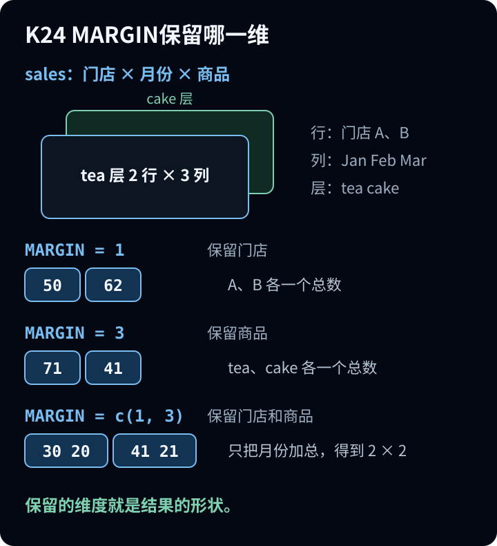

# K24 数组与apply

## 基本信息

- 所属单元为矩阵与数组。
- 难度为核心。
- 前置知识为K19。
- 关联知识为K13、K19、K30、K32。
- 编写人为Claude（AI辅助编写），样品版本为1.0，日期为2026年11月16日。
- 例题和练习数据均为原创模拟教学数据。
- 验证状态为待R实测。

## 学习目标

- 能够用`array()`创建三维数组，并用`[i, j, k]`取出元素和切片。
- 能够用`apply()`沿指定维度汇总，说出`MARGIN`为1、2、3和`c(1, 3)`时保留的是哪些维度。
- 能够区分`apply(m, 1, ...)`按行与`apply(m, 2, ...)`按列，避免汇总方向错误。

## 先备检查

1. `matrix(1:6, nrow = 2)[, 2]`的结果是什么？预期回答为`3 4`。
2. `mean(c(20, 22, 21, 23))`等于多少？预期回答为21.5。

## 直观理解

矩阵是一张表，数组可以看成一摞同样大小的表，例如“门店×月份”的销售表按商品摞成两层，第三个下标就是层号。`apply()`的`MARGIN`指“要保留哪一维作为分组”：保留第1维，就对每个门店把其余所有格子汇总成一个数；保留第3维，就对每一层汇总；保留`c(1, 3)`，就得到“门店×商品”的小表。没有被保留的维度都会被汇总掉。

## 为什么

1. 为什么数组的填充顺序是第1维变化最快？数组和矩阵一样按列存储，先填满第1维，再推进第2维，最后推进第3维。
2. 为什么`apply(m, 1, mean)`得到的是每行的平均值？`MARGIN = 1`表示保留行，对每一行的所有列求平均。
3. 为什么数据框不适合直接用`apply()`？`apply()`会先把数据框转换为矩阵，混合类型的列会被统一成字符，数值计算就会出错，这时应使用K32的`lapply()`或`sapply()`。

## 基础例题

创建2行3列2层的数组，查看维度，取出第2层和单个元素，并按层求和。

独立脚本见[K24_example_01.R](../ai_tutor/content_assets/code/K24_example_01.R)。

```r
a <- array(1:12, dim = c(2, 3, 2))
print(dim(a))
print(a[, , 2])
print(a[2, 3, 1])
print(apply(a, 3, sum))
```

### 预期输出（待R实测）

```text
[1] 2 3 2
     [,1] [,2] [,3]
[1,]    7    9   11
[2,]    8   10   12
[1] 6
[1] 21 57
```

### 逐步讲解

1. `dim`依次为行数、列数和层数。
2. 第1层放1到6，第2层放7到12，每层内部仍按列填充。
3. `a[2, 3, 1]`取第1层第2行第3列，值为6。
4. `apply(a, 3, sum)`对每一层求和，1到6之和为21，7到12之和为57。

## 应用例题

两家门店三个月的销售量按商品分为两层（tea和cake）。需要查看tea层的明细，计算每家门店的总销量、每种商品的总销量，以及“门店×商品”的汇总表。

独立脚本见[K24_example_02.R](../ai_tutor/content_assets/code/K24_example_02.R)。

```r
sales <- array(c(10, 12, 11, 15, 9, 14,
                 5, 6, 7, 6, 8, 9),
               dim = c(2, 3, 2),
               dimnames = list(c("A", "B"), c("Jan", "Feb", "Mar"), c("tea", "cake")))
print(sales[, , "tea"])
print(apply(sales, 1, sum))
print(apply(sales, 3, sum))
print(apply(sales, c(1, 3), sum))
```

### 预期输出（待R实测）

```text
  Jan Feb Mar
A  10  11   9
B  12  15  14
 A  B 
50 62 
 tea cake 
  71   41 
  tea cake
A  30   20
B  41   21
```

### 逐步讲解

1. `dimnames`依次给门店、月份和商品命名，可以按名称取出tea层。
2. 保留第1维，把每家门店所有月份、所有商品的销量加总。
3. 保留第3维，把每种商品所有门店、所有月份的销量加总。
4. 保留第1维和第3维，只把月份加总，得到2行2列的汇总表。

汇总表中A店tea为30，是10、11、9三个月之和。两种商品的单位相同时，按门店汇总的总销量才有意义；如果一种按杯、一种按块计数，就应分开报告。

## 图解方案

图名为“MARGIN保留哪一维”，采用立体示意图，以SVG手绘。中间是两层叠放的2行3列网格，三个分支分别画出`MARGIN = 1`、`MARGIN = 3`和`MARGIN = c(1, 3)`的结果形状，并标出被汇总掉的维度。



图的规律是“保留的维度就是结果的形状”，学生可以先画出想要的结果形状，再决定`MARGIN`怎么写。

## 易错案例

想计算每门课的平均分，却写成了`MARGIN = 1`，得到的是每名学生的平均分。

```r
m <- matrix(c(60, 80, 70, 90, 100, 85), nrow = 2,
            dimnames = list(c("Ann", "Ben"), c("math", "eng", "art")))
print(apply(m, 1, mean))
```

### 实际错误或异常结果（待R实测）

```text
     Ann      Ben 
76.66667 85.00000 
```

参考修正保留第2维，即按列求平均。

```r
m <- matrix(c(60, 80, 70, 90, 100, 85), nrow = 2,
            dimnames = list(c("Ann", "Ben"), c("math", "eng", "art")))
print(apply(m, 2, mean))
```

### 预期输出（待R实测）

```text
math  eng  art 
70.0 80.0 92.5 
```

结果的名称能帮助发现方向错误：想要课程平均分，结果的名称就应该是课程名。对矩阵按行或按列求和、求平均，也可以直接使用`rowMeans()`、`colMeans()`。

## 完整练习

两个城市四天的最高气温（摄氏度）按周分为两层。要求计算每周所有记录的平均气温、每个城市两周的平均气温，以及每个城市每周的最高气温。

提示先确认想要的结果形状，再选择`MARGIN`。

独立脚本见[K24_exercise.R](../ai_tutor/content_assets/code/K24_exercise.R)。

```r
temp <- array(c(20, 25, 22, 27, 21, 26, 23, 28,
                19, 24, 21, 25, 20, 26, 22, 27),
              dim = c(2, 4, 2),
              dimnames = list(c("Xian", "Wuhan"), paste0("d", 1:4), c("w1", "w2")))
print(apply(temp, 3, mean))
print(apply(temp, 1, mean))
print(apply(temp, c(1, 3), max))
```

### 预期输出（待R实测）

```text
w1 w2 
24 23 
 Xian Wuhan 
   21    26 
      w1 w2
Xian  23 22
Wuhan 28 27
```

评分共10分，三种汇总各得3分，能说明每种结果的形状来自哪些保留维度得1分。常见错误是把每周平均写成`apply(temp, 2, mean)`，得到的是每一天的平均值；或者误以为数组按行填充，导致城市的数据交错。

## 自测题

1. 预测下面三行的输出。

```r
a <- array(1:24, dim = c(2, 3, 4))
print(dim(a[, , 1]))
print(length(apply(a, 3, sum)))
print(a[1, 1, 2])
```

### 预期输出（待R实测）

```text
[1] 2 3
[1] 4
[1] 7
```

每层是2行3列；保留第3维会得到4个结果；第1层占用1到6，所以第2层的第一个元素是7。

2. 对一个含有字符列的数据框使用`apply(df, 1, sum)`会怎样？答案为数据框先被转换成字符矩阵，求和会报错，应改用数值列或K32的函数。

## 追问建议

- 例题请求用`aperm()`调整数组维度的顺序，并说明结果如何变化。
- 易错点请求比较`apply(m, 2, mean)`与`colMeans(m)`的结果和速度。
- 练习请求找出每个城市气温最高的是哪一天。
- 相关知识继续学习K32，用`sapply()`处理列表和数据框的批量计算。

## 来源与验证

- 课程来源为[S3《CH2R语言数据操作课件.pdf》PDF 63–65、82](../../成员一/CH2R语言数据操作课件.pdf#page=63)。
- 补充来源为R官方帮助主题`help("array")`、`help("apply")`、`help("colSums")`。
- 本文代码尚未在R中运行，输出为编写者依据R规则推算的预期结果。基础例题的切片与按层求和与课程资料中已实测的输出一致。
- 核对方法为在ai_tutor目录运行`python scripts/check_r_outputs.py K24`，全部通过后加`--write`标记为已实测。
- 图解为SVG手绘，未附生成脚本。
